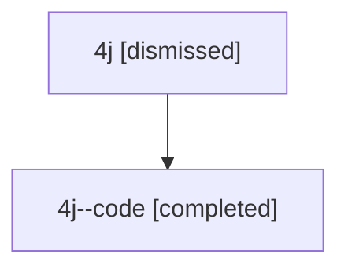

# Session: 4j

[Agent Hoods](../README.md) / [bbugyi200](../users/bbugyi200/README.md) / [athena](../users/bbugyi200/machines/athena/README.md) / [4j](../users/bbugyi200/machines/athena/hoods/4j/README.md) / 4j

Owner: `bbugyi200.athena` · Hood: `4j` · Members: 2

## Lineage

The diagram is an optional enhancement; the ordered table below contains the same lineage in accessible text.

| Role | Agent | State | Model / provider | Timing | Commits | Prompt | Chat |
|---|---|---|---|---|---:|---|---|
| root | 4j | dismissed | gpt-5.6-sol / codex | 2026-07-10T12:54:39.664066 → 2026-07-10T13:06:31.206095 | 0 | [Prompt](../agents/bbugyi200.athena.4j/prompt.md) | [Chat](../agents/bbugyi200.athena.4j/chat.md) |
| code | 4j--code | completed | gpt-5.6-sol / codex | 2026-07-10T16:57:43.578514+00:00 | [1](../agents/bbugyi200.athena.4j--code/README.md#commits) | — | [Chat](../agents/bbugyi200.athena.4j--code/chat.md) |

## Commits

| Role | Repo | Commit | Subject | Committed |
|---|---|---|---|---|
| code | — | `f401add` | feat(cli)!: rename dataview command to query | 2026-07-10 13:06:13 EDT |

## Neighbors

| Agent | Relation | State |
|---|---|---|
| [4j.f-0.w-0](bbugyi200.athena.4j.f-0.w-0.md) (session · 2) | descendant | completed 1, dismissed 1 |
