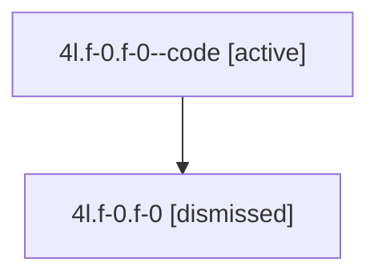

# Session: 4l.f-0.f-0

[Agent Hoods](../README.md) / [bbugyi200](../users/bbugyi200/README.md) / [athena](../users/bbugyi200/machines/athena/README.md) / [4l](../users/bbugyi200/machines/athena/hoods/4l/README.md) / 4l.f-0.f-0

Owner: `bbugyi200.athena` · Hood: `4l` · Members: 2

## Lineage

The diagram is an optional enhancement; the ordered table below contains the same lineage in accessible text.

| Role | Agent | State | Model / provider | Timing | Commits | Prompt | Chat |
|---|---|---|---|---|---:|---|---|
| code | 4l.f-0.f-0--code | active | gpt-5.6-sol / codex | 2026-07-10T19:55:32.900357+00:00 | 0 | — | — |
| root | 4l.f-0.f-0 | dismissed | gpt-5.6-sol / codex | 2026-07-10T15:51:40.451914 | 0 | [Prompt](../agents/bbugyi200.athena.4l.f-0.f-0/prompt.md) | [Chat](../agents/bbugyi200.athena.4l.f-0.f-0/chat.md) |

## Neighbors

| Agent | Relation | State |
|---|---|---|
| [4l.f-0](bbugyi200.athena.4l.f-0.md) (session · 2) | ancestor | completed 1, dismissed 1 |
| [4l](bbugyi200.athena.4l.md) (session · 2) | ancestor | completed 1, dismissed 1 |
| [4l.f-1](bbugyi200.athena.4l.f-1.md) (session · 2) | 4l hood | active 1, dismissed 1 |
| [4l.f-1.f-0](../agents/bbugyi200.athena.4l.f-1.f-0/README.md) | 4l hood | dismissed |
| [4l.f-2](bbugyi200.athena.4l.f-2.md) (session · 2) | 4l hood | completed 1, dismissed 1 |
| [4l.f-2.f-0](bbugyi200.athena.4l.f-2.f-0.md) (session · 2) | 4l hood | completed 1, dismissed 1 |
| [4l.f-2.f-0.w-0](../agents/bbugyi200.athena.4l.f-2.f-0.w-0/README.md) | 4l hood | dismissed |
