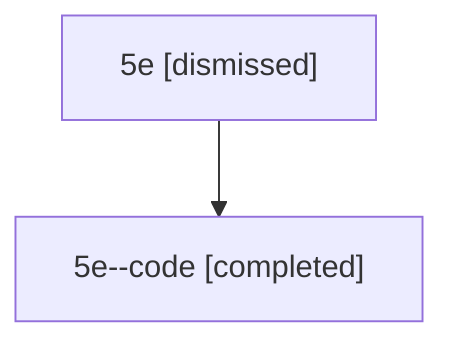

# Session: 5e

[Agent Hoods](../README.md) / [bbugyi200](../users/bbugyi200/README.md) / [athena](../users/bbugyi200/machines/athena/README.md) / [5e](../users/bbugyi200/machines/athena/hoods/5e/README.md) / 5e

Owner: `bbugyi200.athena` · Hood: `5e` · Members: 2

## Lineage

The diagram is an optional enhancement; the ordered table below contains the same lineage in accessible text.

| Role | Agent | State | Model / provider | Timing | Commits | Prompt | Chat |
|---|---|---|---|---|---:|---|---|
| root | 5e | dismissed | gpt-5.6-sol / codex | 2026-07-11T08:42:13.427084 → 2026-07-11T09:00:59.076925 | 0 | [Prompt](../agents/bbugyi200.athena.5e/prompt.md) | [Chat](../agents/bbugyi200.athena.5e/chat.md) |
| code | 5e--code | completed | gpt-5.6-sol / codex | 2026-07-11T12:47:52.338543+00:00 | [1](../agents/bbugyi200.athena.5e--code/README.md#commits) | — | [Chat](../agents/bbugyi200.athena.5e--code/chat.md) |

## Commits

| Role | Repo | Commit | Subject | Committed |
|---|---|---|---|---|
| — | — | `a2a9d2d` | chore: Add SDD prompt and plan for obsidian\_ctrl\_jk\_header\_navigation | 2026-06-11 11:11:46 EDT |
| code | — | `b6a9b4c` | docs: document project scheduling from lifecycle tasks | 2026-07-11 09:00:39 EDT |
