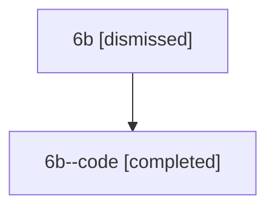

# Session: 6b

[Agent Hoods](../README.md) / [bbugyi200](../users/bbugyi200/README.md) / [athena](../users/bbugyi200/machines/athena/README.md) / [6b](../users/bbugyi200/machines/athena/hoods/6b/README.md) / 6b

Owner: `bbugyi200.athena` · Hood: `6b` · Members: 2

## Lineage

The diagram is an optional enhancement; the ordered table below contains the same lineage in accessible text.

| Role | Agent | State | Model / provider | Timing | Commits | Prompt | Chat |
|---|---|---|---|---|---:|---|---|
| root | 6b | dismissed | claude-fable-5 / claude | 2026-07-11T18:22:08.934377 → 2026-07-11T19:10:18.403532 | 0 | [Prompt](../agents/bbugyi200.athena.6b/prompt.md) | [Chat](../agents/bbugyi200.athena.6b/chat.md) |
| code | 6b--code | completed | gpt-5.6-sol / codex | 2026-07-11T22:53:08.393295+00:00 | [1](../agents/bbugyi200.athena.6b--code/README.md#commits) | — | [Chat](../agents/bbugyi200.athena.6b--code/chat.md) |

## Commits

| Role | Repo | Commit | Subject | Committed |
|---|---|---|---|---|
| code | — | `5db0e6a` | fix: address review findings across native workflows | 2026-07-11 19:09:56 EDT |
