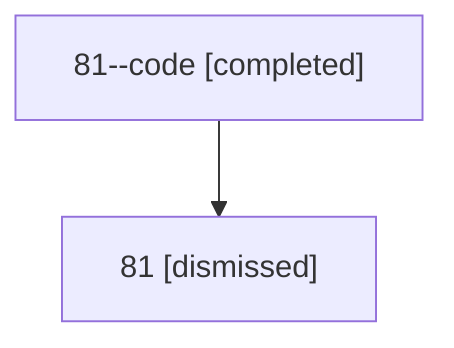

# Session: 81

[Agent Hoods](../README.md) / [bbugyi200](../users/bbugyi200/README.md) / [athena](../users/bbugyi200/machines/athena/README.md) / [81](../users/bbugyi200/machines/athena/hoods/81/README.md) / 81

Owner: `bbugyi200.athena` · Hood: `81` · Members: 2

## Lineage

The diagram is an optional enhancement; the ordered table below contains the same lineage in accessible text.

| Role | Agent | State | Model / provider | Timing | Commits | Prompt | Chat |
|---|---|---|---|---|---:|---|---|
| code | 81--code | completed | gpt-5.6-sol / codex | 2026-07-13T15:41:48.113791+00:00 | 0 | — | [Chat](../agents/bbugyi200.athena.81--code/chat.md) |
| root | 81 | dismissed | gpt-5.6-sol / codex | 2026-07-13T11:38:05.652783 → 2026-07-13T11:50:50.440668 | 0 | [Prompt](../agents/bbugyi200.athena.81/prompt.md) | [Chat](../agents/bbugyi200.athena.81/chat.md) |

## Commits

| Role | Repo | Commit | Subject | Committed |
|---|---|---|---|---|
| — | — | `5c46c48` | feat(projects): tag lifecycle tasks with #prj and #ref | 2026-06-15 16:08:34 EDT |
