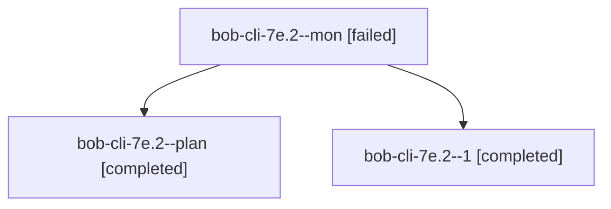

# Session: bob-cli-7e.2

[Agent Hoods](../README.md) / [bbugyi200](../users/bbugyi200/README.md) / [athena](../users/bbugyi200/machines/athena/README.md) / [bob-cli-7e](../users/bbugyi200/machines/athena/hoods/bob-cli-7e/README.md) / bob-cli-7e.2

Owner: `bbugyi200.athena` · Hood: `bob-cli-7e` · Members: 3 · Bead: [bob-cli-7e.2](https://github.com/bobs-org/bob-cli--beads/blob/main/pages/bob-cli-7e/bob-cli-7e.2.md)

## Lineage

The diagram is an optional enhancement; the ordered table below contains the same lineage in accessible text.

| Role | Agent | State | Model / provider | Timing | Commits | Prompt | Chat |
|---|---|---|---|---|---:|---|---|
| mon | bob-cli-7e.2--mon | failed | gpt-6-luna / codex | 2026-10-13T15:57:24.696235+00:00 → 2026-10-13T16:14:29.708558+00:00 | 0 | — | [Chat](../agents/bbugyi200.athena.bob-cli-7e.2--mon/chat.md) |
| plan | bob-cli-7e.2--plan | completed | gpt-6-luna / codex | 2026-10-13T15:41:27.828404+00:00 → 2026-10-13T15:58:17.704951+00:00 | 0 | [Prompt](../agents/bbugyi200.athena.bob-cli-7e.2--plan/prompt.md) | [Chat](../agents/bbugyi200.athena.bob-cli-7e.2--plan/chat.md) |
| 1 | bob-cli-7e.2--1 | completed | gpt-6-luna / codex | 2026-10-13T16:15:24.386765+00:00 → 2026-10-13T16:27:38.604128+00:00 | [1](../agents/bbugyi200.athena.bob-cli-7e.2--1/README.md#commits) | [Prompt](../agents/bbugyi200.athena.bob-cli-7e.2--1/prompt.md) | [Chat](../agents/bbugyi200.athena.bob-cli-7e.2--1/chat.md) |

## Commits

| Role | Repo | Commit | Subject | Committed |
|---|---|---|---|---|
| 1 | bob-cli | [`8e575c7`](https://github.com/bobs-org/bob-cli/commit/8e575c73570b68f991806f6b890a9a9440cc1f9b) | feat(task-dependencies): add BLOCKS parsing and managed-line guards | 2026-10-13 12:22:45 EDT |

## Neighbors

| Agent | Relation | State |
|---|---|---|
| [bob-cli-7e.1](bbugyi200.athena.bob-cli-7e.1.md) (session · 3) | bob-cli-7e hood | completed 2, failed 1 |
| [bob-cli-7e.3](../agents/bbugyi200.athena.bob-cli-7e.3/README.md) | bob-cli-7e hood | completed |
| [bob-cli-7e.4](bbugyi200.athena.bob-cli-7e.4.md) (session · 3) | bob-cli-7e hood | completed 2, failed 1 |
| [bob-cli-7e.5](../agents/bbugyi200.athena.bob-cli-7e.5/README.md) | bob-cli-7e hood | completed |
| [bob-cli-7e.6](../agents/bbugyi200.athena.bob-cli-7e.6/README.md) | bob-cli-7e hood | active |
| [bob-cli-7e.7](../agents/bbugyi200.athena.bob-cli-7e.7/README.md) | bob-cli-7e hood | active |
| [bob-cli-7e.8](../agents/bbugyi200.athena.bob-cli-7e.8/README.md) | bob-cli-7e hood | waiting |
| [bob-cli-7e.9](../agents/bbugyi200.athena.bob-cli-7e.9/README.md) | bob-cli-7e hood | waiting |
| [bob-cli-7e.land](../agents/bbugyi200.athena.bob-cli-7e.land/README.md) | bob-cli-7e hood | waiting |
