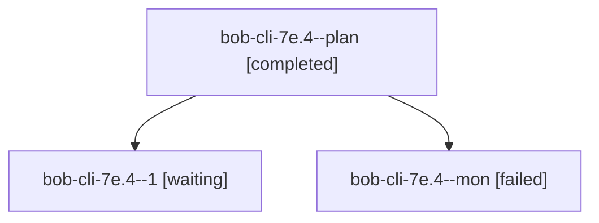

# Session: bob-cli-7e.4

[Agent Hoods](../README.md) / [bbugyi200](../users/bbugyi200/README.md) / [athena](../users/bbugyi200/machines/athena/README.md) / [bob-cli-7e](../users/bbugyi200/machines/athena/hoods/bob-cli-7e/README.md) / bob-cli-7e.4

Owner: `bbugyi200.athena` · Hood: `bob-cli-7e` · Members: 3 · Bead: [bob-cli-7e.4](https://github.com/bobs-org/bob-cli--beads/blob/main/pages/bob-cli-7e/bob-cli-7e.4.md)

## Lineage

The diagram is an optional enhancement; the ordered table below contains the same lineage in accessible text.

| Role | Agent | State | Model / provider | Timing | Commits | Prompt | Chat |
|---|---|---|---|---|---:|---|---|
| plan | bob-cli-7e.4--plan | completed | gpt-6-luna / codex | 2026-10-13T15:42:08.106637+00:00 → 2026-10-13T15:55:47.038531+00:00 | 0 | [Prompt](../agents/bbugyi200.athena.bob-cli-7e.4--plan/prompt.md) | [Chat](../agents/bbugyi200.athena.bob-cli-7e.4--plan/chat.md) |
| 1 | bob-cli-7e.4--1 | waiting | gpt-6-luna / codex | 20261013115615 | 0 | [Prompt](../agents/bbugyi200.athena.bob-cli-7e.4--1/prompt.md) | — |
| mon | bob-cli-7e.4--mon | failed | gpt-6-luna / codex | 2026-10-13T15:54:49.842884+00:00 → 2026-10-13T15:57:15.556874+00:00 | 0 | — | [Chat](../agents/bbugyi200.athena.bob-cli-7e.4--mon/chat.md) |

## Neighbors

| Agent | Relation | State |
|---|---|---|
| [bob-cli-7e.1](bbugyi200.athena.bob-cli-7e.1.md) (session · 3) | bob-cli-7e hood | completed 2, failed 1 |
| [bob-cli-7e.2](bbugyi200.athena.bob-cli-7e.2.md) (session · 3) | bob-cli-7e hood | completed 1, failed 1, waiting 1 |
| [bob-cli-7e.3](../agents/bbugyi200.athena.bob-cli-7e.3/README.md) | bob-cli-7e hood | active |
| [bob-cli-7e.5](../agents/bbugyi200.athena.bob-cli-7e.5/README.md) | bob-cli-7e hood | waiting |
| [bob-cli-7e.6](../agents/bbugyi200.athena.bob-cli-7e.6/README.md) | bob-cli-7e hood | waiting |
| [bob-cli-7e.7](../agents/bbugyi200.athena.bob-cli-7e.7/README.md) | bob-cli-7e hood | waiting |
| [bob-cli-7e.8](../agents/bbugyi200.athena.bob-cli-7e.8/README.md) | bob-cli-7e hood | waiting |
| [bob-cli-7e.9](../agents/bbugyi200.athena.bob-cli-7e.9/README.md) | bob-cli-7e hood | waiting |
| [bob-cli-7e.land](../agents/bbugyi200.athena.bob-cli-7e.land/README.md) | bob-cli-7e hood | waiting |
