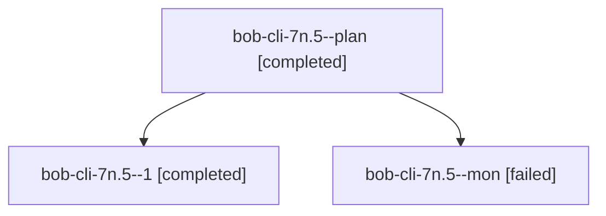

# Session: bob-cli-7n.5

[Agent Hoods](../README.md) / [bbugyi200](../users/bbugyi200/README.md) / [athena](../users/bbugyi200/machines/athena/README.md) / [bob-cli-7n](../users/bbugyi200/machines/athena/hoods/bob-cli-7n/README.md) / bob-cli-7n.5

Owner: `bbugyi200.athena` · Hood: `bob-cli-7n` · Members: 3 · Bead: [bob-cli-7n.5](https://github.com/bobs-org/bob-cli--beads/blob/main/pages/bob-cli-7n/bob-cli-7n.5.md)

## Lineage

The diagram is an optional enhancement; the ordered table below contains the same lineage in accessible text.

| Role | Agent | State | Model / provider | Timing | Commits | Prompt | Chat |
|---|---|---|---|---|---:|---|---|
| plan | bob-cli-7n.5--plan | completed | gpt-6-luna / codex | 2026-10-14T16:25:07.100188+00:00 → 2026-10-14T16:44:29.808152+00:00 | 0 | [Prompt](../agents/bbugyi200.athena.bob-cli-7n.5--plan/prompt.md) | [Chat](../agents/bbugyi200.athena.bob-cli-7n.5--plan/chat.md) |
| 1 | bob-cli-7n.5--1 | completed | gpt-6-luna / codex | 2026-10-14T16:48:16.583703+00:00 → 2026-10-14T16:54:42.561837+00:00 | [1](../agents/bbugyi200.athena.bob-cli-7n.5--1/README.md#commits) | [Prompt](../agents/bbugyi200.athena.bob-cli-7n.5--1/prompt.md) | [Chat](../agents/bbugyi200.athena.bob-cli-7n.5--1/chat.md) |
| mon | bob-cli-7n.5--mon | failed | gpt-6-luna / codex | 2026-10-14T16:43:58.549016+00:00 → 2026-10-14T16:47:45.571218+00:00 | 0 | — | [Chat](../agents/bbugyi200.athena.bob-cli-7n.5--mon/chat.md) |

## Commits

| Role | Repo | Commit | Subject | Committed |
|---|---|---|---|---|
| 1 | bob-cli | [`78f1a69`](https://github.com/bobs-org/bob-cli/commit/78f1a6932c4dcd563ea785738a74077b67cb83bc) | feat(capture): add blocked-task completion candidates | 2026-10-14 12:53:19 EDT |

## Neighbors

| Agent | Relation | State |
|---|---|---|
| [bob-cli-7n.1](../agents/bbugyi200.athena.bob-cli-7n.1/README.md) | bob-cli-7n hood | completed |
| [bob-cli-7n.2](bbugyi200.athena.bob-cli-7n.2.md) (session · 3) | bob-cli-7n hood | completed 2, failed 1 |
| [bob-cli-7n.3](bbugyi200.athena.bob-cli-7n.3.md) (session · 3) | bob-cli-7n hood | completed 2, failed 1 |
| [bob-cli-7n.4](bbugyi200.athena.bob-cli-7n.4.md) (session · 3) | bob-cli-7n hood | active 1, completed 1, failed 1 |
| [bob-cli-7n.6](../agents/bbugyi200.athena.bob-cli-7n.6/README.md) | bob-cli-7n hood | waiting |
| [bob-cli-7n.7](../agents/bbugyi200.athena.bob-cli-7n.7/README.md) | bob-cli-7n hood | waiting |
| [bob-cli-7n.8](../agents/bbugyi200.athena.bob-cli-7n.8/README.md) | bob-cli-7n hood | waiting |
| [bob-cli-7n.land](../agents/bbugyi200.athena.bob-cli-7n.land/README.md) | bob-cli-7n hood | waiting |
