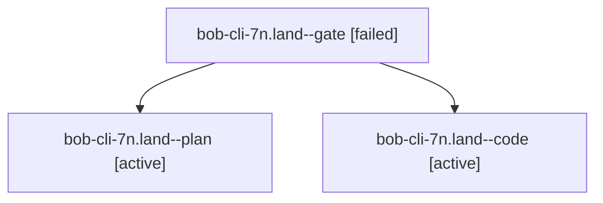

# Session: bob-cli-7n.land

[Agent Hoods](../README.md) / [bbugyi200](../users/bbugyi200/README.md) / [athena](../users/bbugyi200/machines/athena/README.md) / [bob-cli-7n](../users/bbugyi200/machines/athena/hoods/bob-cli-7n/README.md) / bob-cli-7n.land

Owner: `bbugyi200.athena` · Hood: `bob-cli-7n` · Members: 3 · Bead: [bob-cli-7n](https://github.com/bobs-org/bob-cli--beads/blob/main/pages/bob-cli-7n/README.md)

## Lineage

The diagram is an optional enhancement; the ordered table below contains the same lineage in accessible text.

| Role | Agent | State | Model / provider | Timing | Commits | Prompt | Chat |
|---|---|---|---|---|---:|---|---|
| gate | bob-cli-7n.land--gate | failed | opus / claude | 2026-10-14T19:25:14.578010+00:00 → 2026-10-14T19:25:40.702904+00:00 | 0 | — | [Chat](../agents/bbugyi200.athena.bob-cli-7n.land--gate/chat.md) |
| plan | bob-cli-7n.land--plan | active | opus / claude | 2026-10-14T18:57:44.592474+00:00 | 0 | [Prompt](../agents/bbugyi200.athena.bob-cli-7n.land--plan/prompt.md) | [Chat](../agents/bbugyi200.athena.bob-cli-7n.land--plan/chat.md) |
| code | bob-cli-7n.land--code | active | grok-4.6 / grok | 2026-10-14T19:26:01.373964+00:00 | [1](../agents/bbugyi200.athena.bob-cli-7n.land--code/README.md#commits) | — | — |

## Commits

| Role | Repo | Commit | Subject | Committed |
|---|---|---|---|---|
| code | bob-cli | [`498e5ab`](https://github.com/bobs-org/bob-cli/commit/498e5ab27f07e5dab7675a2cfae095a36e44dbae) | fix(capture): land star-blocks repairs and close the epic | 2026-10-14 15:55:44 EDT |

## Neighbors

| Agent | Relation | State |
|---|---|---|
| [bob-cli-7n.1](../agents/bbugyi200.athena.bob-cli-7n.1/README.md) | bob-cli-7n hood | completed |
| [bob-cli-7n.2](bbugyi200.athena.bob-cli-7n.2.md) (session · 3) | bob-cli-7n hood | completed 2, failed 1 |
| [bob-cli-7n.3](bbugyi200.athena.bob-cli-7n.3.md) (session · 3) | bob-cli-7n hood | completed 2, failed 1 |
| [bob-cli-7n.4](bbugyi200.athena.bob-cli-7n.4.md) (session · 3) | bob-cli-7n hood | completed 2, failed 1 |
| [bob-cli-7n.5](bbugyi200.athena.bob-cli-7n.5.md) (session · 3) | bob-cli-7n hood | completed 2, failed 1 |
| [bob-cli-7n.6](../agents/bbugyi200.athena.bob-cli-7n.6/README.md) | bob-cli-7n hood | completed |
| [bob-cli-7n.7](../agents/bbugyi200.athena.bob-cli-7n.7/README.md) | bob-cli-7n hood | completed |
| [bob-cli-7n.8](../agents/bbugyi200.athena.bob-cli-7n.8/README.md) | bob-cli-7n hood | completed |
