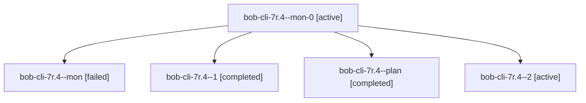

# Session: bob-cli-7r.4

[Agent Hoods](../README.md) / [bbugyi200](../users/bbugyi200/README.md) / [athena](../users/bbugyi200/machines/athena/README.md) / [bob-cli-7r](../users/bbugyi200/machines/athena/hoods/bob-cli-7r/README.md) / bob-cli-7r.4

Owner: `bbugyi200.athena` · Hood: `bob-cli-7r` · Members: 5 · Bead: [bob-cli-7r.4](https://github.com/bobs-org/bob-cli--beads/blob/main/pages/bob-cli-7r/bob-cli-7r.4.md)

## Lineage

The diagram is an optional enhancement; the ordered table below contains the same lineage in accessible text.

| Role | Agent | State | Model / provider | Timing | Commits | Prompt | Chat |
|---|---|---|---|---|---:|---|---|
| mon-0 | bob-cli-7r.4--mon-0 | active | gpt-6-luna / codex | 2026-10-14T21:42:43.365004+00:00 | 0 | — | — |
| mon | bob-cli-7r.4--mon | failed | gpt-6-luna / codex | 2026-10-14T21:30:54.806080+00:00 → 2026-10-14T21:34:49.213552+00:00 | 0 | — | [Chat](../agents/bbugyi200.athena.bob-cli-7r.4--mon/chat.md) |
| 1 | bob-cli-7r.4--1 | completed | gpt-6-luna / codex | 2026-10-14T21:35:24.973421+00:00 → 2026-10-14T21:43:13.209385+00:00 | 0 | [Prompt](../agents/bbugyi200.athena.bob-cli-7r.4--1/prompt.md) | [Chat](../agents/bbugyi200.athena.bob-cli-7r.4--1/chat.md) |
| plan | bob-cli-7r.4--plan | completed | gpt-6-luna / codex | 2026-10-14T21:16:34.301631+00:00 → 2026-10-14T21:31:41.547833+00:00 | 0 | [Prompt](../agents/bbugyi200.athena.bob-cli-7r.4--plan/prompt.md) | [Chat](../agents/bbugyi200.athena.bob-cli-7r.4--plan/chat.md) |
| 2 | bob-cli-7r.4--2 | active | gpt-6-luna / codex | 20261014174549 | 0 | [Prompt](../agents/bbugyi200.athena.bob-cli-7r.4--2/prompt.md) | — |

## Neighbors

| Agent | Relation | State |
|---|---|---|
| [bob-cli-7r.1](../agents/bbugyi200.athena.bob-cli-7r.1/README.md) | bob-cli-7r hood | completed |
| [bob-cli-7r.2](../agents/bbugyi200.athena.bob-cli-7r.2/README.md) | bob-cli-7r hood | completed |
| [bob-cli-7r.3](../agents/bbugyi200.athena.bob-cli-7r.3/README.md) | bob-cli-7r hood | active |
| [bob-cli-7r.5](../agents/bbugyi200.athena.bob-cli-7r.5/README.md) | bob-cli-7r hood | waiting |
| [bob-cli-7r.6](../agents/bbugyi200.athena.bob-cli-7r.6/README.md) | bob-cli-7r hood | waiting |
| [bob-cli-7r.7](../agents/bbugyi200.athena.bob-cli-7r.7/README.md) | bob-cli-7r hood | waiting |
| [bob-cli-7r.land](../agents/bbugyi200.athena.bob-cli-7r.land/README.md) | bob-cli-7r hood | waiting |
