# Session: bob-cli-7r.6

[Agent Hoods](../README.md) / [bbugyi200](../users/bbugyi200/README.md) / [athena](../users/bbugyi200/machines/athena/README.md) / [bob-cli-7r](../users/bbugyi200/machines/athena/hoods/bob-cli-7r/README.md) / bob-cli-7r.6

Owner: `bbugyi200.athena` · Hood: `bob-cli-7r` · Members: 17 · Bead: [bob-cli-7r.6](https://github.com/bobs-org/bob-cli--beads/blob/main/pages/bob-cli-7r/bob-cli-7r.6.md)

## Lineage

```mermaid
flowchart TD
  n0["bob-cli-7r.6--3 [completed]"]
  n1["bob-cli-7r.6--7 [completed]"]
  n0 --> n1
  n2["bob-cli-7r.6--6 [completed]"]
  n0 --> n2
  n3["bob-cli-7r.6--mon-5 [failed]"]
  n0 --> n3
  n4["bob-cli-7r.6--mon-4 [failed]"]
  n0 --> n4
  n5["bob-cli-7r.6--mon-6 [failed]"]
  n0 --> n5
  n6["bob-cli-7r.6--mon-3 [failed]"]
  n0 --> n6
  n7["bob-cli-7r.6--mon-1 [failed]"]
  n0 --> n7
  n8["bob-cli-7r.6--2 [completed]"]
  n0 --> n8
  n9["bob-cli-7r.6--8 [completed]"]
  n0 --> n9
  n10["bob-cli-7r.6--mon-0 [failed]"]
  n0 --> n10
  n11["bob-cli-7r.6--mon [failed]"]
  n0 --> n11
  n12["bob-cli-7r.6--4 [completed]"]
  n0 --> n12
  n13["bob-cli-7r.6--plan [completed]"]
  n0 --> n13
  n14["bob-cli-7r.6--1 [completed]"]
  n0 --> n14
  n15["bob-cli-7r.6--mon-2 [failed]"]
  n0 --> n15
  n16["bob-cli-7r.6--5 [completed]"]
  n0 --> n16
```

The diagram is an optional enhancement; the ordered table below contains the same lineage in accessible text.

| Role | Agent | State | Model / provider | Timing | Commits | Prompt | Chat |
|---|---|---|---|---|---:|---|---|
| 3 | bob-cli-7r.6--3 | completed | gpt-6-luna / codex | 2026-10-14T22:58:05.993391+00:00 → 2026-10-14T23:05:38.992114+00:00 | 0 | [Prompt](../agents/bbugyi200.athena.bob-cli-7r.6--3/prompt.md) | [Chat](../agents/bbugyi200.athena.bob-cli-7r.6--3/chat.md) |
| 7 | bob-cli-7r.6--7 | completed | gpt-6-luna / codex | 2026-10-14T23:41:55.069863+00:00 → 2026-10-14T23:47:25.116311+00:00 | 0 | [Prompt](../agents/bbugyi200.athena.bob-cli-7r.6--7/prompt.md) | [Chat](../agents/bbugyi200.athena.bob-cli-7r.6--7/chat.md) |
| 6 | bob-cli-7r.6--6 | completed | gpt-6-luna / codex | 2026-10-14T23:29:28.071644+00:00 → 2026-10-14T23:39:25.279062+00:00 | 0 | [Prompt](../agents/bbugyi200.athena.bob-cli-7r.6--6/prompt.md) | [Chat](../agents/bbugyi200.athena.bob-cli-7r.6--6/chat.md) |
| mon-5 | bob-cli-7r.6--mon-5 | failed | gpt-6-luna / codex | 2026-10-14T23:38:44.659473+00:00 → 2026-10-14T23:41:24.494446+00:00 | 0 | — | [Chat](../agents/bbugyi200.athena.bob-cli-7r.6--mon-5/chat.md) |
| mon-4 | bob-cli-7r.6--mon-4 | failed | gpt-6-luna / codex | 2026-10-14T23:24:56.750808+00:00 → 2026-10-14T23:28:33.305140+00:00 | 0 | — | [Chat](../agents/bbugyi200.athena.bob-cli-7r.6--mon-4/chat.md) |
| mon-6 | bob-cli-7r.6--mon-6 | failed | gpt-6-luna / codex | 2026-10-14T23:46:55.501481+00:00 → 2026-10-14T23:49:29.348166+00:00 | 0 | — | [Chat](../agents/bbugyi200.athena.bob-cli-7r.6--mon-6/chat.md) |
| mon-3 | bob-cli-7r.6--mon-3 | failed | gpt-6-luna / codex | 2026-10-14T23:14:06.408654+00:00 → 2026-10-14T23:18:51.618767+00:00 | 0 | — | [Chat](../agents/bbugyi200.athena.bob-cli-7r.6--mon-3/chat.md) |
| mon-1 | bob-cli-7r.6--mon-1 | failed | gpt-6-luna / codex | 2026-10-14T22:55:46.912975+00:00 → 2026-10-14T22:57:37.435580+00:00 | 0 | — | [Chat](../agents/bbugyi200.athena.bob-cli-7r.6--mon-1/chat.md) |
| 2 | bob-cli-7r.6--2 | completed | gpt-6-luna / codex | 2026-10-14T22:46:33.660595+00:00 → 2026-10-14T22:56:15.914523+00:00 | 0 | [Prompt](../agents/bbugyi200.athena.bob-cli-7r.6--2/prompt.md) | [Chat](../agents/bbugyi200.athena.bob-cli-7r.6--2/chat.md) |
| 8 | bob-cli-7r.6--8 | completed | gpt-6-luna / codex | 2026-10-14T23:50:19.386957+00:00 → 2026-10-14T23:55:57.061107+00:00 | 0 | [Prompt](../agents/bbugyi200.athena.bob-cli-7r.6--8/prompt.md) | [Chat](../agents/bbugyi200.athena.bob-cli-7r.6--8/chat.md) |
| mon-0 | bob-cli-7r.6--mon-0 | failed | gpt-6-luna / codex | 2026-10-14T22:43:55.469836+00:00 → 2026-10-14T22:46:02.130400+00:00 | 0 | — | [Chat](../agents/bbugyi200.athena.bob-cli-7r.6--mon-0/chat.md) |
| mon | bob-cli-7r.6--mon | failed | gpt-6-luna / codex | 2026-10-14T22:35:09.538059+00:00 → 2026-10-14T22:37:18.646117+00:00 | 0 | — | [Chat](../agents/bbugyi200.athena.bob-cli-7r.6--mon/chat.md) |
| 4 | bob-cli-7r.6--4 | completed | gpt-6-luna / codex | 2026-10-14T23:08:48.988482+00:00 → 2026-10-14T23:14:42.716750+00:00 | 0 | [Prompt](../agents/bbugyi200.athena.bob-cli-7r.6--4/prompt.md) | [Chat](../agents/bbugyi200.athena.bob-cli-7r.6--4/chat.md) |
| plan | bob-cli-7r.6--plan | completed | gpt-6-luna / codex | 2026-10-14T22:25:36.126216+00:00 → 2026-10-14T22:35:55.769010+00:00 | 0 | [Prompt](../agents/bbugyi200.athena.bob-cli-7r.6--plan/prompt.md) | [Chat](../agents/bbugyi200.athena.bob-cli-7r.6--plan/chat.md) |
| 1 | bob-cli-7r.6--1 | completed | gpt-6-luna / codex | 2026-10-14T22:38:22.696946+00:00 → 2026-10-14T22:44:44.086417+00:00 | 0 | [Prompt](../agents/bbugyi200.athena.bob-cli-7r.6--1/prompt.md) | [Chat](../agents/bbugyi200.athena.bob-cli-7r.6--1/chat.md) |
| mon-2 | bob-cli-7r.6--mon-2 | failed | gpt-6-luna / codex | 2026-10-14T23:05:11.691222+00:00 → 2026-10-14T23:08:18.312202+00:00 | 0 | — | [Chat](../agents/bbugyi200.athena.bob-cli-7r.6--mon-2/chat.md) |
| 5 | bob-cli-7r.6--5 | completed | gpt-6-luna / codex | 2026-10-14T23:19:20.915478+00:00 → 2026-10-14T23:25:31.445760+00:00 | 0 | [Prompt](../agents/bbugyi200.athena.bob-cli-7r.6--5/prompt.md) | [Chat](../agents/bbugyi200.athena.bob-cli-7r.6--5/chat.md) |

## Neighbors

| Agent | Relation | State |
|---|---|---|
| [bob-cli-7r.1](../agents/bbugyi200.athena.bob-cli-7r.1/README.md) | bob-cli-7r hood | completed |
| [bob-cli-7r.2](../agents/bbugyi200.athena.bob-cli-7r.2/README.md) | bob-cli-7r hood | completed |
| [bob-cli-7r.3](../agents/bbugyi200.athena.bob-cli-7r.3/README.md) | bob-cli-7r hood | completed |
| [bob-cli-7r.4](bbugyi200.athena.bob-cli-7r.4.md) (session · 5) | bob-cli-7r hood | completed 3, failed 2 |
| [bob-cli-7r.5](../agents/bbugyi200.athena.bob-cli-7r.5/README.md) | bob-cli-7r hood | completed |
| [bob-cli-7r.7](bbugyi200.athena.bob-cli-7r.7.md) (session · 3) | bob-cli-7r hood | active 1, completed 1, failed 1 |
| [bob-cli-7r.land](../agents/bbugyi200.athena.bob-cli-7r.land/README.md) | bob-cli-7r hood | waiting |
