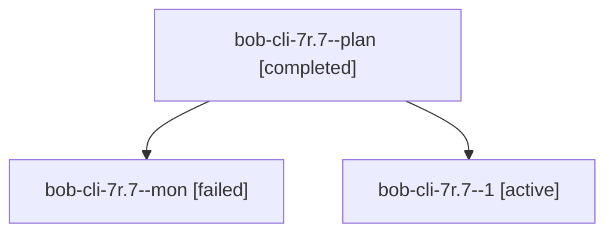

# Session: bob-cli-7r.7

[Agent Hoods](../README.md) / [bbugyi200](../users/bbugyi200/README.md) / [athena](../users/bbugyi200/machines/athena/README.md) / [bob-cli-7r](../users/bbugyi200/machines/athena/hoods/bob-cli-7r/README.md) / bob-cli-7r.7

Owner: `bbugyi200.athena` · Hood: `bob-cli-7r` · Members: 3 · Bead: [bob-cli-7r.7](https://github.com/bobs-org/bob-cli--beads/blob/main/pages/bob-cli-7r/bob-cli-7r.7.md)

## Lineage

The diagram is an optional enhancement; the ordered table below contains the same lineage in accessible text.

| Role | Agent | State | Model / provider | Timing | Commits | Prompt | Chat |
|---|---|---|---|---|---:|---|---|
| plan | bob-cli-7r.7--plan | completed | grok-4.6 / grok | 2026-10-14T23:56:30.747266+00:00 → 2026-10-15T00:14:07.301784+00:00 | 0 | [Prompt](../agents/bbugyi200.athena.bob-cli-7r.7--plan/prompt.md) | [Chat](../agents/bbugyi200.athena.bob-cli-7r.7--plan/chat.md) |
| mon | bob-cli-7r.7--mon | failed | grok-4.6 / grok | 2026-10-15T00:08:37.998320+00:00 → 2026-10-15T00:15:30.517759+00:00 | 0 | — | [Chat](../agents/bbugyi200.athena.bob-cli-7r.7--mon/chat.md) |
| 1 | bob-cli-7r.7--1 | active | grok-4.6 / grok | 2026-10-15T00:16:12.683201+00:00 | [1](../agents/bbugyi200.athena.bob-cli-7r.7--1/README.md#commits) | [Prompt](../agents/bbugyi200.athena.bob-cli-7r.7--1/prompt.md) | — |

## Commits

| Role | Repo | Commit | Subject | Committed |
|---|---|---|---|---|
| 1 | bob-cli | [`75a1809`](https://github.com/bobs-org/bob-cli/commit/75a180967746f23fcf22f40b5da0b8c43d2b1aad) | docs(capture): align RXC1 owner JSON and cover RX8 execute | 2026-10-14 20:18:31 EDT |

## Neighbors

| Agent | Relation | State |
|---|---|---|
| [bob-cli-7r.1](../agents/bbugyi200.athena.bob-cli-7r.1/README.md) | bob-cli-7r hood | completed |
| [bob-cli-7r.2](../agents/bbugyi200.athena.bob-cli-7r.2/README.md) | bob-cli-7r hood | completed |
| [bob-cli-7r.3](../agents/bbugyi200.athena.bob-cli-7r.3/README.md) | bob-cli-7r hood | completed |
| [bob-cli-7r.4](bbugyi200.athena.bob-cli-7r.4.md) (session · 5) | bob-cli-7r hood | completed 3, failed 2 |
| [bob-cli-7r.5](../agents/bbugyi200.athena.bob-cli-7r.5/README.md) | bob-cli-7r hood | completed |
| [bob-cli-7r.6](bbugyi200.athena.bob-cli-7r.6.md) (session · 17) | bob-cli-7r hood | completed 9, failed 8 |
| [bob-cli-7r.land](../agents/bbugyi200.athena.bob-cli-7r.land/README.md) | bob-cli-7r hood | waiting |
