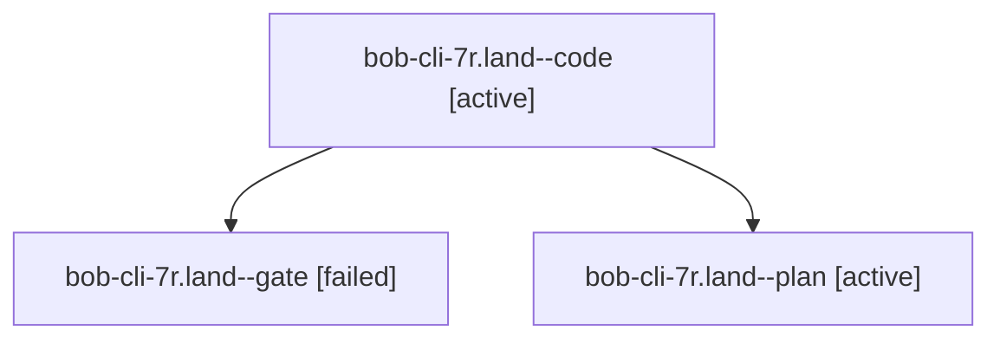

# Session: bob-cli-7r.land

[Agent Hoods](../README.md) / [bbugyi200](../users/bbugyi200/README.md) / [athena](../users/bbugyi200/machines/athena/README.md) / [bob-cli-7r](../users/bbugyi200/machines/athena/hoods/bob-cli-7r/README.md) / bob-cli-7r.land

Owner: `bbugyi200.athena` · Hood: `bob-cli-7r` · Members: 3 · Bead: [bob-cli-7r](https://github.com/bobs-org/bob-cli--beads/blob/main/pages/bob-cli-7r/README.md)

## Lineage

The diagram is an optional enhancement; the ordered table below contains the same lineage in accessible text.

| Role | Agent | State | Model / provider | Timing | Commits | Prompt | Chat |
|---|---|---|---|---|---:|---|---|
| code | bob-cli-7r.land--code | active | grok-4.6 / grok | 2026-10-15T00:48:19.948809+00:00 | [1](../agents/bbugyi200.athena.bob-cli-7r.land--code/README.md#commits) | — | — |
| gate | bob-cli-7r.land--gate | failed | opus / claude | 2026-10-15T00:47:34.347822+00:00 → 2026-10-15T00:47:58.906992+00:00 | 0 | — | [Chat](../agents/bbugyi200.athena.bob-cli-7r.land--gate/chat.md) |
| plan | bob-cli-7r.land--plan | active | opus / claude | 2026-10-15T00:20:38.541447+00:00 | 0 | [Prompt](../agents/bbugyi200.athena.bob-cli-7r.land--plan/prompt.md) | [Chat](../agents/bbugyi200.athena.bob-cli-7r.land--plan/chat.md) |

## Commits

| Role | Repo | Commit | Subject | Committed |
|---|---|---|---|---|
| code | bob-cli | [`14505e5`](https://github.com/bobs-org/bob-cli/commit/14505e5751dc4fea1c15e8ed87add9c89ceb574b) | fix(capture): land remaining existing-owner relationship defects (A1-A7) | 2026-10-14 21:24:13 EDT |

## Neighbors

| Agent | Relation | State |
|---|---|---|
| [bob-cli-7r.1](../agents/bbugyi200.athena.bob-cli-7r.1/README.md) | bob-cli-7r hood | completed |
| [bob-cli-7r.2](../agents/bbugyi200.athena.bob-cli-7r.2/README.md) | bob-cli-7r hood | completed |
| [bob-cli-7r.3](../agents/bbugyi200.athena.bob-cli-7r.3/README.md) | bob-cli-7r hood | completed |
| [bob-cli-7r.4](bbugyi200.athena.bob-cli-7r.4.md) (session · 5) | bob-cli-7r hood | completed 3, failed 2 |
| [bob-cli-7r.5](../agents/bbugyi200.athena.bob-cli-7r.5/README.md) | bob-cli-7r hood | completed |
| [bob-cli-7r.6](bbugyi200.athena.bob-cli-7r.6.md) (session · 17) | bob-cli-7r hood | completed 9, failed 8 |
| [bob-cli-7r.7](bbugyi200.athena.bob-cli-7r.7.md) (session · 3) | bob-cli-7r hood | completed 2, failed 1 |
