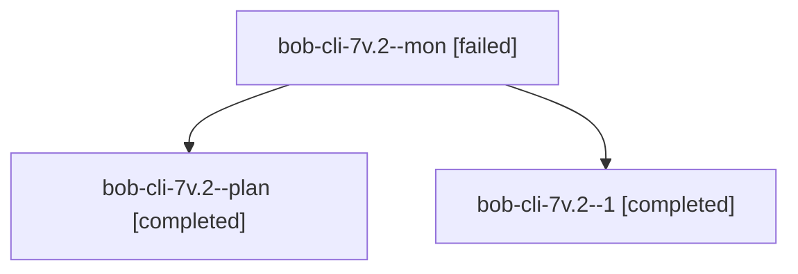

# Session: bob-cli-7v.2

[Agent Hoods](../README.md) / [bbugyi200](../users/bbugyi200/README.md) / [athena](../users/bbugyi200/machines/athena/README.md) / [bob-cli-7v](../users/bbugyi200/machines/athena/hoods/bob-cli-7v/README.md) / bob-cli-7v.2

Owner: `bbugyi200.athena` · Hood: `bob-cli-7v` · Members: 3 · Bead: [bob-cli-7v.2](https://github.com/bobs-org/bob-cli--beads/blob/main/pages/bob-cli-7v/bob-cli-7v.2.md)

## Lineage

The diagram is an optional enhancement; the ordered table below contains the same lineage in accessible text.

| Role | Agent | State | Model / provider | Timing | Commits | Prompt | Chat |
|---|---|---|---|---|---:|---|---|
| mon | bob-cli-7v.2--mon | failed | gpt-6-luna / codex | 2026-10-15T16:45:35.105551+00:00 → 2026-10-15T16:47:27.680703+00:00 | 0 | — | [Chat](../agents/bbugyi200.athena.bob-cli-7v.2--mon/chat.md) |
| plan | bob-cli-7v.2--plan | completed | gpt-6-luna / codex | 2026-10-15T16:32:21.355462+00:00 → 2026-10-15T16:46:03.144600+00:00 | 0 | [Prompt](../agents/bbugyi200.athena.bob-cli-7v.2--plan/prompt.md) | [Chat](../agents/bbugyi200.athena.bob-cli-7v.2--plan/chat.md) |
| 1 | bob-cli-7v.2--1 | completed | gpt-6-luna / codex | 2026-10-15T16:47:56.446098+00:00 → 2026-10-15T16:59:10.935234+00:00 | [1](../agents/bbugyi200.athena.bob-cli-7v.2--1/README.md#commits) | [Prompt](../agents/bbugyi200.athena.bob-cli-7v.2--1/prompt.md) | [Chat](../agents/bbugyi200.athena.bob-cli-7v.2--1/chat.md) |

## Commits

| Role | Repo | Commit | Subject | Committed |
|---|---|---|---|---|
| 1 | bob-cli | [`63ec1ca`](https://github.com/bobs-org/bob-cli/commit/63ec1ca5f138da48c3e244a4745006ad272ecf6f) | feat(ref): add collection naming and metadata rules | 2026-10-15 12:57:34 EDT |

## Neighbors

| Agent | Relation | State |
|---|---|---|
| [bob-cli-7v.1](../agents/bbugyi200.athena.bob-cli-7v.1/README.md) | bob-cli-7v hood | completed |
| [bob-cli-7v.3](../agents/bbugyi200.athena.bob-cli-7v.3/README.md) | bob-cli-7v hood | completed |
| [bob-cli-7v.4](../agents/bbugyi200.athena.bob-cli-7v.4/README.md) | bob-cli-7v hood | completed |
| [bob-cli-7v.5](bbugyi200.athena.bob-cli-7v.5.md) (session · 3) | bob-cli-7v hood | completed 2, failed 1 |
| [bob-cli-7v.6](bbugyi200.athena.bob-cli-7v.6.md) (session · 9) | bob-cli-7v hood | completed 5, failed 4 |
| [bob-cli-7v.7](bbugyi200.athena.bob-cli-7v.7.md) (session · 5) | bob-cli-7v hood | completed 3, failed 2 |
| [bob-cli-7v.land](bbugyi200.athena.bob-cli-7v.land.md) (session · 3) | bob-cli-7v hood | active 2, failed 1 |
