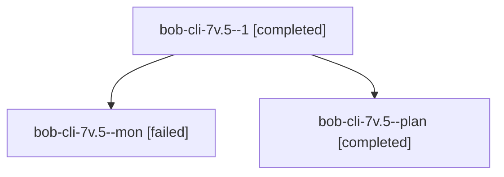

# Session: bob-cli-7v.5

[Agent Hoods](../README.md) / [bbugyi200](../users/bbugyi200/README.md) / [athena](../users/bbugyi200/machines/athena/README.md) / [bob-cli-7v](../users/bbugyi200/machines/athena/hoods/bob-cli-7v/README.md) / bob-cli-7v.5

Owner: `bbugyi200.athena` · Hood: `bob-cli-7v` · Members: 3 · Bead: [bob-cli-7v.5](https://github.com/bobs-org/bob-cli--beads/blob/main/pages/bob-cli-7v/bob-cli-7v.5.md)

## Lineage

The diagram is an optional enhancement; the ordered table below contains the same lineage in accessible text.

| Role | Agent | State | Model / provider | Timing | Commits | Prompt | Chat |
|---|---|---|---|---|---:|---|---|
| 1 | bob-cli-7v.5--1 | completed | grok-4.6 / grok | 2026-10-15T17:52:49.791701+00:00 → 2026-10-15T17:58:52.612313+00:00 | [1](../agents/bbugyi200.athena.bob-cli-7v.5--1/README.md#commits) | [Prompt](../agents/bbugyi200.athena.bob-cli-7v.5--1/prompt.md) | [Chat](../agents/bbugyi200.athena.bob-cli-7v.5--1/chat.md) |
| mon | bob-cli-7v.5--mon | failed | grok-4.6 / grok | 2026-10-15T17:48:55.239051+00:00 → 2026-10-15T17:52:22.180318+00:00 | 0 | — | [Chat](../agents/bbugyi200.athena.bob-cli-7v.5--mon/chat.md) |
| plan | bob-cli-7v.5--plan | completed | grok-4.6 / grok | 2026-10-15T17:24:29.952458+00:00 → 2026-10-15T17:49:37.678788+00:00 | 0 | [Prompt](../agents/bbugyi200.athena.bob-cli-7v.5--plan/prompt.md) | [Chat](../agents/bbugyi200.athena.bob-cli-7v.5--plan/chat.md) |

## Commits

| Role | Repo | Commit | Subject | Committed |
|---|---|---|---|---|
| 1 | bob-cli | [`9bdb0bd`](https://github.com/bobs-org/bob-cli/commit/9bdb0bd9eadbb0382f06f5815ebc51019e94ae9a) | feat(highlights-ref): wire the multi-url collection capture pipeline | 2026-10-15 13:57:29 EDT |

## Neighbors

| Agent | Relation | State |
|---|---|---|
| [bob-cli-7v.1](../agents/bbugyi200.athena.bob-cli-7v.1/README.md) | bob-cli-7v hood | completed |
| [bob-cli-7v.2](bbugyi200.athena.bob-cli-7v.2.md) (session · 3) | bob-cli-7v hood | completed 2, failed 1 |
| [bob-cli-7v.3](../agents/bbugyi200.athena.bob-cli-7v.3/README.md) | bob-cli-7v hood | completed |
| [bob-cli-7v.4](../agents/bbugyi200.athena.bob-cli-7v.4/README.md) | bob-cli-7v hood | completed |
| [bob-cli-7v.6](bbugyi200.athena.bob-cli-7v.6.md) (session · 9) | bob-cli-7v hood | completed 5, failed 4 |
| [bob-cli-7v.7](bbugyi200.athena.bob-cli-7v.7.md) (session · 5) | bob-cli-7v hood | completed 3, failed 2 |
| [bob-cli-7v.land](bbugyi200.athena.bob-cli-7v.land.md) (session · 11) | bob-cli-7v hood | active 1, completed 5, failed 5 |
