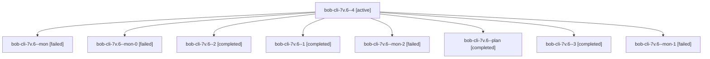

# Session: bob-cli-7v.6

[Agent Hoods](../README.md) / [bbugyi200](../users/bbugyi200/README.md) / [athena](../users/bbugyi200/machines/athena/README.md) / [bob-cli-7v](../users/bbugyi200/machines/athena/hoods/bob-cli-7v/README.md) / bob-cli-7v.6

Owner: `bbugyi200.athena` · Hood: `bob-cli-7v` · Members: 9 · Bead: [bob-cli-7v.6](https://github.com/bobs-org/bob-cli--beads/blob/main/pages/bob-cli-7v/bob-cli-7v.6.md)

## Lineage

The diagram is an optional enhancement; the ordered table below contains the same lineage in accessible text.

| Role | Agent | State | Model / provider | Timing | Commits | Prompt | Chat |
|---|---|---|---|---|---:|---|---|
| 4 | bob-cli-7v.6--4 | active | gpt-6-luna / codex | 2026-10-15T18:38:02.463600+00:00 | [1](../agents/bbugyi200.athena.bob-cli-7v.6--4/README.md#commits) | [Prompt](../agents/bbugyi200.athena.bob-cli-7v.6--4/prompt.md) | — |
| mon | bob-cli-7v.6--mon | failed | gpt-6-luna / codex | 2026-10-15T18:06:29.000858+00:00 → 2026-10-15T18:10:30.338358+00:00 | 0 | — | [Chat](../agents/bbugyi200.athena.bob-cli-7v.6--mon/chat.md) |
| mon-0 | bob-cli-7v.6--mon-0 | failed | gpt-6-luna / codex | 2026-10-15T18:18:29.202520+00:00 → 2026-10-15T18:22:27.002375+00:00 | 0 | — | [Chat](../agents/bbugyi200.athena.bob-cli-7v.6--mon-0/chat.md) |
| 2 | bob-cli-7v.6--2 | completed | gpt-6-luna / codex | 2026-10-15T18:22:55.889635+00:00 → 2026-10-15T18:27:46.012674+00:00 | 0 | [Prompt](../agents/bbugyi200.athena.bob-cli-7v.6--2/prompt.md) | [Chat](../agents/bbugyi200.athena.bob-cli-7v.6--2/chat.md) |
| 1 | bob-cli-7v.6--1 | completed | gpt-6-luna / codex | 2026-10-15T18:11:03.694738+00:00 → 2026-10-15T18:18:57.899777+00:00 | 0 | [Prompt](../agents/bbugyi200.athena.bob-cli-7v.6--1/prompt.md) | [Chat](../agents/bbugyi200.athena.bob-cli-7v.6--1/chat.md) |
| mon-2 | bob-cli-7v.6--mon-2 | failed | gpt-6-luna / codex | 2026-10-15T18:33:15.315635+00:00 → 2026-10-15T18:37:30.670712+00:00 | 0 | — | [Chat](../agents/bbugyi200.athena.bob-cli-7v.6--mon-2/chat.md) |
| plan | bob-cli-7v.6--plan | completed | gpt-6-luna / codex | 2026-10-15T17:59:24.335703+00:00 → 2026-10-15T18:07:07.482230+00:00 | 0 | [Prompt](../agents/bbugyi200.athena.bob-cli-7v.6--plan/prompt.md) | [Chat](../agents/bbugyi200.athena.bob-cli-7v.6--plan/chat.md) |
| 3 | bob-cli-7v.6--3 | completed | gpt-6-luna / codex | 2026-10-15T18:29:32.223428+00:00 → 2026-10-15T18:33:43.008603+00:00 | 0 | [Prompt](../agents/bbugyi200.athena.bob-cli-7v.6--3/prompt.md) | [Chat](../agents/bbugyi200.athena.bob-cli-7v.6--3/chat.md) |
| mon-1 | bob-cli-7v.6--mon-1 | failed | gpt-6-luna / codex | 2026-10-15T18:27:06.368569+00:00 → 2026-10-15T18:29:03.399754+00:00 | 0 | — | [Chat](../agents/bbugyi200.athena.bob-cli-7v.6--mon-1/chat.md) |

## Commits

| Role | Repo | Commit | Subject | Committed |
|---|---|---|---|---|
| 4 | bob-cli | [`f596bf3`](https://github.com/bobs-org/bob-cli/commit/f596bf33154e1c0440820aab46c91b92357799a7) | feat(ref): add collection listen and attach support | 2026-10-15 14:41:57 EDT |

## Neighbors

| Agent | Relation | State |
|---|---|---|
| [bob-cli-7v.1](../agents/bbugyi200.athena.bob-cli-7v.1/README.md) | bob-cli-7v hood | completed |
| [bob-cli-7v.2](bbugyi200.athena.bob-cli-7v.2.md) (session · 3) | bob-cli-7v hood | completed 2, failed 1 |
| [bob-cli-7v.3](../agents/bbugyi200.athena.bob-cli-7v.3/README.md) | bob-cli-7v hood | completed |
| [bob-cli-7v.4](../agents/bbugyi200.athena.bob-cli-7v.4/README.md) | bob-cli-7v hood | completed |
| [bob-cli-7v.5](bbugyi200.athena.bob-cli-7v.5.md) (session · 3) | bob-cli-7v hood | completed 2, failed 1 |
| [bob-cli-7v.7](../agents/bbugyi200.athena.bob-cli-7v.7/README.md) | bob-cli-7v hood | waiting |
| [bob-cli-7v.land](../agents/bbugyi200.athena.bob-cli-7v.land/README.md) | bob-cli-7v hood | waiting |
