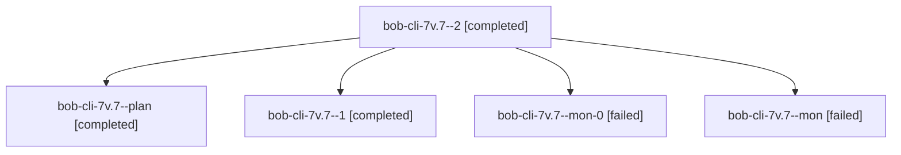

# Session: bob-cli-7v.7

[Agent Hoods](../README.md) / [bbugyi200](../users/bbugyi200/README.md) / [athena](../users/bbugyi200/machines/athena/README.md) / [bob-cli-7v](../users/bbugyi200/machines/athena/hoods/bob-cli-7v/README.md) / bob-cli-7v.7

Owner: `bbugyi200.athena` · Hood: `bob-cli-7v` · Members: 5 · Bead: [bob-cli-7v.7](https://github.com/bobs-org/bob-cli--beads/blob/main/pages/bob-cli-7v/bob-cli-7v.7.md)

## Lineage

The diagram is an optional enhancement; the ordered table below contains the same lineage in accessible text.

| Role | Agent | State | Model / provider | Timing | Commits | Prompt | Chat |
|---|---|---|---|---|---:|---|---|
| 2 | bob-cli-7v.7--2 | completed | gpt-6-luna / codex | 2026-10-15T18:59:13.843176+00:00 → 2026-10-15T19:08:53.310955+00:00 | [1](../agents/bbugyi200.athena.bob-cli-7v.7--2/README.md#commits) | [Prompt](../agents/bbugyi200.athena.bob-cli-7v.7--2/prompt.md) | [Chat](../agents/bbugyi200.athena.bob-cli-7v.7--2/chat.md) |
| plan | bob-cli-7v.7--plan | completed | gpt-6-luna / codex | 2026-10-15T18:44:00.532139+00:00 → 2026-10-15T18:49:40.545465+00:00 | 0 | [Prompt](../agents/bbugyi200.athena.bob-cli-7v.7--plan/prompt.md) | [Chat](../agents/bbugyi200.athena.bob-cli-7v.7--plan/chat.md) |
| 1 | bob-cli-7v.7--1 | completed | gpt-6-luna / codex | 2026-10-15T18:51:57.480894+00:00 → 2026-10-15T18:57:08.091597+00:00 | 0 | [Prompt](../agents/bbugyi200.athena.bob-cli-7v.7--1/prompt.md) | [Chat](../agents/bbugyi200.athena.bob-cli-7v.7--1/chat.md) |
| mon-0 | bob-cli-7v.7--mon-0 | failed | gpt-6-luna / codex | 2026-10-15T18:56:37.975029+00:00 → 2026-10-15T18:58:46.762257+00:00 | 0 | — | [Chat](../agents/bbugyi200.athena.bob-cli-7v.7--mon-0/chat.md) |
| mon | bob-cli-7v.7--mon | failed | gpt-6-luna / codex | 2026-10-15T18:49:10.471830+00:00 → 2026-10-15T18:51:31.109977+00:00 | 0 | — | [Chat](../agents/bbugyi200.athena.bob-cli-7v.7--mon/chat.md) |

## Commits

| Role | Repo | Commit | Subject | Committed |
|---|---|---|---|---|
| 2 | bob-cli | [`dad02a2`](https://github.com/bobs-org/bob-cli/commit/dad02a2f6e308ca8492759a967e17658d140f6b4) | docs(ref): document multi-url collections | 2026-10-15 15:07:15 EDT |

## Neighbors

| Agent | Relation | State |
|---|---|---|
| [bob-cli-7v.1](../agents/bbugyi200.athena.bob-cli-7v.1/README.md) | bob-cli-7v hood | completed |
| [bob-cli-7v.2](bbugyi200.athena.bob-cli-7v.2.md) (session · 3) | bob-cli-7v hood | completed 2, failed 1 |
| [bob-cli-7v.3](../agents/bbugyi200.athena.bob-cli-7v.3/README.md) | bob-cli-7v hood | completed |
| [bob-cli-7v.4](../agents/bbugyi200.athena.bob-cli-7v.4/README.md) | bob-cli-7v hood | completed |
| [bob-cli-7v.5](bbugyi200.athena.bob-cli-7v.5.md) (session · 3) | bob-cli-7v hood | completed 2, failed 1 |
| [bob-cli-7v.6](bbugyi200.athena.bob-cli-7v.6.md) (session · 9) | bob-cli-7v hood | completed 5, failed 4 |
| [bob-cli-7v.land](bbugyi200.athena.bob-cli-7v.land.md) (session · 11) | bob-cli-7v hood | active 1, completed 5, failed 5 |
