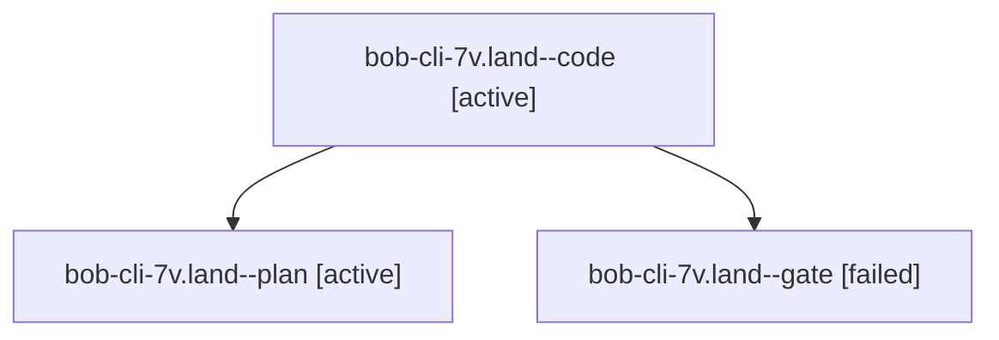

# Session: bob-cli-7v.land

[Agent Hoods](../README.md) / [bbugyi200](../users/bbugyi200/README.md) / [athena](../users/bbugyi200/machines/athena/README.md) / [bob-cli-7v](../users/bbugyi200/machines/athena/hoods/bob-cli-7v/README.md) / bob-cli-7v.land

Owner: `bbugyi200.athena` · Hood: `bob-cli-7v` · Members: 3 · Bead: [bob-cli-7v](https://github.com/bobs-org/bob-cli--beads/blob/main/pages/bob-cli-7v/README.md)

## Lineage

The diagram is an optional enhancement; the ordered table below contains the same lineage in accessible text.

| Role | Agent | State | Model / provider | Timing | Commits | Prompt | Chat |
|---|---|---|---|---|---:|---|---|
| code | bob-cli-7v.land--code | active | gpt-6-luna / codex | 2026-10-15T19:31:38.223356+00:00 | 0 | — | — |
| plan | bob-cli-7v.land--plan | active | opus / claude | 2026-10-15T19:09:26.003810+00:00 | 0 | [Prompt](../agents/bbugyi200.athena.bob-cli-7v.land--plan/prompt.md) | [Chat](../agents/bbugyi200.athena.bob-cli-7v.land--plan/chat.md) |
| gate | bob-cli-7v.land--gate | failed | opus / claude | 2026-10-15T19:30:50.874526+00:00 → 2026-10-15T19:31:17.356311+00:00 | 0 | — | [Chat](../agents/bbugyi200.athena.bob-cli-7v.land--gate/chat.md) |

## Neighbors

| Agent | Relation | State |
|---|---|---|
| [bob-cli-7v.1](../agents/bbugyi200.athena.bob-cli-7v.1/README.md) | bob-cli-7v hood | completed |
| [bob-cli-7v.2](bbugyi200.athena.bob-cli-7v.2.md) (session · 3) | bob-cli-7v hood | completed 2, failed 1 |
| [bob-cli-7v.3](../agents/bbugyi200.athena.bob-cli-7v.3/README.md) | bob-cli-7v hood | completed |
| [bob-cli-7v.4](../agents/bbugyi200.athena.bob-cli-7v.4/README.md) | bob-cli-7v hood | completed |
| [bob-cli-7v.5](bbugyi200.athena.bob-cli-7v.5.md) (session · 3) | bob-cli-7v hood | completed 2, failed 1 |
| [bob-cli-7v.6](bbugyi200.athena.bob-cli-7v.6.md) (session · 9) | bob-cli-7v hood | completed 5, failed 4 |
| [bob-cli-7v.7](bbugyi200.athena.bob-cli-7v.7.md) (session · 5) | bob-cli-7v hood | completed 3, failed 2 |
