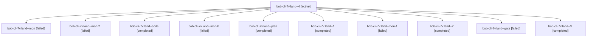

# Session: bob-cli-7v.land

[Agent Hoods](../README.md) / [bbugyi200](../users/bbugyi200/README.md) / [athena](../users/bbugyi200/machines/athena/README.md) / [bob-cli-7v](../users/bbugyi200/machines/athena/hoods/bob-cli-7v/README.md) / bob-cli-7v.land

Owner: `bbugyi200.athena` · Hood: `bob-cli-7v` · Members: 11 · Bead: [bob-cli-7v](https://github.com/bobs-org/bob-cli--beads/blob/main/pages/bob-cli-7v/README.md)

## Lineage

The diagram is an optional enhancement; the ordered table below contains the same lineage in accessible text.

| Role | Agent | State | Model / provider | Timing | Commits | Prompt | Chat |
|---|---|---|---|---|---:|---|---|
| 4 | bob-cli-7v.land--4 | active | muse-spark-1.3-contributor / muse | 2026-10-15T20:25:30.422926+00:00 | [1](../agents/bbugyi200.athena.bob-cli-7v.land--4/README.md#commits) | [Prompt](../agents/bbugyi200.athena.bob-cli-7v.land--4/prompt.md) | — |
| mon | bob-cli-7v.land--mon | failed | gpt-6-luna / codex | 2026-10-15T19:45:13.524650+00:00 → 2026-10-15T19:47:53.335218+00:00 | 0 | — | [Chat](../agents/bbugyi200.athena.bob-cli-7v.land--mon/chat.md) |
| mon-2 | bob-cli-7v.land--mon-2 | failed | gpt-6-luna / codex | 2026-10-15T20:18:24.510978+00:00 → 2026-10-15T20:24:48.821881+00:00 | 0 | — | [Chat](../agents/bbugyi200.athena.bob-cli-7v.land--mon-2/chat.md) |
| code | bob-cli-7v.land--code | completed | gpt-6-luna / codex | 2026-10-15T19:31:38.223356+00:00 → 2026-10-15T19:45:57.542962+00:00 | 0 | — | [Chat](../agents/bbugyi200.athena.bob-cli-7v.land--code/chat.md) |
| mon-0 | bob-cli-7v.land--mon-0 | failed | gpt-6-luna / codex | 2026-10-15T19:53:34.999532+00:00 → 2026-10-15T19:58:58.030139+00:00 | 0 | — | [Chat](../agents/bbugyi200.athena.bob-cli-7v.land--mon-0/chat.md) |
| plan | bob-cli-7v.land--plan | completed | opus / claude | 2026-10-15T19:09:26.003810+00:00 → 2026-10-15T19:45:57.542962+00:00 | 0 | [Prompt](../agents/bbugyi200.athena.bob-cli-7v.land--plan/prompt.md) | [Chat](../agents/bbugyi200.athena.bob-cli-7v.land--plan/chat.md) |
| 1 | bob-cli-7v.land--1 | completed | gpt-6-luna / codex | 2026-10-15T19:48:25.150490+00:00 → 2026-10-15T19:54:25.335284+00:00 | 0 | [Prompt](../agents/bbugyi200.athena.bob-cli-7v.land--1/prompt.md) | [Chat](../agents/bbugyi200.athena.bob-cli-7v.land--1/chat.md) |
| mon-1 | bob-cli-7v.land--mon-1 | failed | gpt-6-luna / codex | 2026-10-15T20:06:03.067025+00:00 → 2026-10-15T20:11:56.744878+00:00 | 0 | — | [Chat](../agents/bbugyi200.athena.bob-cli-7v.land--mon-1/chat.md) |
| 2 | bob-cli-7v.land--2 | completed | gpt-6-luna / codex | 2026-10-15T19:59:31.233807+00:00 → 2026-10-15T20:06:35.481003+00:00 | 0 | [Prompt](../agents/bbugyi200.athena.bob-cli-7v.land--2/prompt.md) | [Chat](../agents/bbugyi200.athena.bob-cli-7v.land--2/chat.md) |
| gate | bob-cli-7v.land--gate | failed | opus / claude | 2026-10-15T19:30:50.874526+00:00 → 2026-10-15T19:31:17.356311+00:00 | 0 | — | [Chat](../agents/bbugyi200.athena.bob-cli-7v.land--gate/chat.md) |
| 3 | bob-cli-7v.land--3 | completed | gpt-6-luna / codex | 2026-10-15T20:12:30.845871+00:00 → 2026-10-15T20:20:04.476779+00:00 | 0 | [Prompt](../agents/bbugyi200.athena.bob-cli-7v.land--3/prompt.md) | [Chat](../agents/bbugyi200.athena.bob-cli-7v.land--3/chat.md) |

## Commits

| Role | Repo | Commit | Subject | Committed |
|---|---|---|---|---|
| 4 | bob-cli | [`ade85d3`](https://github.com/bobs-org/bob-cli/commit/ade85d3c7f8f9fc5e7a35731ec7afba54cd79e65) | feat(ref): land multi-URL collections for bob-cli-7v | 2026-10-15 16:39:03 EDT |

## Neighbors

| Agent | Relation | State |
|---|---|---|
| [bob-cli-7v.1](../agents/bbugyi200.athena.bob-cli-7v.1/README.md) | bob-cli-7v hood | completed |
| [bob-cli-7v.2](bbugyi200.athena.bob-cli-7v.2.md) (session · 3) | bob-cli-7v hood | completed 2, failed 1 |
| [bob-cli-7v.3](../agents/bbugyi200.athena.bob-cli-7v.3/README.md) | bob-cli-7v hood | completed |
| [bob-cli-7v.4](../agents/bbugyi200.athena.bob-cli-7v.4/README.md) | bob-cli-7v hood | completed |
| [bob-cli-7v.5](bbugyi200.athena.bob-cli-7v.5.md) (session · 3) | bob-cli-7v hood | completed 2, failed 1 |
| [bob-cli-7v.6](bbugyi200.athena.bob-cli-7v.6.md) (session · 9) | bob-cli-7v hood | completed 5, failed 4 |
| [bob-cli-7v.7](bbugyi200.athena.bob-cli-7v.7.md) (session · 5) | bob-cli-7v hood | completed 3, failed 2 |
