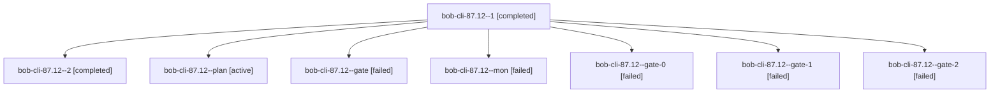

# Session: bob-cli-87.12

[Agent Hoods](../README.md) / [bbugyi200](../users/bbugyi200/README.md) / [athena](../users/bbugyi200/machines/athena/README.md) / [bob-cli-87](../users/bbugyi200/machines/athena/hoods/bob-cli-87/README.md) / bob-cli-87.12

Owner: `bbugyi200.athena` · Hood: `bob-cli-87` · Members: 8 · Bead: [bob-cli-87.12](https://github.com/bobs-org/bob-cli--beads/blob/main/pages/bob-cli-87/bob-cli-87.12.md)

## Lineage

The diagram is an optional enhancement; the ordered table below contains the same lineage in accessible text.

| Role | Agent | State | Model / provider | Timing | Commits | Prompt | Chat |
|---|---|---|---|---|---:|---|---|
| 1 | bob-cli-87.12--1 | completed | grok-4.6 / grok | 2026-10-17T11:42:21.449069+00:00 → 2026-10-17T11:52:50.304650+00:00 | 0 | [Prompt](../agents/bbugyi200.athena.bob-cli-87.12--1/prompt.md) | [Chat](../agents/bbugyi200.athena.bob-cli-87.12--1/chat.md) |
| 2 | bob-cli-87.12--2 | completed | grok-4.6 / grok | 2026-10-17T12:03:07.694438+00:00 → 2026-10-17T12:08:42.581589+00:00 | 0 | [Prompt](../agents/bbugyi200.athena.bob-cli-87.12--2/prompt.md) | [Chat](../agents/bbugyi200.athena.bob-cli-87.12--2/chat.md) |
| plan | bob-cli-87.12--plan | active | grok-4.6 / grok | 2026-10-17T11:08:08.281156+00:00 | 0 | [Prompt](../agents/bbugyi200.athena.bob-cli-87.12--plan/prompt.md) | [Chat](../agents/bbugyi200.athena.bob-cli-87.12--plan/chat.md) |
| gate | bob-cli-87.12--gate | failed | grok-4.6 / grok | 2026-10-17T11:25:04.314229+00:00 → 2026-10-17T11:25:04.514456+00:00 | 0 | — | [Chat](../agents/bbugyi200.athena.bob-cli-87.12--gate/chat.md) |
| mon | bob-cli-87.12--mon | failed | grok-4.6 / grok | 2026-10-17T12:07:54.282558+00:00 → 2026-10-17T12:24:28.485481+00:00 | 0 | — | [Chat](../agents/bbugyi200.athena.bob-cli-87.12--mon/chat.md) |
| gate-0 | bob-cli-87.12--gate-0 | failed | grok-4.6 / grok | 2026-10-17T11:40:44.882260+00:00 → 2026-10-17T11:41:32.943495+00:00 | 0 | — | [Chat](../agents/bbugyi200.athena.bob-cli-87.12--gate-0/chat.md) |
| gate-1 | bob-cli-87.12--gate-1 | failed | grok-4.6 / grok | 2026-10-17T12:01:23.989909+00:00 → 2026-10-17T12:02:02.977428+00:00 | 0 | — | [Chat](../agents/bbugyi200.athena.bob-cli-87.12--gate-1/chat.md) |
| gate-2 | bob-cli-87.12--gate-2 | failed | grok-4.6 / grok | 2026-10-17T12:36:39.926603+00:00 → 2026-10-17T12:37:01.501589+00:00 | 0 | — | [Chat](../agents/bbugyi200.athena.bob-cli-87.12--gate-2/chat.md) |

## Neighbors

| Agent | Relation | State |
|---|---|---|
| [bob-cli-87.1](../agents/bbugyi200.athena.bob-cli-87.1/README.md) | bob-cli-87 hood | completed |
| [bob-cli-87.10](../agents/bbugyi200.athena.bob-cli-87.10/README.md) | bob-cli-87 hood | completed |
| [bob-cli-87.11](bbugyi200.athena.bob-cli-87.11.md) (session · 7) | bob-cli-87 hood | completed 4, failed 3 |
| [bob-cli-87.12--3--1](../agents/bbugyi200.athena.bob-cli-87.12--3--1/README.md) | bob-cli-87 hood | active |
| [bob-cli-87.12--3--2](../agents/bbugyi200.athena.bob-cli-87.12--3--2/README.md) | bob-cli-87 hood | active |
| [bob-cli-87.12--3--4](../agents/bbugyi200.athena.bob-cli-87.12--3--4/README.md) | bob-cli-87 hood | active |
| [bob-cli-87.12--3--5](../agents/bbugyi200.athena.bob-cli-87.12--3--5/README.md) | bob-cli-87 hood | active |
| [bob-cli-87.12--3--6](../agents/bbugyi200.athena.bob-cli-87.12--3--6/README.md) | bob-cli-87 hood | completed |
| [bob-cli-87.12--3--gate](../agents/bbugyi200.athena.bob-cli-87.12--3--gate/README.md) | bob-cli-87 hood | failed |
| [bob-cli-87.12--3--gate-0](../agents/bbugyi200.athena.bob-cli-87.12--3--gate-0/README.md) | bob-cli-87 hood | failed |
| [bob-cli-87.12--3--gate-1](../agents/bbugyi200.athena.bob-cli-87.12--3--gate-1/README.md) | bob-cli-87 hood | failed |
| [bob-cli-87.12--3--gate-2](../agents/bbugyi200.athena.bob-cli-87.12--3--gate-2/README.md) | bob-cli-87 hood | failed |
| [bob-cli-87.12--3--gate-3](../agents/bbugyi200.athena.bob-cli-87.12--3--gate-3/README.md) | bob-cli-87 hood | failed |
| [bob-cli-87.12--3--plan](../agents/bbugyi200.athena.bob-cli-87.12--3--plan/README.md) | bob-cli-87 hood | completed |
| [bob-cli-87.13.1](../agents/bbugyi200.athena.bob-cli-87.13.1/README.md) | bob-cli-87 hood | active |
| [bob-cli-87.13.2](bbugyi200.athena.bob-cli-87.13.2.md) (session · 3) | bob-cli-87 hood | active 1, completed 1, failed 1 |
| [bob-cli-87.13.3](bbugyi200.athena.bob-cli-87.13.3.md) (session · 3) | bob-cli-87 hood | active 1, completed 1, failed 1 |
| [bob-cli-87.13.4](../agents/bbugyi200.athena.bob-cli-87.13.4/README.md) | bob-cli-87 hood | waiting |
| [bob-cli-87.13.land](../agents/bbugyi200.athena.bob-cli-87.13.land/README.md) | bob-cli-87 hood | waiting |
| [bob-cli-87.2](bbugyi200.athena.bob-cli-87.2.md) (session · 3) | bob-cli-87 hood | failed 3 |
| [bob-cli-87.2.1.1](bbugyi200.athena.bob-cli-87.2.1.1.md) (session · 9) | bob-cli-87 hood | completed 5, failed 4 |
| [bob-cli-87.2.1.2](../agents/bbugyi200.athena.bob-cli-87.2.1.2/README.md) | bob-cli-87 hood | completed |
| [bob-cli-87.2.1.3](../agents/bbugyi200.athena.bob-cli-87.2.1.3/README.md) | bob-cli-87 hood | completed |
| [bob-cli-87.2.1.4](bbugyi200.athena.bob-cli-87.2.1.4.md) (session · 7) | bob-cli-87 hood | completed 4, failed 3 |
| [bob-cli-87.2.1.land](bbugyi200.athena.bob-cli-87.2.1.land.md) (session · 5) | bob-cli-87 hood | completed 3, failed 2 |
| [bob-cli-87.3](bbugyi200.athena.bob-cli-87.3.md) (session · 3) | bob-cli-87 hood | failed 3 |
| [bob-cli-87.3.1.1](../agents/bbugyi200.athena.bob-cli-87.3.1.1/README.md) | bob-cli-87 hood | completed |
| [bob-cli-87.3.1.2](../agents/bbugyi200.athena.bob-cli-87.3.1.2/README.md) | bob-cli-87 hood | completed |
| [bob-cli-87.3.1.3](bbugyi200.athena.bob-cli-87.3.1.3.md) (session · 5) | bob-cli-87 hood | completed 3, failed 2 |
| [bob-cli-87.3.1.land](bbugyi200.athena.bob-cli-87.3.1.land.md) (session · 3) | bob-cli-87 hood | completed 2, failed 1 |
| [bob-cli-87.4](bbugyi200.athena.bob-cli-87.4.md) (session · 3) | bob-cli-87 hood | completed 2, failed 1 |
| [bob-cli-87.5](bbugyi200.athena.bob-cli-87.5.md) (session · 7) | bob-cli-87 hood | completed 4, failed 3 |
| [bob-cli-87.6](../agents/bbugyi200.athena.bob-cli-87.6/README.md) | bob-cli-87 hood | completed |
| [bob-cli-87.7](bbugyi200.athena.bob-cli-87.7.md) (session · 3) | bob-cli-87 hood | completed 2, failed 1 |
| [bob-cli-87.8](bbugyi200.athena.bob-cli-87.8.md) (session · 3) | bob-cli-87 hood | completed 2, failed 1 |
| [bob-cli-87.9](../agents/bbugyi200.athena.bob-cli-87.9/README.md) | bob-cli-87 hood | completed |
| [bob-cli-87.land](bbugyi200.athena.bob-cli-87.land.md) (session · 3) | bob-cli-87 hood | failed 3 |
