# Session: bob-cli-87.13.4

[Agent Hoods](../README.md) / [bbugyi200](../users/bbugyi200/README.md) / [athena](../users/bbugyi200/machines/athena/README.md) / [bob-cli-87](../users/bbugyi200/machines/athena/hoods/bob-cli-87/README.md) / bob-cli-87.13.4

Owner: `bbugyi200.athena` · Hood: `bob-cli-87` · Members: 37 · Bead: [bob-cli-87.13.4](https://github.com/bobs-org/bob-cli--beads/blob/main/pages/bob-cli-87/bob-cli-87.13.4.md)

## Lineage

```mermaid
flowchart TD
  n0["bob-cli-87.13.4--i [active]"]
  n1["bob-cli-87.13.4--6 [completed]"]
  n0 --> n1
  n2["bob-cli-87.13.4--mon-b [failed]"]
  n0 --> n2
  n3["bob-cli-87.13.4--mon-3 [failed]"]
  n0 --> n3
  n4["bob-cli-87.13.4--mon-2 [failed]"]
  n0 --> n4
  n5["bob-cli-87.13.4--3 [completed]"]
  n0 --> n5
  n6["bob-cli-87.13.4--mon-7 [failed]"]
  n0 --> n6
  n7["bob-cli-87.13.4--4 [completed]"]
  n0 --> n7
  n8["bob-cli-87.13.4--mon-e [failed]"]
  n0 --> n8
  n9["bob-cli-87.13.4--c [completed]"]
  n0 --> n9
  n10["bob-cli-87.13.4--b [completed]"]
  n0 --> n10
  n11["bob-cli-87.13.4--mon [failed]"]
  n0 --> n11
  n12["bob-cli-87.13.4--mon-0 [failed]"]
  n0 --> n12
  n13["bob-cli-87.13.4--mon-5 [failed]"]
  n0 --> n13
  n14["bob-cli-87.13.4--mon-6 [failed]"]
  n0 --> n14
  n15["bob-cli-87.13.4--5 [completed]"]
  n0 --> n15
  n16["bob-cli-87.13.4--mon-d [failed]"]
  n0 --> n16
  n17["bob-cli-87.13.4--8 [completed]"]
  n0 --> n17
  n18["bob-cli-87.13.4--e [completed]"]
  n0 --> n18
  n19["bob-cli-87.13.4--mon-9 [failed]"]
  n0 --> n19
  n20["bob-cli-87.13.4--mon-a [failed]"]
  n0 --> n20
  n21["bob-cli-87.13.4--2 [completed]"]
  n0 --> n21
  n22["bob-cli-87.13.4--g [completed]"]
  n0 --> n22
  n23["bob-cli-87.13.4--a [completed]"]
  n0 --> n23
  n24["bob-cli-87.13.4--d [completed]"]
  n0 --> n24
  n25["bob-cli-87.13.4--mon-g [failed]"]
  n0 --> n25
  n26["bob-cli-87.13.4--mon-f [failed]"]
  n0 --> n26
  n27["bob-cli-87.13.4--mon-c [failed]"]
  n0 --> n27
  n28["bob-cli-87.13.4--mon-1 [failed]"]
  n0 --> n28
  n29["bob-cli-87.13.4--h [completed]"]
  n0 --> n29
  n30["bob-cli-87.13.4--mon-8 [failed]"]
  n0 --> n30
  n31["bob-cli-87.13.4--1 [completed]"]
  n0 --> n31
  n32["bob-cli-87.13.4--9 [completed]"]
  n0 --> n32
  n33["bob-cli-87.13.4--mon-4 [failed]"]
  n0 --> n33
  n34["bob-cli-87.13.4--plan [completed]"]
  n0 --> n34
  n35["bob-cli-87.13.4--7 [completed]"]
  n0 --> n35
  n36["bob-cli-87.13.4--f [completed]"]
  n0 --> n36
```

The diagram is an optional enhancement; the ordered table below contains the same lineage in accessible text.

| Role | Agent | State | Model / provider | Timing | Commits | Prompt | Chat |
|---|---|---|---|---|---:|---|---|
| i | bob-cli-87.13.4--i | active | grok-4.6 / grok | 2026-10-17T23:26:18.419588+00:00 | [1](../agents/bbugyi200.athena.bob-cli-87.13.4--i/README.md#commits) | [Prompt](../agents/bbugyi200.athena.bob-cli-87.13.4--i/prompt.md) | — |
| 6 | bob-cli-87.13.4--6 | completed | gpt-6-luna / codex | 2026-10-17T17:31:15.481696+00:00 → 2026-10-17T17:54:59.138812+00:00 | 0 | [Prompt](../agents/bbugyi200.athena.bob-cli-87.13.4--6/prompt.md) | [Chat](../agents/bbugyi200.athena.bob-cli-87.13.4--6/chat.md) |
| mon-b | bob-cli-87.13.4--mon-b | failed | gpt-6-luna / codex | 2026-10-17T21:00:57.077151+00:00 → 2026-10-17T21:36:03.020584+00:00 | 0 | — | [Chat](../agents/bbugyi200.athena.bob-cli-87.13.4--mon-b/chat.md) |
| mon-3 | bob-cli-87.13.4--mon-3 | failed | gpt-6-luna / codex | 2026-10-17T16:54:46.089219+00:00 → 2026-10-17T17:16:26.065277+00:00 | 0 | — | [Chat](../agents/bbugyi200.athena.bob-cli-87.13.4--mon-3/chat.md) |
| mon-2 | bob-cli-87.13.4--mon-2 | failed | gpt-6-luna / codex | 2026-10-17T16:44:47.186382+00:00 → 2026-10-17T16:48:14.921803+00:00 | 0 | — | [Chat](../agents/bbugyi200.athena.bob-cli-87.13.4--mon-2/chat.md) |
| 3 | bob-cli-87.13.4--3 | completed | gpt-6-luna / codex | 2026-10-17T16:25:20.129868+00:00 → 2026-10-17T16:46:53.326928+00:00 | 0 | [Prompt](../agents/bbugyi200.athena.bob-cli-87.13.4--3/prompt.md) | [Chat](../agents/bbugyi200.athena.bob-cli-87.13.4--3/chat.md) |
| mon-7 | bob-cli-87.13.4--mon-7 | failed | gpt-6-luna / codex | 2026-10-17T18:56:54.558424+00:00 → 2026-10-17T19:36:45.843451+00:00 | 0 | — | [Chat](../agents/bbugyi200.athena.bob-cli-87.13.4--mon-7/chat.md) |
| 4 | bob-cli-87.13.4--4 | completed | gpt-6-luna / codex | 2026-10-17T16:49:25.168145+00:00 → 2026-10-17T16:55:18.727922+00:00 | 0 | [Prompt](../agents/bbugyi200.athena.bob-cli-87.13.4--4/prompt.md) | [Chat](../agents/bbugyi200.athena.bob-cli-87.13.4--4/chat.md) |
| mon-e | bob-cli-87.13.4--mon-e | failed | grok-4.6 / grok | 2026-10-17T22:37:53.424288+00:00 → 2026-10-17T22:42:50.950669+00:00 | 0 | — | [Chat](../agents/bbugyi200.athena.bob-cli-87.13.4--mon-e/chat.md) |
| c | bob-cli-87.13.4--c | completed | gpt-6-luna / codex | 2026-10-17T20:55:07.047218+00:00 → 2026-10-17T21:01:53.630752+00:00 | 0 | [Prompt](../agents/bbugyi200.athena.bob-cli-87.13.4--c/prompt.md) | [Chat](../agents/bbugyi200.athena.bob-cli-87.13.4--c/chat.md) |
| b | bob-cli-87.13.4--b | completed | gpt-6-luna / codex | 2026-10-17T20:42:32.056826+00:00 → 2026-10-17T20:51:31.459005+00:00 | 0 | [Prompt](../agents/bbugyi200.athena.bob-cli-87.13.4--b/prompt.md) | [Chat](../agents/bbugyi200.athena.bob-cli-87.13.4--b/chat.md) |
| mon | bob-cli-87.13.4--mon | failed | gpt-6-luna / codex | 2026-10-17T15:40:52.984151+00:00 → 2026-10-17T15:43:53.853593+00:00 | 0 | — | [Chat](../agents/bbugyi200.athena.bob-cli-87.13.4--mon/chat.md) |
| mon-0 | bob-cli-87.13.4--mon-0 | failed | gpt-6-luna / codex | 2026-10-17T15:56:01.112319+00:00 → 2026-10-17T15:59:18.259225+00:00 | 0 | — | [Chat](../agents/bbugyi200.athena.bob-cli-87.13.4--mon-0/chat.md) |
| mon-5 | bob-cli-87.13.4--mon-5 | failed | gpt-6-luna / codex | 2026-10-17T17:50:11.970345+00:00 → 2026-10-17T17:56:52.960113+00:00 | 0 | — | [Chat](../agents/bbugyi200.athena.bob-cli-87.13.4--mon-5/chat.md) |
| mon-6 | bob-cli-87.13.4--mon-6 | failed | gpt-6-luna / codex | 2026-10-17T18:10:01.533272+00:00 → 2026-10-17T18:41:32.260773+00:00 | 0 | — | [Chat](../agents/bbugyi200.athena.bob-cli-87.13.4--mon-6/chat.md) |
| 5 | bob-cli-87.13.4--5 | completed | gpt-6-luna / codex | 2026-10-17T17:17:21.768321+00:00 → 2026-10-17T17:28:16.501340+00:00 | 0 | [Prompt](../agents/bbugyi200.athena.bob-cli-87.13.4--5/prompt.md) | [Chat](../agents/bbugyi200.athena.bob-cli-87.13.4--5/chat.md) |
| mon-d | bob-cli-87.13.4--mon-d | failed | grok-4.6 / grok | 2026-10-17T21:54:34.545688+00:00 → 2026-10-17T22:29:52.683141+00:00 | 0 | — | [Chat](../agents/bbugyi200.athena.bob-cli-87.13.4--mon-d/chat.md) |
| 8 | bob-cli-87.13.4--8 | completed | gpt-6-luna / codex | 2026-10-17T18:43:08.022243+00:00 → 2026-10-17T18:59:27.488832+00:00 | 0 | [Prompt](../agents/bbugyi200.athena.bob-cli-87.13.4--8/prompt.md) | [Chat](../agents/bbugyi200.athena.bob-cli-87.13.4--8/chat.md) |
| e | bob-cli-87.13.4--e | completed | grok-4.6 / grok | 2026-10-17T21:49:21.711230+00:00 → 2026-10-17T21:55:07.367710+00:00 | 0 | [Prompt](../agents/bbugyi200.athena.bob-cli-87.13.4--e/prompt.md) | [Chat](../agents/bbugyi200.athena.bob-cli-87.13.4--e/chat.md) |
| mon-9 | bob-cli-87.13.4--mon-9 | failed | gpt-6-luna / codex | 2026-10-17T20:06:13.492825+00:00 → 2026-10-17T20:41:05.886935+00:00 | 0 | — | [Chat](../agents/bbugyi200.athena.bob-cli-87.13.4--mon-9/chat.md) |
| mon-a | bob-cli-87.13.4--mon-a | failed | gpt-6-luna / codex | 2026-10-17T20:50:25.691090+00:00 → 2026-10-17T20:53:28.699849+00:00 | 0 | — | [Chat](../agents/bbugyi200.athena.bob-cli-87.13.4--mon-a/chat.md) |
| 2 | bob-cli-87.13.4--2 | completed | gpt-6-luna / codex | 2026-10-17T16:00:06.775351+00:00 → 2026-10-17T16:05:39.570510+00:00 | 0 | [Prompt](../agents/bbugyi200.athena.bob-cli-87.13.4--2/prompt.md) | [Chat](../agents/bbugyi200.athena.bob-cli-87.13.4--2/chat.md) |
| g | bob-cli-87.13.4--g | completed | grok-4.6 / grok | 2026-10-17T22:44:33.700554+00:00 → 2026-10-17T23:03:30.674279+00:00 | 0 | [Prompt](../agents/bbugyi200.athena.bob-cli-87.13.4--g/prompt.md) | [Chat](../agents/bbugyi200.athena.bob-cli-87.13.4--g/chat.md) |
| a | bob-cli-87.13.4--a | completed | gpt-6-luna / codex | 2026-10-17T19:56:18.992799+00:00 → 2026-10-17T20:06:45.554535+00:00 | 0 | [Prompt](../agents/bbugyi200.athena.bob-cli-87.13.4--a/prompt.md) | [Chat](../agents/bbugyi200.athena.bob-cli-87.13.4--a/chat.md) |
| d | bob-cli-87.13.4--d | completed | gpt-6-luna / codex | 2026-10-17T21:38:01.548305+00:00 → 2026-10-17T21:45:04.149962+00:00 | 0 | [Prompt](../agents/bbugyi200.athena.bob-cli-87.13.4--d/prompt.md) | [Chat](../agents/bbugyi200.athena.bob-cli-87.13.4--d/chat.md) |
| mon-g | bob-cli-87.13.4--mon-g | failed | grok-4.6 / grok | 2026-10-17T23:20:05.527375+00:00 → 2026-10-17T23:24:55.962030+00:00 | 0 | — | [Chat](../agents/bbugyi200.athena.bob-cli-87.13.4--mon-g/chat.md) |
| mon-f | bob-cli-87.13.4--mon-f | failed | grok-4.6 / grok | 2026-10-17T23:02:34.891181+00:00 → 2026-10-17T23:07:09.418748+00:00 | 0 | — | [Chat](../agents/bbugyi200.athena.bob-cli-87.13.4--mon-f/chat.md) |
| mon-c | bob-cli-87.13.4--mon-c | failed | gpt-6-luna / codex | 2026-10-17T21:44:15.251155+00:00 → 2026-10-17T21:47:17.710378+00:00 | 0 | — | [Chat](../agents/bbugyi200.athena.bob-cli-87.13.4--mon-c/chat.md) |
| mon-1 | bob-cli-87.13.4--mon-1 | failed | gpt-6-luna / codex | 2026-10-17T16:05:02.988738+00:00 → 2026-10-17T16:23:59.168317+00:00 | 0 | — | [Chat](../agents/bbugyi200.athena.bob-cli-87.13.4--mon-1/chat.md) |
| h | bob-cli-87.13.4--h | completed | grok-4.6 / grok | 2026-10-17T23:09:04.936291+00:00 → 2026-10-17T23:20:56.765468+00:00 | 0 | [Prompt](../agents/bbugyi200.athena.bob-cli-87.13.4--h/prompt.md) | [Chat](../agents/bbugyi200.athena.bob-cli-87.13.4--h/chat.md) |
| mon-8 | bob-cli-87.13.4--mon-8 | failed | gpt-6-luna / codex | 2026-10-17T19:51:16.664868+00:00 → 2026-10-17T19:55:00.984465+00:00 | 0 | — | [Chat](../agents/bbugyi200.athena.bob-cli-87.13.4--mon-8/chat.md) |
| 1 | bob-cli-87.13.4--1 | completed | gpt-6-luna / codex | 2026-10-17T15:44:39.369703+00:00 → 2026-10-17T15:57:10.173387+00:00 | 0 | [Prompt](../agents/bbugyi200.athena.bob-cli-87.13.4--1/prompt.md) | [Chat](../agents/bbugyi200.athena.bob-cli-87.13.4--1/chat.md) |
| 9 | bob-cli-87.13.4--9 | completed | gpt-6-luna / codex | 2026-10-17T19:36:41.557761+00:00 → 2026-10-17T19:53:24.347743+00:00 | 0 | [Prompt](../agents/bbugyi200.athena.bob-cli-87.13.4--9/prompt.md) | [Chat](../agents/bbugyi200.athena.bob-cli-87.13.4--9/chat.md) |
| mon-4 | bob-cli-87.13.4--mon-4 | failed | gpt-6-luna / codex | 2026-10-17T17:27:20.501261+00:00 → 2026-10-17T17:29:48.637169+00:00 | 0 | — | [Chat](../agents/bbugyi200.athena.bob-cli-87.13.4--mon-4/chat.md) |
| plan | bob-cli-87.13.4--plan | completed | gpt-6-luna / codex | 2026-10-17T15:33:04.630077+00:00 → 2026-10-17T15:41:50.286290+00:00 | 0 | [Prompt](../agents/bbugyi200.athena.bob-cli-87.13.4--plan/prompt.md) | [Chat](../agents/bbugyi200.athena.bob-cli-87.13.4--plan/chat.md) |
| 7 | bob-cli-87.13.4--7 | completed | gpt-6-luna / codex | 2026-10-17T17:57:43.048973+00:00 → 2026-10-17T18:10:34.501630+00:00 | 0 | [Prompt](../agents/bbugyi200.athena.bob-cli-87.13.4--7/prompt.md) | [Chat](../agents/bbugyi200.athena.bob-cli-87.13.4--7/chat.md) |
| f | bob-cli-87.13.4--f | completed | grok-4.6 / grok | 2026-10-17T22:31:41.651402+00:00 → 2026-10-17T22:38:46.691962+00:00 | 0 | [Prompt](../agents/bbugyi200.athena.bob-cli-87.13.4--f/prompt.md) | [Chat](../agents/bbugyi200.athena.bob-cli-87.13.4--f/chat.md) |

## Commits

| Role | Repo | Commit | Subject | Committed |
|---|---|---|---|---|
| i | bob-cli | [`860f0be`](https://github.com/bobs-org/bob-cli/commit/860f0be726a73b264e9d7b3d307f4679a8d73f79) | fix(note-snapshot): residue-gate corpus, resolve file links, and record verification | 2026-10-17 19:32:50 EDT |

## Neighbors

| Agent | Relation | State |
|---|---|---|
| [bob-cli-87.13.1](bbugyi200.athena.bob-cli-87.13.1.md) (session · 3) | bob-cli-87.13 hood | completed 2, failed 1 |
| [bob-cli-87.13.2](bbugyi200.athena.bob-cli-87.13.2.md) (session · 9) | bob-cli-87.13 hood | completed 5, failed 4 |
| [bob-cli-87.13.3](bbugyi200.athena.bob-cli-87.13.3.md) (session · 3) | bob-cli-87.13 hood | completed 2, failed 1 |
| [bob-cli-87.13.land](../agents/bbugyi200.athena.bob-cli-87.13.land/README.md) | bob-cli-87.13 hood | waiting |
| [bob-cli-87.1](../agents/bbugyi200.athena.bob-cli-87.1/README.md) | bob-cli-87 hood | active |
| [bob-cli-87.10](../agents/bbugyi200.athena.bob-cli-87.10/README.md) | bob-cli-87 hood | active |
| [bob-cli-87.11](bbugyi200.athena.bob-cli-87.11.md) (session · 7) | bob-cli-87 hood | active 7 |
| [bob-cli-87.12](bbugyi200.athena.bob-cli-87.12.md) (session · 8) | bob-cli-87 hood | active 1, completed 2, failed 5 |
| [bob-cli-87.12](../agents/bbugyi200.athena.bob-cli-87.12/README.md) | bob-cli-87 hood | waiting |
| [bob-cli-87.12--3--1](../agents/bbugyi200.athena.bob-cli-87.12--3--1/README.md) | bob-cli-87 hood | active |
| [bob-cli-87.12--3--2](../agents/bbugyi200.athena.bob-cli-87.12--3--2/README.md) | bob-cli-87 hood | active |
| [bob-cli-87.12--3--4](../agents/bbugyi200.athena.bob-cli-87.12--3--4/README.md) | bob-cli-87 hood | active |
| [bob-cli-87.12--3--5](../agents/bbugyi200.athena.bob-cli-87.12--3--5/README.md) | bob-cli-87 hood | active |
| [bob-cli-87.12--3--6](../agents/bbugyi200.athena.bob-cli-87.12--3--6/README.md) | bob-cli-87 hood | completed |
| [bob-cli-87.12--3--gate](../agents/bbugyi200.athena.bob-cli-87.12--3--gate/README.md) | bob-cli-87 hood | failed |
| [bob-cli-87.12--3--gate-0](../agents/bbugyi200.athena.bob-cli-87.12--3--gate-0/README.md) | bob-cli-87 hood | failed |
| [bob-cli-87.12--3--gate-1](../agents/bbugyi200.athena.bob-cli-87.12--3--gate-1/README.md) | bob-cli-87 hood | failed |
| [bob-cli-87.12--3--gate-2](../agents/bbugyi200.athena.bob-cli-87.12--3--gate-2/README.md) | bob-cli-87 hood | failed |
| [bob-cli-87.12--3--gate-3](../agents/bbugyi200.athena.bob-cli-87.12--3--gate-3/README.md) | bob-cli-87 hood | failed |
| [bob-cli-87.12--3--plan](../agents/bbugyi200.athena.bob-cli-87.12--3--plan/README.md) | bob-cli-87 hood | completed |
| [bob-cli-87.2](bbugyi200.athena.bob-cli-87.2.md) (session · 3) | bob-cli-87 hood | active 3 |
| [bob-cli-87.2.1.1](bbugyi200.athena.bob-cli-87.2.1.1.md) (session · 9) | bob-cli-87 hood | active 9 |
| [bob-cli-87.2.1.2](../agents/bbugyi200.athena.bob-cli-87.2.1.2/README.md) | bob-cli-87 hood | active |
| [bob-cli-87.2.1.3](../agents/bbugyi200.athena.bob-cli-87.2.1.3/README.md) | bob-cli-87 hood | active |
| [bob-cli-87.2.1.4](bbugyi200.athena.bob-cli-87.2.1.4.md) (session · 7) | bob-cli-87 hood | active 7 |
| [bob-cli-87.2.1.land](bbugyi200.athena.bob-cli-87.2.1.land.md) (session · 5) | bob-cli-87 hood | active 3, completed 1, failed 1 |
| [bob-cli-87.3](bbugyi200.athena.bob-cli-87.3.md) (session · 3) | bob-cli-87 hood | active 3 |
| [bob-cli-87.3.1.1](../agents/bbugyi200.athena.bob-cli-87.3.1.1/README.md) | bob-cli-87 hood | active |
| [bob-cli-87.3.1.2](../agents/bbugyi200.athena.bob-cli-87.3.1.2/README.md) | bob-cli-87 hood | active |
| [bob-cli-87.3.1.3](bbugyi200.athena.bob-cli-87.3.1.3.md) (session · 5) | bob-cli-87 hood | active 5 |
| [bob-cli-87.3.1.land](bbugyi200.athena.bob-cli-87.3.1.land.md) (session · 3) | bob-cli-87 hood | active 2, completed 1 |
| [bob-cli-87.4](bbugyi200.athena.bob-cli-87.4.md) (session · 3) | bob-cli-87 hood | active 2, completed 1 |
| [bob-cli-87.5](bbugyi200.athena.bob-cli-87.5.md) (session · 7) | bob-cli-87 hood | active 5, completed 1, failed 1 |
| [bob-cli-87.6](../agents/bbugyi200.athena.bob-cli-87.6/README.md) | bob-cli-87 hood | active |
| [bob-cli-87.7](bbugyi200.athena.bob-cli-87.7.md) (session · 3) | bob-cli-87 hood | active 3 |
| [bob-cli-87.8](bbugyi200.athena.bob-cli-87.8.md) (session · 3) | bob-cli-87 hood | active 3 |
| [bob-cli-87.9](../agents/bbugyi200.athena.bob-cli-87.9/README.md) | bob-cli-87 hood | active |
| [bob-cli-87.land](bbugyi200.athena.bob-cli-87.land.md) (session · 3) | bob-cli-87 hood | active 3 |
