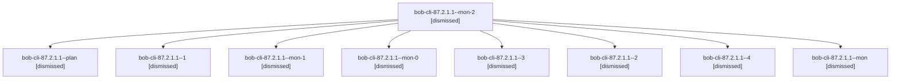

# Session: bob-cli-87.2.1.1

[Agent Hoods](../README.md) / [bbugyi200](../users/bbugyi200/README.md) / [athena](../users/bbugyi200/machines/athena/README.md) / [bob-cli-87](../users/bbugyi200/machines/athena/hoods/bob-cli-87/README.md) / bob-cli-87.2.1.1

Owner: `bbugyi200.athena` · Hood: `bob-cli-87` · Members: 9 · Bead: [bob-cli-87.2.1.1](https://github.com/bobs-org/bob-cli--beads/blob/main/pages/bob-cli-87/bob-cli-87.2.1.1.md)

## Lineage

The diagram is an optional enhancement; the ordered table below contains the same lineage in accessible text.

| Role | Agent | State | Model / provider | Timing | Commits | Prompt | Chat |
|---|---|---|---|---|---:|---|---|
| mon-2 | bob-cli-87.2.1.1--mon-2 | dismissed | gpt-6-luna / codex | 2026-10-16T08:12:17.420101 → 2026-10-16T08:13:23.011038 | 0 | — | [Chat](../agents/bbugyi200.athena.bob-cli-87.2.1.1--mon-2/chat.md) |
| plan | bob-cli-87.2.1.1--plan | dismissed | gpt-6-luna / codex | 2026-10-16T07:28:14.130771 → 2026-10-16T07:38:50.214961 | 0 | [Prompt](../agents/bbugyi200.athena.bob-cli-87.2.1.1--plan/prompt.md) | [Chat](../agents/bbugyi200.athena.bob-cli-87.2.1.1--plan/chat.md) |
| 1 | bob-cli-87.2.1.1--1 | dismissed | gpt-6-luna / codex | 2026-10-16T07:41:30.469087 → 2026-10-16T07:51:47.273151 | 0 | [Prompt](../agents/bbugyi200.athena.bob-cli-87.2.1.1--1/prompt.md) | [Chat](../agents/bbugyi200.athena.bob-cli-87.2.1.1--1/chat.md) |
| mon-1 | bob-cli-87.2.1.1--mon-1 | dismissed | gpt-6-luna / codex | 2026-10-16T08:00:20.137793 → 2026-10-16T08:03:24.156259 | 0 | — | [Chat](../agents/bbugyi200.athena.bob-cli-87.2.1.1--mon-1/chat.md) |
| mon-0 | bob-cli-87.2.1.1--mon-0 | dismissed | gpt-6-luna / codex | 2026-10-16T07:50:55.565733 → 2026-10-16T07:51:52.683165 | 0 | — | [Chat](../agents/bbugyi200.athena.bob-cli-87.2.1.1--mon-0/chat.md) |
| 3 | bob-cli-87.2.1.1--3 | dismissed | gpt-6-luna / codex | 2026-10-16T08:05:22.629064 → 2026-10-16T08:13:07.718448 | 0 | [Prompt](../agents/bbugyi200.athena.bob-cli-87.2.1.1--3/prompt.md) | [Chat](../agents/bbugyi200.athena.bob-cli-87.2.1.1--3/chat.md) |
| 2 | bob-cli-87.2.1.1--2 | dismissed | gpt-6-luna / codex | 2026-10-16T07:53:47.619856 → 2026-10-16T08:01:10.141491 | 0 | [Prompt](../agents/bbugyi200.athena.bob-cli-87.2.1.1--2/prompt.md) | [Chat](../agents/bbugyi200.athena.bob-cli-87.2.1.1--2/chat.md) |
| 4 | bob-cli-87.2.1.1--4 | dismissed | gpt-6-luna / codex | 2026-10-16T08:15:20.762823 → 2026-10-16T08:32:38.127758 | [1](../agents/bbugyi200.athena.bob-cli-87.2.1.1--4/README.md#commits) | [Prompt](../agents/bbugyi200.athena.bob-cli-87.2.1.1--4/prompt.md) | [Chat](../agents/bbugyi200.athena.bob-cli-87.2.1.1--4/chat.md) |
| mon | bob-cli-87.2.1.1--mon | dismissed | gpt-6-luna / codex | 2026-10-16T07:38:15.958517 → 2026-10-16T07:39:25.564272 | 0 | — | [Chat](../agents/bbugyi200.athena.bob-cli-87.2.1.1--mon/chat.md) |

## Commits

| Role | Repo | Commit | Subject | Committed |
|---|---|---|---|---|
| 4 | — | `426b07c` | feat(highlights): add snapshot model and markdown contract | 2026-10-16 08:28:56 EDT |

## Neighbors

| Agent | Relation | State |
|---|---|---|
| [bob-cli-87.2](bbugyi200.athena.bob-cli-87.2.md) (session · 3) | ancestor | dismissed 3 |
| [bob-cli-87.2.1.2](../agents/bbugyi200.athena.bob-cli-87.2.1.2/README.md) | bob-cli-87.2.1 hood | dismissed |
| [bob-cli-87.2.1.3](../agents/bbugyi200.athena.bob-cli-87.2.1.3/README.md) | bob-cli-87.2.1 hood | dismissed |
| [bob-cli-87.2.1.4](bbugyi200.athena.bob-cli-87.2.1.4.md) (session · 7) | bob-cli-87.2.1 hood | dismissed 7 |
| [bob-cli-87.2.1.land](bbugyi200.athena.bob-cli-87.2.1.land.md) (session · 5) | bob-cli-87.2.1 hood | completed 1, dismissed 3, failed 1 |
| [bob-cli-87.1](../agents/bbugyi200.athena.bob-cli-87.1/README.md) | bob-cli-87 hood | dismissed |
| [bob-cli-87.10](../agents/bbugyi200.athena.bob-cli-87.10/README.md) | bob-cli-87 hood | dismissed |
| [bob-cli-87.11](bbugyi200.athena.bob-cli-87.11.md) (session · 7) | bob-cli-87 hood | dismissed 7 |
| [bob-cli-87.12](bbugyi200.athena.bob-cli-87.12.md) (session · 8) | bob-cli-87 hood | completed 2, dismissed 1, failed 5 |
| [bob-cli-87.12](../agents/bbugyi200.athena.bob-cli-87.12/README.md) | bob-cli-87 hood | waiting |
| [bob-cli-87.12--3--1](../agents/bbugyi200.athena.bob-cli-87.12--3--1/README.md) | bob-cli-87 hood | active |
| [bob-cli-87.12--3--2](../agents/bbugyi200.athena.bob-cli-87.12--3--2/README.md) | bob-cli-87 hood | active |
| [bob-cli-87.12--3--4](../agents/bbugyi200.athena.bob-cli-87.12--3--4/README.md) | bob-cli-87 hood | active |
| [bob-cli-87.12--3--5](../agents/bbugyi200.athena.bob-cli-87.12--3--5/README.md) | bob-cli-87 hood | active |
| [bob-cli-87.12--3--6](../agents/bbugyi200.athena.bob-cli-87.12--3--6/README.md) | bob-cli-87 hood | completed |
| [bob-cli-87.12--3--gate](../agents/bbugyi200.athena.bob-cli-87.12--3--gate/README.md) | bob-cli-87 hood | failed |
| [bob-cli-87.12--3--gate-0](../agents/bbugyi200.athena.bob-cli-87.12--3--gate-0/README.md) | bob-cli-87 hood | failed |
| [bob-cli-87.12--3--gate-1](../agents/bbugyi200.athena.bob-cli-87.12--3--gate-1/README.md) | bob-cli-87 hood | failed |
| [bob-cli-87.12--3--gate-2](../agents/bbugyi200.athena.bob-cli-87.12--3--gate-2/README.md) | bob-cli-87 hood | failed |
| [bob-cli-87.12--3--gate-3](../agents/bbugyi200.athena.bob-cli-87.12--3--gate-3/README.md) | bob-cli-87 hood | failed |
| [bob-cli-87.12--3--plan](../agents/bbugyi200.athena.bob-cli-87.12--3--plan/README.md) | bob-cli-87 hood | completed |
| [bob-cli-87.13.1](bbugyi200.athena.bob-cli-87.13.1.md) (session · 3) | bob-cli-87 hood | completed 2, failed 1 |
| [bob-cli-87.13.2](bbugyi200.athena.bob-cli-87.13.2.md) (session · 9) | bob-cli-87 hood | completed 5, failed 4 |
| [bob-cli-87.13.3](bbugyi200.athena.bob-cli-87.13.3.md) (session · 3) | bob-cli-87 hood | completed 2, failed 1 |
| [bob-cli-87.13.4](bbugyi200.athena.bob-cli-87.13.4.md) (session · 37) | bob-cli-87 hood | completed 19, failed 18 |
| [bob-cli-87.13.land](bbugyi200.athena.bob-cli-87.13.land.md) (session · 5) | bob-cli-87 hood | completed 2, dismissed 1, failed 2 |
| [bob-cli-87.3](bbugyi200.athena.bob-cli-87.3.md) (session · 3) | bob-cli-87 hood | dismissed 3 |
| [bob-cli-87.3.1.1](../agents/bbugyi200.athena.bob-cli-87.3.1.1/README.md) | bob-cli-87 hood | dismissed |
| [bob-cli-87.3.1.2](../agents/bbugyi200.athena.bob-cli-87.3.1.2/README.md) | bob-cli-87 hood | active |
| [bob-cli-87.3.1.3](bbugyi200.athena.bob-cli-87.3.1.3.md) (session · 5) | bob-cli-87 hood | dismissed 5 |
| [bob-cli-87.3.1.land](bbugyi200.athena.bob-cli-87.3.1.land.md) (session · 3) | bob-cli-87 hood | completed 1, dismissed 2 |
| [bob-cli-87.4](bbugyi200.athena.bob-cli-87.4.md) (session · 3) | bob-cli-87 hood | completed 1, dismissed 2 |
| [bob-cli-87.5](bbugyi200.athena.bob-cli-87.5.md) (session · 7) | bob-cli-87 hood | completed 1, dismissed 5, failed 1 |
| [bob-cli-87.6](../agents/bbugyi200.athena.bob-cli-87.6/README.md) | bob-cli-87 hood | dismissed |
| [bob-cli-87.7](bbugyi200.athena.bob-cli-87.7.md) (session · 3) | bob-cli-87 hood | dismissed 3 |
| [bob-cli-87.8](bbugyi200.athena.bob-cli-87.8.md) (session · 3) | bob-cli-87 hood | dismissed 3 |
| [bob-cli-87.9](../agents/bbugyi200.athena.bob-cli-87.9/README.md) | bob-cli-87 hood | dismissed |
| [bob-cli-87.land](bbugyi200.athena.bob-cli-87.land.md) (session · 3) | bob-cli-87 hood | dismissed 3 |
