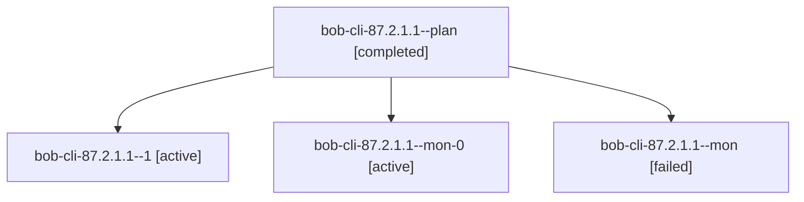

# Session: bob-cli-87.2.1.1

[Agent Hoods](../README.md) / [bbugyi200](../users/bbugyi200/README.md) / [athena](../users/bbugyi200/machines/athena/README.md) / [bob-cli-87](../users/bbugyi200/machines/athena/hoods/bob-cli-87/README.md) / bob-cli-87.2.1.1

Owner: `bbugyi200.athena` · Hood: `bob-cli-87` · Members: 4 · Bead: [bob-cli-87.2.1.1](https://github.com/bobs-org/bob-cli--beads/blob/main/pages/bob-cli-87/bob-cli-87.2.1.1.md)

## Lineage

The diagram is an optional enhancement; the ordered table below contains the same lineage in accessible text.

| Role | Agent | State | Model / provider | Timing | Commits | Prompt | Chat |
|---|---|---|---|---|---:|---|---|
| plan | bob-cli-87.2.1.1--plan | completed | gpt-6-luna / codex | 2026-10-16T11:28:14.130771+00:00 → 2026-10-16T11:38:50.195806+00:00 | 0 | [Prompt](../agents/bbugyi200.athena.bob-cli-87.2.1.1--plan/prompt.md) | [Chat](../agents/bbugyi200.athena.bob-cli-87.2.1.1--plan/chat.md) |
| 1 | bob-cli-87.2.1.1--1 | active | gpt-6-luna / codex | 2026-10-16T11:41:30.469087+00:00 | 0 | [Prompt](../agents/bbugyi200.athena.bob-cli-87.2.1.1--1/prompt.md) | [Chat](../agents/bbugyi200.athena.bob-cli-87.2.1.1--1/chat.md) |
| mon-0 | bob-cli-87.2.1.1--mon-0 | active | gpt-6-luna / codex | 2026-10-16T11:50:55.565733+00:00 | 0 | — | — |
| mon | bob-cli-87.2.1.1--mon | failed | gpt-6-luna / codex | 2026-10-16T11:38:15.958517+00:00 → 2026-10-16T11:40:54.698942+00:00 | 0 | — | [Chat](../agents/bbugyi200.athena.bob-cli-87.2.1.1--mon/chat.md) |

## Neighbors

| Agent | Relation | State |
|---|---|---|
| [bob-cli-87.2](bbugyi200.athena.bob-cli-87.2.md) (session · 3) | ancestor | failed 3 |
| [bob-cli-87.2.1.2](../agents/bbugyi200.athena.bob-cli-87.2.1.2/README.md) | bob-cli-87.2.1 hood | waiting |
| [bob-cli-87.2.1.3](../agents/bbugyi200.athena.bob-cli-87.2.1.3/README.md) | bob-cli-87.2.1 hood | waiting |
| [bob-cli-87.2.1.4](../agents/bbugyi200.athena.bob-cli-87.2.1.4/README.md) | bob-cli-87.2.1 hood | waiting |
| [bob-cli-87.2.1.land](../agents/bbugyi200.athena.bob-cli-87.2.1.land/README.md) | bob-cli-87.2.1 hood | waiting |
| [bob-cli-87.1](../agents/bbugyi200.athena.bob-cli-87.1/README.md) | bob-cli-87 hood | completed |
| [bob-cli-87.10](../agents/bbugyi200.athena.bob-cli-87.10/README.md) | bob-cli-87 hood | waiting |
| [bob-cli-87.11](../agents/bbugyi200.athena.bob-cli-87.11/README.md) | bob-cli-87 hood | waiting |
| [bob-cli-87.12](../agents/bbugyi200.athena.bob-cli-87.12/README.md) | bob-cli-87 hood | waiting |
| [bob-cli-87.3](../agents/bbugyi200.athena.bob-cli-87.3/README.md) | bob-cli-87 hood | waiting |
| [bob-cli-87.4](bbugyi200.athena.bob-cli-87.4.md) (session · 3) | bob-cli-87 hood | active 2, failed 1 |
| [bob-cli-87.5](../agents/bbugyi200.athena.bob-cli-87.5/README.md) | bob-cli-87 hood | waiting |
| [bob-cli-87.6](../agents/bbugyi200.athena.bob-cli-87.6/README.md) | bob-cli-87 hood | waiting |
| [bob-cli-87.7](../agents/bbugyi200.athena.bob-cli-87.7/README.md) | bob-cli-87 hood | waiting |
| [bob-cli-87.8](../agents/bbugyi200.athena.bob-cli-87.8/README.md) | bob-cli-87 hood | waiting |
| [bob-cli-87.9](../agents/bbugyi200.athena.bob-cli-87.9/README.md) | bob-cli-87 hood | completed |
| [bob-cli-87.land](../agents/bbugyi200.athena.bob-cli-87.land/README.md) | bob-cli-87 hood | waiting |
