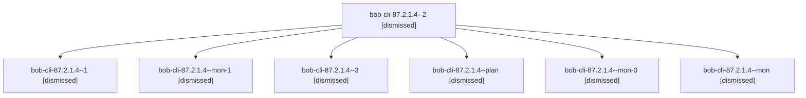

# Session: bob-cli-87.2.1.4

[Agent Hoods](../README.md) / [bbugyi200](../users/bbugyi200/README.md) / [athena](../users/bbugyi200/machines/athena/README.md) / [bob-cli-87](../users/bbugyi200/machines/athena/hoods/bob-cli-87/README.md) / bob-cli-87.2.1.4

Owner: `bbugyi200.athena` · Hood: `bob-cli-87` · Members: 7 · Bead: [bob-cli-87.2.1.4](https://github.com/bobs-org/bob-cli--beads/blob/main/pages/bob-cli-87/bob-cli-87.2.1.4.md)

## Lineage

The diagram is an optional enhancement; the ordered table below contains the same lineage in accessible text.

| Role | Agent | State | Model / provider | Timing | Commits | Prompt | Chat |
|---|---|---|---|---|---:|---|---|
| 2 | bob-cli-87.2.1.4--2 | dismissed | gpt-6-luna / codex | 2026-10-16T10:11:04.889841 → 2026-10-16T10:17:48.947636 | 0 | [Prompt](../agents/bbugyi200.athena.bob-cli-87.2.1.4--2/prompt.md) | [Chat](../agents/bbugyi200.athena.bob-cli-87.2.1.4--2/chat.md) |
| 1 | bob-cli-87.2.1.4--1 | dismissed | gpt-6-luna / codex | 2026-10-16T10:02:24.503032 → 2026-10-16T10:08:44.064215 | 0 | [Prompt](../agents/bbugyi200.athena.bob-cli-87.2.1.4--1/prompt.md) | [Chat](../agents/bbugyi200.athena.bob-cli-87.2.1.4--1/chat.md) |
| mon-1 | bob-cli-87.2.1.4--mon-1 | dismissed | gpt-6-luna / codex | 2026-10-16T10:16:52.402779 → 2026-10-16T10:21:14.244540 | 0 | — | [Chat](../agents/bbugyi200.athena.bob-cli-87.2.1.4--mon-1/chat.md) |
| 3 | bob-cli-87.2.1.4--3 | dismissed | gpt-6-luna / codex | 2026-10-16T10:23:04.226627 → 2026-10-16T10:34:20.903620 | [1](../agents/bbugyi200.athena.bob-cli-87.2.1.4--3/README.md#commits) | [Prompt](../agents/bbugyi200.athena.bob-cli-87.2.1.4--3/prompt.md) | [Chat](../agents/bbugyi200.athena.bob-cli-87.2.1.4--3/chat.md) |
| plan | bob-cli-87.2.1.4--plan | dismissed | gpt-6-luna / codex | 2026-10-16T09:36:42.597978 → 2026-10-16T09:59:55.345148 | 0 | [Prompt](../agents/bbugyi200.athena.bob-cli-87.2.1.4--plan/prompt.md) | [Chat](../agents/bbugyi200.athena.bob-cli-87.2.1.4--plan/chat.md) |
| mon-0 | bob-cli-87.2.1.4--mon-0 | dismissed | gpt-6-luna / codex | 2026-10-16T10:07:59.619102 → 2026-10-16T10:09:01.563297 | 0 | — | [Chat](../agents/bbugyi200.athena.bob-cli-87.2.1.4--mon-0/chat.md) |
| mon | bob-cli-87.2.1.4--mon | dismissed | gpt-6-luna / codex | 2026-10-16T09:59:10.219968 → 2026-10-16T10:00:25.370639 | 0 | — | [Chat](../agents/bbugyi200.athena.bob-cli-87.2.1.4--mon/chat.md) |

## Commits

| Role | Repo | Commit | Subject | Committed |
|---|---|---|---|---|
| 3 | — | `a086cd9` | feat(note-snapshot): complete bounded transclusions | 2026-10-16 10:32:21 EDT |

## Neighbors

| Agent | Relation | State |
|---|---|---|
| [bob-cli-87.2](bbugyi200.athena.bob-cli-87.2.md) (session · 3) | ancestor | dismissed 3 |
| [bob-cli-87.2.1.1](bbugyi200.athena.bob-cli-87.2.1.1.md) (session · 9) | bob-cli-87.2.1 hood | active 4, dismissed 5 |
| [bob-cli-87.2.1.2](../agents/bbugyi200.athena.bob-cli-87.2.1.2/README.md) | bob-cli-87.2.1 hood | active |
| [bob-cli-87.2.1.3](../agents/bbugyi200.athena.bob-cli-87.2.1.3/README.md) | bob-cli-87.2.1 hood | dismissed |
| [bob-cli-87.2.1.land](bbugyi200.athena.bob-cli-87.2.1.land.md) (session · 5) | bob-cli-87.2.1 hood | active 1, completed 1, dismissed 2, failed 1 |
| [bob-cli-87.1](../agents/bbugyi200.athena.bob-cli-87.1/README.md) | bob-cli-87 hood | dismissed |
| [bob-cli-87.10](../agents/bbugyi200.athena.bob-cli-87.10/README.md) | bob-cli-87 hood | active |
| [bob-cli-87.11](bbugyi200.athena.bob-cli-87.11.md) (session · 7) | bob-cli-87 hood | active 3, dismissed 4 |
| [bob-cli-87.12](bbugyi200.athena.bob-cli-87.12.md) (session · 8) | bob-cli-87 hood | completed 2, dismissed 1, failed 5 |
| [bob-cli-87.12](../agents/bbugyi200.athena.bob-cli-87.12/README.md) | bob-cli-87 hood | waiting |
| [bob-cli-87.12--3--1](../agents/bbugyi200.athena.bob-cli-87.12--3--1/README.md) | bob-cli-87 hood | active |
| [bob-cli-87.12--3--2](../agents/bbugyi200.athena.bob-cli-87.12--3--2/README.md) | bob-cli-87 hood | active |
| [bob-cli-87.12--3--4](../agents/bbugyi200.athena.bob-cli-87.12--3--4/README.md) | bob-cli-87 hood | active |
| [bob-cli-87.12--3--5](../agents/bbugyi200.athena.bob-cli-87.12--3--5/README.md) | bob-cli-87 hood | active |
| [bob-cli-87.12--3--6](../agents/bbugyi200.athena.bob-cli-87.12--3--6/README.md) | bob-cli-87 hood | completed |
| [bob-cli-87.12--3--gate](../agents/bbugyi200.athena.bob-cli-87.12--3--gate/README.md) | bob-cli-87 hood | failed |
| [bob-cli-87.12--3--gate-0](../agents/bbugyi200.athena.bob-cli-87.12--3--gate-0/README.md) | bob-cli-87 hood | failed |
| [bob-cli-87.12--3--gate-1](../agents/bbugyi200.athena.bob-cli-87.12--3--gate-1/README.md) | bob-cli-87 hood | failed |
| [bob-cli-87.12--3--gate-2](../agents/bbugyi200.athena.bob-cli-87.12--3--gate-2/README.md) | bob-cli-87 hood | failed |
| [bob-cli-87.12--3--gate-3](../agents/bbugyi200.athena.bob-cli-87.12--3--gate-3/README.md) | bob-cli-87 hood | failed |
| [bob-cli-87.12--3--plan](../agents/bbugyi200.athena.bob-cli-87.12--3--plan/README.md) | bob-cli-87 hood | completed |
| [bob-cli-87.13.1](bbugyi200.athena.bob-cli-87.13.1.md) (session · 3) | bob-cli-87 hood | completed 2, failed 1 |
| [bob-cli-87.13.2](bbugyi200.athena.bob-cli-87.13.2.md) (session · 9) | bob-cli-87 hood | completed 5, failed 4 |
| [bob-cli-87.13.3](bbugyi200.athena.bob-cli-87.13.3.md) (session · 3) | bob-cli-87 hood | completed 2, failed 1 |
| [bob-cli-87.13.4](bbugyi200.athena.bob-cli-87.13.4.md) (session · 37) | bob-cli-87 hood | completed 19, failed 18 |
| [bob-cli-87.13.land](bbugyi200.athena.bob-cli-87.13.land.md) (session · 5) | bob-cli-87 hood | completed 2, dismissed 1, failed 2 |
| [bob-cli-87.3](bbugyi200.athena.bob-cli-87.3.md) (session · 3) | bob-cli-87 hood | dismissed 3 |
| [bob-cli-87.3.1.1](../agents/bbugyi200.athena.bob-cli-87.3.1.1/README.md) | bob-cli-87 hood | dismissed |
| [bob-cli-87.3.1.2](../agents/bbugyi200.athena.bob-cli-87.3.1.2/README.md) | bob-cli-87 hood | active |
| [bob-cli-87.3.1.3](bbugyi200.athena.bob-cli-87.3.1.3.md) (session · 5) | bob-cli-87 hood | active 3, dismissed 2 |
| [bob-cli-87.3.1.land](bbugyi200.athena.bob-cli-87.3.1.land.md) (session · 3) | bob-cli-87 hood | active 1, completed 1, dismissed 1 |
| [bob-cli-87.4](bbugyi200.athena.bob-cli-87.4.md) (session · 3) | bob-cli-87 hood | active 2, completed 1 |
| [bob-cli-87.5](bbugyi200.athena.bob-cli-87.5.md) (session · 7) | bob-cli-87 hood | active 1, completed 1, dismissed 4, failed 1 |
| [bob-cli-87.6](../agents/bbugyi200.athena.bob-cli-87.6/README.md) | bob-cli-87 hood | dismissed |
| [bob-cli-87.7](bbugyi200.athena.bob-cli-87.7.md) (session · 3) | bob-cli-87 hood | active 1, dismissed 2 |
| [bob-cli-87.8](bbugyi200.athena.bob-cli-87.8.md) (session · 3) | bob-cli-87 hood | dismissed 3 |
| [bob-cli-87.9](../agents/bbugyi200.athena.bob-cli-87.9/README.md) | bob-cli-87 hood | active |
| [bob-cli-87.land](bbugyi200.athena.bob-cli-87.land.md) (session · 3) | bob-cli-87 hood | active 2, dismissed 1 |
