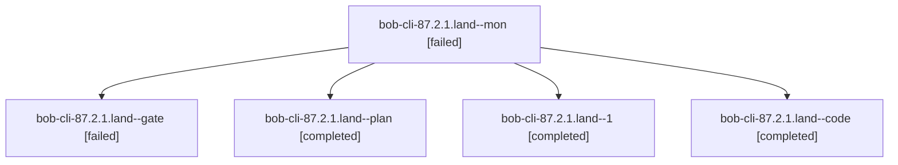

# Session: bob-cli-87.2.1.land

[Agent Hoods](../README.md) / [bbugyi200](../users/bbugyi200/README.md) / [athena](../users/bbugyi200/machines/athena/README.md) / [bob-cli-87](../users/bbugyi200/machines/athena/hoods/bob-cli-87/README.md) / bob-cli-87.2.1.land

Owner: `bbugyi200.athena` · Hood: `bob-cli-87` · Members: 5 · Bead: [bob-cli-87.2.1](https://github.com/bobs-org/bob-cli--beads/blob/main/pages/bob-cli-87/bob-cli-87.2.1.md)

## Lineage



The diagram is an optional enhancement; the ordered table below contains the same lineage in accessible text.

| Role | Agent | State | Model / provider | Timing | Commits | Prompt | Chat |
|---|---|---|---|---|---:|---|---|
| <a id="member-mon"></a>mon | bob-cli-87.2.1.land--mon | failed | gpt-6-luna / codex | 2026-10-16T15:20:50.978922+00:00 → 2026-10-16T15:23:14.633018+00:00 | 0 | — | [Chat](../agents/bbugyi200.athena.bob-cli-87.2.1.land--mon/chat.md) |
| <a id="member-gate"></a>gate | bob-cli-87.2.1.land--gate | failed | gpt-6-astra / codex | 2026-10-16T14:53:16.328461+00:00 → 2026-10-16T14:53:45.048558+00:00 | 0 | — | [Chat](../agents/bbugyi200.athena.bob-cli-87.2.1.land--gate/chat.md) |
| <a id="member-plan"></a>plan | bob-cli-87.2.1.land--plan | completed | gpt-6-astra / codex | 2026-10-16T14:35:00.063125+00:00 → 2026-10-16T15:21:36.229442+00:00 | 0 | [Prompt](../agents/bbugyi200.athena.bob-cli-87.2.1.land--plan/prompt.md) | [Chat](../agents/bbugyi200.athena.bob-cli-87.2.1.land--plan/chat.md) |
| <a id="member-1"></a>1 | bob-cli-87.2.1.land--1 | completed | gpt-6-luna / codex | 2026-10-16T15:24:03.344458+00:00 → 2026-10-16T15:35:52.982896+00:00 | [1](../agents/bbugyi200.athena.bob-cli-87.2.1.land--1/README.md#commits) | [Prompt](../agents/bbugyi200.athena.bob-cli-87.2.1.land--1/prompt.md) | [Chat](../agents/bbugyi200.athena.bob-cli-87.2.1.land--1/chat.md) |
| <a id="member-code"></a>code | bob-cli-87.2.1.land--code | completed | gpt-6-luna / codex | 2026-10-16T14:54:11.071743+00:00 → 2026-10-16T15:21:36.229442+00:00 | 0 | — | [Chat](../agents/bbugyi200.athena.bob-cli-87.2.1.land--code/chat.md) |

## Commits

| Role | Repo | Commit | Subject | Committed |
|---|---|---|---|---|
| 1 | bob-cli | [`71be24a`](https://github.com/bobs-org/bob-cli/commit/71be24aec573ff43d07235fdd4180b781af31d4e) | fix(snapshot): complete view landing repairs | 2026-10-16 11:29:38 EDT |

## Variables

| Role | Variable | Value |
|---|---|---|
| plan | `artifacts` | \[{bead: bob-cli-87.2.1, kind: file, label: bob-cli-87.2.1 landing metadata failure reproduction, path: /home/bryan/.sase/artifacts/agents/gh\_bobs-org\_\_bob-cli/20261016072719/bob-87-metadata-tests-55f… |

#### artifacts

**Role:** `plan`

```yaml
- bead: bob-cli-87.2.1
  kind: file
  label: bob-cli-87.2.1 landing metadata failure reproduction
  path: /home/bryan/.sase/artifacts/agents/gh_bobs-org__bob-cli/20261016072719/bob-87-metadata-tests-55fd94939113.log
  ref: file:explicit:28b089609636028ae170391f
  source_path: /tmp/bob-87-metadata-tests.log
- bead: bob-cli-87.2.1
  kind: markdown
  label: Snapshot landing audit and failing regression probes
  path: /home/bryan/.sase/artifacts/agents/gh_bobs-org__bob-cli/20261016072719/bob-87-landing-audit-7e85d19b9998.md
  ref: file:explicit:015da024c10eb8fd59ecb5fc
  source_path: /tmp/bob-87-landing-audit.md
```

Values are truncated for display; see each member's agent meta.json for the full values.

## Neighbors

| Agent | Relation | State |
|---|---|---|
| [bob-cli-87.2](bbugyi200.athena.bob-cli-87.2.md) (session · 3) | ancestor | failed 3 |
| [bob-cli-87.2.1.1](bbugyi200.athena.bob-cli-87.2.1.1.md) (session · 9) | bob-cli-87.2.1 hood | completed 5, failed 4 |
| [bob-cli-87.2.1.2](../agents/bbugyi200.athena.bob-cli-87.2.1.2/README.md) | bob-cli-87.2.1 hood | completed |
| [bob-cli-87.2.1.3](../agents/bbugyi200.athena.bob-cli-87.2.1.3/README.md) | bob-cli-87.2.1 hood | completed |
| [bob-cli-87.2.1.4](bbugyi200.athena.bob-cli-87.2.1.4.md) (session · 7) | bob-cli-87.2.1 hood | completed 4, failed 3 |
| [bob-cli-87.1](../agents/bbugyi200.athena.bob-cli-87.1/README.md) | bob-cli-87 hood | completed |
| [bob-cli-87.10](../agents/bbugyi200.athena.bob-cli-87.10/README.md) | bob-cli-87 hood | waiting |
| [bob-cli-87.11](../agents/bbugyi200.athena.bob-cli-87.11/README.md) | bob-cli-87 hood | waiting |
| [bob-cli-87.12](../agents/bbugyi200.athena.bob-cli-87.12/README.md) | bob-cli-87 hood | waiting |
| [bob-cli-87.3](bbugyi200.athena.bob-cli-87.3.md) (session · 3) | bob-cli-87 hood | failed 3 |
| [bob-cli-87.3.1.1](../agents/bbugyi200.athena.bob-cli-87.3.1.1/README.md) | bob-cli-87 hood | completed |
| [bob-cli-87.3.1.2](../agents/bbugyi200.athena.bob-cli-87.3.1.2/README.md) | bob-cli-87 hood | completed |
| [bob-cli-87.3.1.3](bbugyi200.athena.bob-cli-87.3.1.3.md) (session · 5) | bob-cli-87 hood | completed 3, failed 2 |
| [bob-cli-87.3.1.land](bbugyi200.athena.bob-cli-87.3.1.land.md) (session · 3) | bob-cli-87 hood | completed 2, failed 1 |
| [bob-cli-87.4](bbugyi200.athena.bob-cli-87.4.md) (session · 3) | bob-cli-87 hood | completed 2, failed 1 |
| [bob-cli-87.5](bbugyi200.athena.bob-cli-87.5.md) (session · 7) | bob-cli-87 hood | active 1, completed 3, failed 3 |
| [bob-cli-87.6](../agents/bbugyi200.athena.bob-cli-87.6/README.md) | bob-cli-87 hood | waiting |
| [bob-cli-87.7](../agents/bbugyi200.athena.bob-cli-87.7/README.md) | bob-cli-87 hood | waiting |
| [bob-cli-87.8](../agents/bbugyi200.athena.bob-cli-87.8/README.md) | bob-cli-87 hood | waiting |
| [bob-cli-87.9](../agents/bbugyi200.athena.bob-cli-87.9/README.md) | bob-cli-87 hood | completed |
| [bob-cli-87.land](../agents/bbugyi200.athena.bob-cli-87.land/README.md) | bob-cli-87 hood | waiting |
