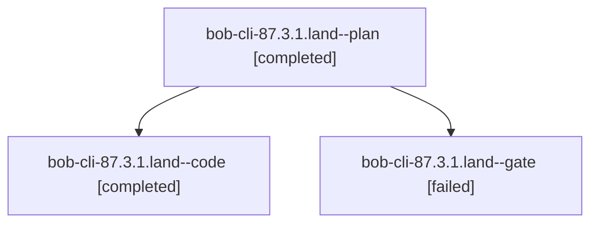

# Session: bob-cli-87.3.1.land

[Agent Hoods](../README.md) / [bbugyi200](../users/bbugyi200/README.md) / [athena](../users/bbugyi200/machines/athena/README.md) / [bob-cli-87](../users/bbugyi200/machines/athena/hoods/bob-cli-87/README.md) / bob-cli-87.3.1.land

Owner: `bbugyi200.athena` · Hood: `bob-cli-87` · Members: 3 · Bead: [bob-cli-87.3.1](https://github.com/bobs-org/bob-cli--beads/blob/main/pages/bob-cli-87/bob-cli-87.3.1.md)

## Lineage



The diagram is an optional enhancement; the ordered table below contains the same lineage in accessible text.

| Role | Agent | State | Model / provider | Timing | Commits | Prompt | Chat |
|---|---|---|---|---|---:|---|---|
| <a id="member-plan"></a>plan | bob-cli-87.3.1.land--plan | completed | gpt-6-astra / codex | 2026-10-16T17:46:29.346123+00:00 → 2026-10-16T18:32:09.165024+00:00 | 0 | [Prompt](../agents/bbugyi200.athena.bob-cli-87.3.1.land--plan/prompt.md) | [Chat](../agents/bbugyi200.athena.bob-cli-87.3.1.land--plan/chat.md) |
| <a id="member-code"></a>code | bob-cli-87.3.1.land--code | completed | muse-spark-1.3-contributor / muse | 2026-10-16T18:01:58.195177+00:00 → 2026-10-16T18:32:09.165024+00:00 | [1](../agents/bbugyi200.athena.bob-cli-87.3.1.land--code/README.md#commits) | — | [Chat](../agents/bbugyi200.athena.bob-cli-87.3.1.land--code/chat.md) |
| <a id="member-gate"></a>gate | bob-cli-87.3.1.land--gate | failed | gpt-6-astra / codex | 2026-10-16T18:00:51.579270+00:00 → 2026-10-16T18:01:23.104361+00:00 | 0 | — | [Chat](../agents/bbugyi200.athena.bob-cli-87.3.1.land--gate/chat.md) |

## Commits

| Role | Repo | Commit | Subject | Committed |
|---|---|---|---|---|
| code | bob-cli | [`16c4640`](https://github.com/bobs-org/bob-cli/commit/16c4640a6135e193de504b83532b12ad1a933d00) | fix(snapshot): finish Bob projection landing repairs | 2026-10-16 14:29:15 EDT |

## Variables

| Role | Variable | Value |
|---|---|---|
| plan | `artifacts` | \[{bead: bob-cli-87.3.1, kind: markdown, label: Bob snapshot landing: seven failing synthetic probes and baseline checks, path: /home/bryan/.sase/artifacts/agents/gh\_bobs-org\_\_bob-cli/20261016114713/b… |

#### artifacts

**Role:** `plan`

```yaml
- bead: bob-cli-87.3.1
  kind: markdown
  label: Bob snapshot landing: seven failing synthetic probes and baseline checks
  path: /home/bryan/.sase/artifacts/agents/gh_bobs-org__bob-cli/20261016114713/bob_snapshot_landing_audit-2a24e482b412.md
  ref: file:explicit:d0d45785d14fd9cc8f6cbfc1
  source_path: /home/bryan/.local/state/sase/workspaces/bobs-org/bob-cli/bob-cli_11/.git/bob_snapshot_landing_audit.md
```

Values are truncated for display; see each member's agent meta.json for the full values.

## Neighbors

| Agent | Relation | State |
|---|---|---|
| [bob-cli-87.3](bbugyi200.athena.bob-cli-87.3.md) (session · 3) | ancestor | failed 3 |
| [bob-cli-87.3.1.1](../agents/bbugyi200.athena.bob-cli-87.3.1.1/README.md) | bob-cli-87.3.1 hood | completed |
| [bob-cli-87.3.1.2](../agents/bbugyi200.athena.bob-cli-87.3.1.2/README.md) | bob-cli-87.3.1 hood | completed |
| [bob-cli-87.3.1.3](bbugyi200.athena.bob-cli-87.3.1.3.md) (session · 5) | bob-cli-87.3.1 hood | completed 3, failed 2 |
| [bob-cli-87.1](../agents/bbugyi200.athena.bob-cli-87.1/README.md) | bob-cli-87 hood | completed |
| [bob-cli-87.10](../agents/bbugyi200.athena.bob-cli-87.10/README.md) | bob-cli-87 hood | waiting |
| [bob-cli-87.11](../agents/bbugyi200.athena.bob-cli-87.11/README.md) | bob-cli-87 hood | waiting |
| [bob-cli-87.12](../agents/bbugyi200.athena.bob-cli-87.12/README.md) | bob-cli-87 hood | waiting |
| [bob-cli-87.2](bbugyi200.athena.bob-cli-87.2.md) (session · 3) | bob-cli-87 hood | failed 3 |
| [bob-cli-87.2.1.1](bbugyi200.athena.bob-cli-87.2.1.1.md) (session · 9) | bob-cli-87 hood | completed 5, failed 4 |
| [bob-cli-87.2.1.2](../agents/bbugyi200.athena.bob-cli-87.2.1.2/README.md) | bob-cli-87 hood | completed |
| [bob-cli-87.2.1.3](../agents/bbugyi200.athena.bob-cli-87.2.1.3/README.md) | bob-cli-87 hood | completed |
| [bob-cli-87.2.1.4](bbugyi200.athena.bob-cli-87.2.1.4.md) (session · 7) | bob-cli-87 hood | completed 4, failed 3 |
| [bob-cli-87.2.1.land](bbugyi200.athena.bob-cli-87.2.1.land.md) (session · 5) | bob-cli-87 hood | completed 3, failed 2 |
| [bob-cli-87.4](bbugyi200.athena.bob-cli-87.4.md) (session · 3) | bob-cli-87 hood | completed 2, failed 1 |
| [bob-cli-87.5](bbugyi200.athena.bob-cli-87.5.md) (session · 7) | bob-cli-87 hood | active 1, completed 3, failed 3 |
| [bob-cli-87.6](../agents/bbugyi200.athena.bob-cli-87.6/README.md) | bob-cli-87 hood | waiting |
| [bob-cli-87.7](../agents/bbugyi200.athena.bob-cli-87.7/README.md) | bob-cli-87 hood | waiting |
| [bob-cli-87.8](../agents/bbugyi200.athena.bob-cli-87.8/README.md) | bob-cli-87 hood | waiting |
| [bob-cli-87.9](../agents/bbugyi200.athena.bob-cli-87.9/README.md) | bob-cli-87 hood | completed |
| [bob-cli-87.land](../agents/bbugyi200.athena.bob-cli-87.land/README.md) | bob-cli-87 hood | waiting |
