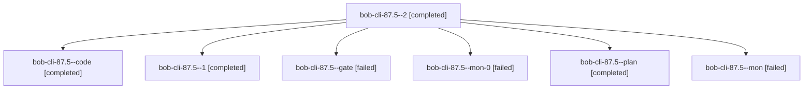

# Session: bob-cli-87.5

[Agent Hoods](../README.md) / [bbugyi200](../users/bbugyi200/README.md) / [athena](../users/bbugyi200/machines/athena/README.md) / [bob-cli-87](../users/bbugyi200/machines/athena/hoods/bob-cli-87/README.md) / bob-cli-87.5

Owner: `bbugyi200.athena` · Hood: `bob-cli-87` · Members: 7 · Bead: [bob-cli-87.5](https://github.com/bobs-org/bob-cli--beads/blob/main/pages/bob-cli-87/bob-cli-87.5.md)

## Lineage

The diagram is an optional enhancement; the ordered table below contains the same lineage in accessible text.

| Role | Agent | State | Model / provider | Timing | Commits | Prompt | Chat |
|---|---|---|---|---|---:|---|---|
| 2 | bob-cli-87.5--2 | completed | gpt-6-luna / codex | 2026-10-16T19:35:54.144605+00:00 → 2026-10-16T19:42:16.887375+00:00 | [1](../agents/bbugyi200.athena.bob-cli-87.5--2/README.md#commits) | [Prompt](../agents/bbugyi200.athena.bob-cli-87.5--2/prompt.md) | [Chat](../agents/bbugyi200.athena.bob-cli-87.5--2/chat.md) |
| code | bob-cli-87.5--code | completed | gpt-6-luna / codex | 2026-10-16T18:38:08.717907+00:00 → 2026-10-16T19:18:09.282358+00:00 | 0 | — | [Chat](../agents/bbugyi200.athena.bob-cli-87.5--code/chat.md) |
| 1 | bob-cli-87.5--1 | completed | gpt-6-luna / codex | 2026-10-16T19:22:50.238432+00:00 → 2026-10-16T19:31:43.097825+00:00 | 0 | [Prompt](../agents/bbugyi200.athena.bob-cli-87.5--1/prompt.md) | [Chat](../agents/bbugyi200.athena.bob-cli-87.5--1/chat.md) |
| gate | bob-cli-87.5--gate | failed | gpt-6-astra / codex | 2026-10-16T18:37:06.420922+00:00 → 2026-10-16T18:37:35.200442+00:00 | 0 | — | [Chat](../agents/bbugyi200.athena.bob-cli-87.5--gate/chat.md) |
| mon-0 | bob-cli-87.5--mon-0 | failed | gpt-6-luna / codex | 2026-10-16T19:30:54.558888+00:00 → 2026-10-16T19:35:05.137388+00:00 | 0 | — | [Chat](../agents/bbugyi200.athena.bob-cli-87.5--mon-0/chat.md) |
| plan | bob-cli-87.5--plan | completed | gpt-6-astra / codex | 2026-10-16T18:28:29.144124+00:00 → 2026-10-16T19:18:09.282358+00:00 | 0 | [Prompt](../agents/bbugyi200.athena.bob-cli-87.5--plan/prompt.md) | [Chat](../agents/bbugyi200.athena.bob-cli-87.5--plan/chat.md) |
| mon | bob-cli-87.5--mon | failed | gpt-6-luna / codex | 2026-10-16T19:15:32.795111+00:00 → 2026-10-16T19:21:36.212779+00:00 | 0 | — | [Chat](../agents/bbugyi200.athena.bob-cli-87.5--mon/chat.md) |

## Commits

| Role | Repo | Commit | Subject | Committed |
|---|---|---|---|---|
| 2 | bob-cli | [`07fef5f`](https://github.com/bobs-org/bob-cli/commit/07fef5f02c9a572b02ea1a9d7bb1a4f265a2b6eb) | feat(ref): wire note snapshot creation | 2026-10-16 15:40:04 EDT |

## Neighbors

| Agent | Relation | State |
|---|---|---|
| [bob-cli-87.1](../agents/bbugyi200.athena.bob-cli-87.1/README.md) | bob-cli-87 hood | completed |
| [bob-cli-87.10](../agents/bbugyi200.athena.bob-cli-87.10/README.md) | bob-cli-87 hood | active |
| [bob-cli-87.11](../agents/bbugyi200.athena.bob-cli-87.11/README.md) | bob-cli-87 hood | waiting |
| [bob-cli-87.12](../agents/bbugyi200.athena.bob-cli-87.12/README.md) | bob-cli-87 hood | waiting |
| [bob-cli-87.2](bbugyi200.athena.bob-cli-87.2.md) (session · 3) | bob-cli-87 hood | failed 3 |
| [bob-cli-87.2.1.1](bbugyi200.athena.bob-cli-87.2.1.1.md) (session · 9) | bob-cli-87 hood | completed 5, failed 4 |
| [bob-cli-87.2.1.2](../agents/bbugyi200.athena.bob-cli-87.2.1.2/README.md) | bob-cli-87 hood | completed |
| [bob-cli-87.2.1.3](../agents/bbugyi200.athena.bob-cli-87.2.1.3/README.md) | bob-cli-87 hood | completed |
| [bob-cli-87.2.1.4](bbugyi200.athena.bob-cli-87.2.1.4.md) (session · 7) | bob-cli-87 hood | completed 4, failed 3 |
| [bob-cli-87.2.1.land](bbugyi200.athena.bob-cli-87.2.1.land.md) (session · 5) | bob-cli-87 hood | completed 3, failed 2 |
| [bob-cli-87.3](bbugyi200.athena.bob-cli-87.3.md) (session · 3) | bob-cli-87 hood | failed 3 |
| [bob-cli-87.3.1.1](../agents/bbugyi200.athena.bob-cli-87.3.1.1/README.md) | bob-cli-87 hood | completed |
| [bob-cli-87.3.1.2](../agents/bbugyi200.athena.bob-cli-87.3.1.2/README.md) | bob-cli-87 hood | completed |
| [bob-cli-87.3.1.3](bbugyi200.athena.bob-cli-87.3.1.3.md) (session · 5) | bob-cli-87 hood | completed 3, failed 2 |
| [bob-cli-87.3.1.land](bbugyi200.athena.bob-cli-87.3.1.land.md) (session · 3) | bob-cli-87 hood | completed 2, failed 1 |
| [bob-cli-87.4](bbugyi200.athena.bob-cli-87.4.md) (session · 3) | bob-cli-87 hood | completed 2, failed 1 |
| [bob-cli-87.6](../agents/bbugyi200.athena.bob-cli-87.6/README.md) | bob-cli-87 hood | active |
| [bob-cli-87.7](../agents/bbugyi200.athena.bob-cli-87.7/README.md) | bob-cli-87 hood | active |
| [bob-cli-87.8](../agents/bbugyi200.athena.bob-cli-87.8/README.md) | bob-cli-87 hood | active |
| [bob-cli-87.9](../agents/bbugyi200.athena.bob-cli-87.9/README.md) | bob-cli-87 hood | completed |
| [bob-cli-87.land](../agents/bbugyi200.athena.bob-cli-87.land/README.md) | bob-cli-87 hood | waiting |
