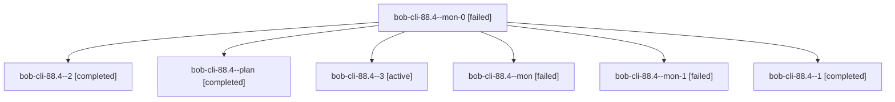

# Session: bob-cli-88.4

[Agent Hoods](../README.md) / [bbugyi200](../users/bbugyi200/README.md) / [athena](../users/bbugyi200/machines/athena/README.md) / [bob-cli-88](../users/bbugyi200/machines/athena/hoods/bob-cli-88/README.md) / bob-cli-88.4

Owner: `bbugyi200.athena` · Hood: `bob-cli-88` · Members: 7 · Bead: [bob-cli-88.4](https://github.com/bobs-org/bob-cli--beads/blob/main/pages/bob-cli-88/bob-cli-88.4.md)

## Lineage

The diagram is an optional enhancement; the ordered table below contains the same lineage in accessible text.

| Role | Agent | State | Model / provider | Timing | Commits | Prompt | Chat |
|---|---|---|---|---|---:|---|---|
| mon-0 | bob-cli-88.4--mon-0 | failed | gpt-6-luna / codex | 2026-10-16T12:35:46.675172+00:00 → 2026-10-16T12:39:44.553993+00:00 | 0 | — | [Chat](../agents/bbugyi200.athena.bob-cli-88.4--mon-0/chat.md) |
| 2 | bob-cli-88.4--2 | completed | gpt-6-luna / codex | 2026-10-16T12:39:44.363961+00:00 → 2026-10-16T12:46:20.029920+00:00 | 0 | [Prompt](../agents/bbugyi200.athena.bob-cli-88.4--2/prompt.md) | [Chat](../agents/bbugyi200.athena.bob-cli-88.4--2/chat.md) |
| plan | bob-cli-88.4--plan | completed | gpt-6-luna / codex | 2026-10-16T12:17:02.209024+00:00 → 2026-10-16T12:25:00.828733+00:00 | 0 | [Prompt](../agents/bbugyi200.athena.bob-cli-88.4--plan/prompt.md) | [Chat](../agents/bbugyi200.athena.bob-cli-88.4--plan/chat.md) |
| 3 | bob-cli-88.4--3 | active | gpt-6-luna / codex | 2026-10-16T12:50:34.639426+00:00 | [1](../agents/bbugyi200.athena.bob-cli-88.4--3/README.md#commits) | [Prompt](../agents/bbugyi200.athena.bob-cli-88.4--3/prompt.md) | — |
| mon | bob-cli-88.4--mon | failed | gpt-6-luna / codex | 2026-10-16T12:24:25.875074+00:00 → 2026-10-16T12:26:27.773590+00:00 | 0 | — | [Chat](../agents/bbugyi200.athena.bob-cli-88.4--mon/chat.md) |
| mon-1 | bob-cli-88.4--mon-1 | failed | gpt-6-luna / codex | 2026-10-16T12:45:04.960433+00:00 → 2026-10-16T12:50:00.052432+00:00 | 0 | — | [Chat](../agents/bbugyi200.athena.bob-cli-88.4--mon-1/chat.md) |
| 1 | bob-cli-88.4--1 | completed | gpt-6-luna / codex | 2026-10-16T12:27:11.553399+00:00 → 2026-10-16T12:38:36.705747+00:00 | 0 | [Prompt](../agents/bbugyi200.athena.bob-cli-88.4--1/prompt.md) | [Chat](../agents/bbugyi200.athena.bob-cli-88.4--1/chat.md) |

## Commits

| Role | Repo | Commit | Subject | Committed |
|---|---|---|---|---|
| 3 | bob-cli | [`298ebdf`](https://github.com/bobs-org/bob-cli/commit/298ebdf41b05000189bba7d5af8e64a1a717685e) | docs(task-cleanup): document emptied entry cleanup | 2026-10-16 08:56:10 EDT |

## Neighbors

| Agent | Relation | State |
|---|---|---|
| [bob-cli-88.1](../agents/bbugyi200.athena.bob-cli-88.1/README.md) | bob-cli-88 hood | completed |
| [bob-cli-88.2](../agents/bbugyi200.athena.bob-cli-88.2/README.md) | bob-cli-88 hood | completed |
| [bob-cli-88.3](../agents/bbugyi200.athena.bob-cli-88.3/README.md) | bob-cli-88 hood | completed |
| [bob-cli-88.land](../agents/bbugyi200.athena.bob-cli-88.land/README.md) | bob-cli-88 hood | waiting |
