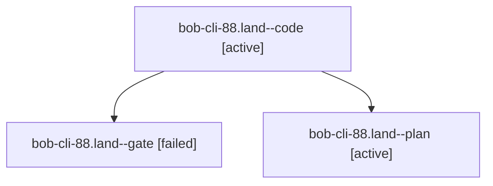

# Session: bob-cli-88.land

[Agent Hoods](../README.md) / [bbugyi200](../users/bbugyi200/README.md) / [athena](../users/bbugyi200/machines/athena/README.md) / [bob-cli-88](../users/bbugyi200/machines/athena/hoods/bob-cli-88/README.md) / bob-cli-88.land

Owner: `bbugyi200.athena` · Hood: `bob-cli-88` · Members: 3 · Bead: [bob-cli-88](https://github.com/bobs-org/bob-cli--beads/blob/main/pages/bob-cli-88/README.md)

## Lineage



The diagram is an optional enhancement; the ordered table below contains the same lineage in accessible text.

| Role | Agent | State | Model / provider | Timing | Commits | Prompt | Chat |
|---|---|---|---|---|---:|---|---|
| <a id="member-code"></a>code | bob-cli-88.land--code | active | muse-spark-1.3-contributor / muse | 2026-10-16T13:13:43.820089+00:00 | 0 | — | — |
| <a id="member-gate"></a>gate | bob-cli-88.land--gate | failed | gpt-6-astra / codex | 2026-10-16T13:12:51.451173+00:00 → 2026-10-16T13:13:17.741332+00:00 | 0 | — | [Chat](../agents/bbugyi200.athena.bob-cli-88.land--gate/chat.md) |
| <a id="member-plan"></a>plan | bob-cli-88.land--plan | active | gpt-6-astra / codex | 2026-10-16T12:58:18.008852+00:00 | 0 | [Prompt](../agents/bbugyi200.athena.bob-cli-88.land--plan/prompt.md) | [Chat](../agents/bbugyi200.athena.bob-cli-88.land--plan/chat.md) |

## Variables

| Role | Variable | Value |
|---|---|---|
| plan | `artifacts` | \[{bead: bob-cli-88, kind: file, label: bob-cli-88 landing: npm test on bob-plugins 86cebc9, 2846 pass and six known failures, path: /home/bryan/.sase/artifacts/agents/gh\_bobs-org\_\_bob-cli/20261016073… |

#### artifacts

**Role:** `plan`

```yaml
- bead: bob-cli-88
  kind: file
  label: bob-cli-88 landing: npm test on bob-plugins 86cebc9, 2846 pass and six known failures
  path: /home/bryan/.sase/artifacts/agents/gh_bobs-org__bob-cli/20261016073014/bob88-npm-test-3e120934043b.log
  ref: file:explicit:d2f93586f3a04ed5c17275e1
  source_path: /tmp/bob88-npm-test.log
```

Values are truncated for display; see each member's agent meta.json for the full values.

## Neighbors

| Agent | Relation | State |
|---|---|---|
| [bob-cli-88.1](../agents/bbugyi200.athena.bob-cli-88.1/README.md) | bob-cli-88 hood | completed |
| [bob-cli-88.2](../agents/bbugyi200.athena.bob-cli-88.2/README.md) | bob-cli-88 hood | completed |
| [bob-cli-88.3](../agents/bbugyi200.athena.bob-cli-88.3/README.md) | bob-cli-88 hood | completed |
| [bob-cli-88.4](bbugyi200.athena.bob-cli-88.4.md) (session · 7) | bob-cli-88 hood | completed 4, failed 3 |
