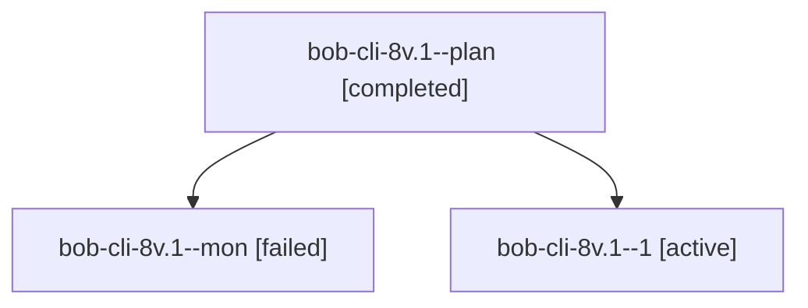

# Session: bob-cli-8v.1

[Agent Hoods](../README.md) / [bbugyi200](../users/bbugyi200/README.md) / [athena](../users/bbugyi200/machines/athena/README.md) / [bob-cli-8v](../users/bbugyi200/machines/athena/hoods/bob-cli-8v/README.md) / bob-cli-8v.1

Owner: `bbugyi200.athena` · Hood: `bob-cli-8v` · Members: 3 · Bead: [bob-cli-8v.1](https://github.com/bobs-org/bob-cli--beads/blob/main/pages/bob-cli-8v/bob-cli-8v.1.md)

## Lineage

The diagram is an optional enhancement; the ordered table below contains the same lineage in accessible text.

| Role | Agent | State | Model / provider | Timing | Commits | Prompt | Chat |
|---|---|---|---|---|---:|---|---|
| plan | bob-cli-8v.1--plan | completed | grok-4.6 / grok | 2026-10-17T19:13:24.327351+00:00 → 2026-10-17T19:28:19.370194+00:00 | 0 | [Prompt](../agents/bbugyi200.athena.bob-cli-8v.1--plan/prompt.md) | [Chat](../agents/bbugyi200.athena.bob-cli-8v.1--plan/chat.md) |
| mon | bob-cli-8v.1--mon | failed | grok-4.6 / grok | 2026-10-17T19:27:41.924285+00:00 → 2026-10-17T19:32:33.318080+00:00 | 0 | — | [Chat](../agents/bbugyi200.athena.bob-cli-8v.1--mon/chat.md) |
| 1 | bob-cli-8v.1--1 | active | grok-4.6 / grok | 2026-10-17T19:34:22.938914+00:00 | 0 | [Prompt](../agents/bbugyi200.athena.bob-cli-8v.1--1/prompt.md) | — |

## Neighbors

| Agent | Relation | State |
|---|---|---|
| [bob-cli-8v.2](bbugyi200.athena.bob-cli-8v.2.md) (session · 3) | bob-cli-8v hood | active 1, completed 1, failed 1 |
| [bob-cli-8v.land](../agents/bbugyi200.athena.bob-cli-8v.land/README.md) | bob-cli-8v hood | waiting |
