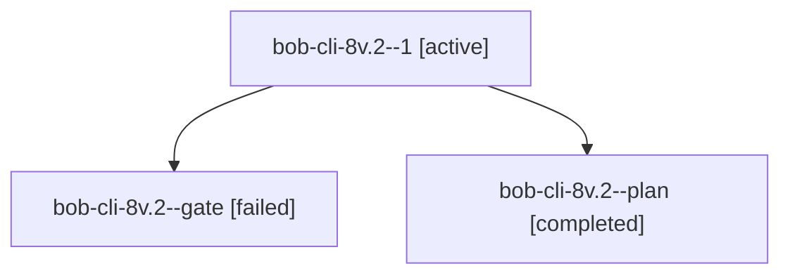

# Session: bob-cli-8v.2

[Agent Hoods](../README.md) / [bbugyi200](../users/bbugyi200/README.md) / [athena](../users/bbugyi200/machines/athena/README.md) / [bob-cli-8v](../users/bbugyi200/machines/athena/hoods/bob-cli-8v/README.md) / bob-cli-8v.2

Owner: `bbugyi200.athena` · Hood: `bob-cli-8v` · Members: 3 · Bead: [bob-cli-8v.2](https://github.com/bobs-org/bob-cli--beads/blob/main/pages/bob-cli-8v/bob-cli-8v.2.md)

## Lineage



The diagram is an optional enhancement; the ordered table below contains the same lineage in accessible text.

| Role | Agent | State | Model / provider | Timing | Commits | Prompt | Chat |
|---|---|---|---|---|---:|---|---|
| <a id="member-1"></a>1 | bob-cli-8v.2--1 | active | gpt-6-astra / codex | 2026-10-18T14:05:47.992564+00:00 | 0 | [Prompt](../agents/bbugyi200.athena.bob-cli-8v.2--1/prompt.md) | — |
| <a id="member-gate"></a>gate | bob-cli-8v.2--gate | failed | gpt-6-astra / codex | 2026-10-18T13:52:38.865494+00:00 → 2026-10-18T14:04:06.437518+00:00 | 0 | — | [Chat](../agents/bbugyi200.athena.bob-cli-8v.2--gate/chat.md) |
| <a id="member-plan"></a>plan | bob-cli-8v.2--plan | completed | gpt-6-astra / codex | 2026-10-18T13:39:33.905493+00:00 → 2026-10-18T13:53:13.364180+00:00 | 0 | [Prompt](../agents/bbugyi200.athena.bob-cli-8v.2--plan/prompt.md) | [Chat](../agents/bbugyi200.athena.bob-cli-8v.2--plan/chat.md) |

## Variables

| Role | Variable | Value |
|---|---|---|
| plan | `artifacts` | \[{bead: bob-cli-8v.2, kind: markdown, label: Athena Plex sandbox completion runbook staged 2026-10-18, path: /home/bryan/.sase/artifacts/agents/gh\_bobs-org\_\_bob-cli/20261018093845/README-9a195bf8f5ed… |

#### artifacts

**Role:** `plan`

```yaml
- bead: bob-cli-8v.2
  kind: markdown
  label: Athena Plex sandbox completion runbook staged 2026-10-18
  path: /home/bryan/.sase/artifacts/agents/gh_bobs-org__bob-cli/20261018093845/README-9a195bf8f5ed.md
  ref: file:explicit:3c305894aaf0e720ed2a65ee
  source_path: /home/bryan/.local/state/sase/workspaces/bobs-org/bob-cli/bob-cli_10/sase/repos/external/projects/tailnet/athena/README.md
- bead: bob-cli-8v.2
  kind: markdown
  label: Athena Plex sandbox validation evidence and N/A acceptance 2026-10-18
  path: /home/bryan/.sase/artifacts/agents/gh_bobs-org__bob-cli/20261018093845/plex-sandbox-validation-7358a179b525.md
  ref: file:explicit:e3e34178de2975395e88b160
  source_path: /home/bryan/.local/state/sase/workspaces/bobs-org/bob-cli/bob-cli_10/sase/repos/external/projects/tailnet/athena/plex-sandbox-validation.md
- bead: bob-cli-8v.2
  kind: file
  label: Exact installed Athena Plex hardening.conf 2026-10-18
  path: /home/bryan/.sase/artifacts/agents/gh_bobs-org__bob-cli/20261018093845/hardening-b4ea3c45174f.conf
  ref: file:explicit:cc18c67f8a7081fd1c6f1155
  source_path: /home/bryan/.local/state/sase/workspaces/bobs-org/bob-cli/bob-cli_10/sase/repos/external/projects/tailnet/athena/etc/systemd/system/plexmediaserver.service.d/hardening.conf
```

Values are truncated for display; see each member's agent meta.json for the full values.

## Neighbors

| Agent | Relation | State |
|---|---|---|
| [bob-cli-8v.1](bbugyi200.athena.bob-cli-8v.1.md) (session · 3) | bob-cli-8v hood | completed 2, failed 1 |
| [bob-cli-8v.land](../agents/bbugyi200.athena.bob-cli-8v.land/README.md) | bob-cli-8v hood | waiting |
