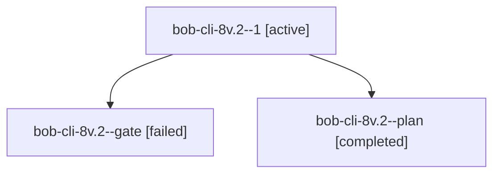

# Session: bob-cli-8v.2

[Agent Hoods](../README.md) / [bbugyi200](../users/bbugyi200/README.md) / [athena](../users/bbugyi200/machines/athena/README.md) / [bob-cli-8v](../users/bbugyi200/machines/athena/hoods/bob-cli-8v/README.md) / bob-cli-8v.2

Owner: `bbugyi200.athena` · Hood: `bob-cli-8v` · Members: 3 · Bead: [bob-cli-8v.2](https://github.com/bobs-org/bob-cli--beads/blob/main/pages/bob-cli-8v/bob-cli-8v.2.md)

## Lineage

The diagram is an optional enhancement; the ordered table below contains the same lineage in accessible text.

| Role | Agent | State | Model / provider | Timing | Commits | Prompt | Chat |
|---|---|---|---|---|---:|---|---|
| 1 | bob-cli-8v.2--1 | active | gpt-6-luna / codex | 2026-10-17T19:35:10.251144+00:00 | 0 | [Prompt](../agents/bbugyi200.athena.bob-cli-8v.2--1/prompt.md) | — |
| gate | bob-cli-8v.2--gate | failed | gpt-6-luna / codex | 2026-10-17T19:20:27.702663+00:00 → 2026-10-17T19:32:22.557964+00:00 | 0 | — | [Chat](../agents/bbugyi200.athena.bob-cli-8v.2--gate/chat.md) |
| plan | bob-cli-8v.2--plan | completed | gpt-6-luna / codex | 2026-10-17T19:12:21.322206+00:00 → 2026-10-17T19:21:09.539473+00:00 | 0 | [Prompt](../agents/bbugyi200.athena.bob-cli-8v.2--plan/prompt.md) | [Chat](../agents/bbugyi200.athena.bob-cli-8v.2--plan/chat.md) |

## Neighbors

| Agent | Relation | State |
|---|---|---|
| [bob-cli-8v.1](bbugyi200.athena.bob-cli-8v.1.md) (session · 3) | bob-cli-8v hood | active 1, completed 1, failed 1 |
| [bob-cli-8v.land](../agents/bbugyi200.athena.bob-cli-8v.land/README.md) | bob-cli-8v hood | waiting |
