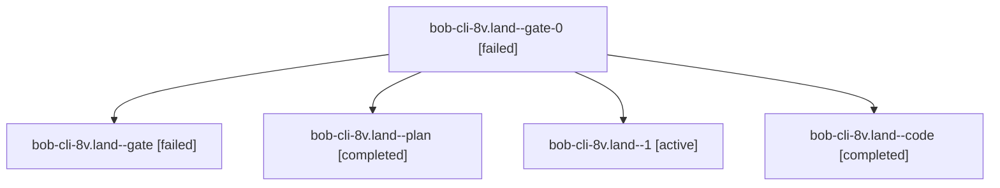

# Session: bob-cli-8v.land

[Agent Hoods](../README.md) / [bbugyi200](../users/bbugyi200/README.md) / [athena](../users/bbugyi200/machines/athena/README.md) / [bob-cli-8v](../users/bbugyi200/machines/athena/hoods/bob-cli-8v/README.md) / bob-cli-8v.land

Owner: `bbugyi200.athena` · Hood: `bob-cli-8v` · Members: 5 · Bead: [bob-cli-8v](https://github.com/bobs-org/bob-cli--beads/blob/main/pages/bob-cli-8v/README.md)

## Lineage

The diagram is an optional enhancement; the ordered table below contains the same lineage in accessible text.

| Role | Agent | State | Model / provider | Timing | Commits | Prompt | Chat |
|---|---|---|---|---|---:|---|---|
| gate-0 | bob-cli-8v.land--gate-0 | failed | sonnet / claude | 2026-10-18T14:39:59.233178+00:00 → 2026-10-18T14:42:19.662869+00:00 | 0 | — | [Chat](../agents/bbugyi200.athena.bob-cli-8v.land--gate-0/chat.md) |
| gate | bob-cli-8v.land--gate | failed | gpt-6-astra / codex | 2026-10-18T14:28:34.947525+00:00 → 2026-10-18T14:29:03.251656+00:00 | 0 | — | [Chat](../agents/bbugyi200.athena.bob-cli-8v.land--gate/chat.md) |
| plan | bob-cli-8v.land--plan | completed | gpt-6-astra / codex | 2026-10-18T14:14:55.147306+00:00 → 2026-10-18T14:40:46.867789+00:00 | 0 | [Prompt](../agents/bbugyi200.athena.bob-cli-8v.land--plan/prompt.md) | [Chat](../agents/bbugyi200.athena.bob-cli-8v.land--plan/chat.md) |
| 1 | bob-cli-8v.land--1 | active | sonnet / claude | 2026-10-18T14:43:29.491632+00:00 | 0 | [Prompt](../agents/bbugyi200.athena.bob-cli-8v.land--1/prompt.md) | — |
| code | bob-cli-8v.land--code | completed | sonnet / claude | 2026-10-18T14:29:33.252222+00:00 → 2026-10-18T14:40:46.867789+00:00 | 0 | — | [Chat](../agents/bbugyi200.athena.bob-cli-8v.land--code/chat.md) |

## Neighbors

| Agent | Relation | State |
|---|---|---|
| [bob-cli-8v.1](bbugyi200.athena.bob-cli-8v.1.md) (session · 3) | bob-cli-8v hood | completed 2, failed 1 |
| [bob-cli-8v.2](bbugyi200.athena.bob-cli-8v.2.md) (session · 3) | bob-cli-8v hood | completed 2, failed 1 |
