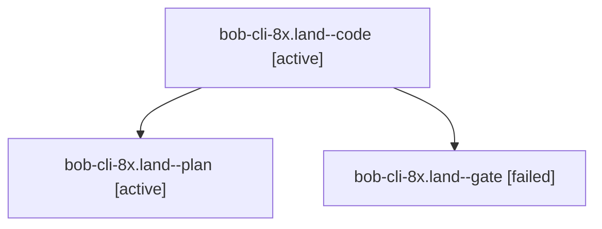

# Session: bob-cli-8x.land

[Agent Hoods](../README.md) / [bbugyi200](../users/bbugyi200/README.md) / [athena](../users/bbugyi200/machines/athena/README.md) / [bob-cli-8x](../users/bbugyi200/machines/athena/hoods/bob-cli-8x/README.md) / bob-cli-8x.land

Owner: `bbugyi200.athena` · Hood: `bob-cli-8x` · Members: 3 · Bead: [bob-cli-8x](https://github.com/bobs-org/bob-cli--beads/blob/main/pages/bob-cli-8x/README.md)

## Lineage

The diagram is an optional enhancement; the ordered table below contains the same lineage in accessible text.

| Role | Agent | State | Model / provider | Timing | Commits | Prompt | Chat |
|---|---|---|---|---|---:|---|---|
| code | bob-cli-8x.land--code | active | sonnet / claude | 2026-10-18T00:46:35.609100+00:00 | 0 | — | — |
| plan | bob-cli-8x.land--plan | active | opus / claude | 2026-10-18T00:12:59.742927+00:00 | 0 | [Prompt](../agents/bbugyi200.athena.bob-cli-8x.land--plan/prompt.md) | [Chat](../agents/bbugyi200.athena.bob-cli-8x.land--plan/chat.md) |
| gate | bob-cli-8x.land--gate | failed | opus / claude | 2026-10-18T00:44:54.063436+00:00 → 2026-10-18T00:46:12.652949+00:00 | 0 | — | [Chat](../agents/bbugyi200.athena.bob-cli-8x.land--gate/chat.md) |

## Neighbors

| Agent | Relation | State |
|---|---|---|
| [bob-cli-8x.1](../agents/bbugyi200.athena.bob-cli-8x.1/README.md) | bob-cli-8x hood | completed |
| [bob-cli-8x.2](../agents/bbugyi200.athena.bob-cli-8x.2/README.md) | bob-cli-8x hood | completed |
| [bob-cli-8x.3](../agents/bbugyi200.athena.bob-cli-8x.3/README.md) | bob-cli-8x hood | completed |
| [bob-cli-8x.4](../agents/bbugyi200.athena.bob-cli-8x.4/README.md) | bob-cli-8x hood | completed |
| [bob-cli-8x.5](../agents/bbugyi200.athena.bob-cli-8x.5/README.md) | bob-cli-8x hood | completed |
| [bob-cli-8x.6](../agents/bbugyi200.athena.bob-cli-8x.6/README.md) | bob-cli-8x hood | completed |
