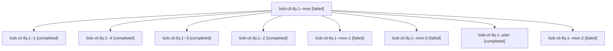

# Session: bob-cli-8y.1

[Agent Hoods](../README.md) / [bbugyi200](../users/bbugyi200/README.md) / [athena](../users/bbugyi200/machines/athena/README.md) / [bob-cli-8y](../users/bbugyi200/machines/athena/hoods/bob-cli-8y/README.md) / bob-cli-8y.1

Owner: `bbugyi200.athena` · Hood: `bob-cli-8y` · Members: 9 · Bead: [bob-cli-8y.1](https://github.com/bobs-org/bob-cli--beads/blob/main/pages/bob-cli-8y/bob-cli-8y.1.md)

## Lineage

The diagram is an optional enhancement; the ordered table below contains the same lineage in accessible text.

| Role | Agent | State | Model / provider | Timing | Commits | Prompt | Chat |
|---|---|---|---|---|---:|---|---|
| mon | bob-cli-8y.1--mon | failed | gpt-6-luna / codex | 2026-10-17T23:41:13.904120+00:00 → 2026-10-17T23:45:54.330438+00:00 | 0 | — | [Chat](../agents/bbugyi200.athena.bob-cli-8y.1--mon/chat.md) |
| 1 | bob-cli-8y.1--1 | completed | gpt-6-luna / codex | 2026-10-17T23:44:56.482345+00:00 → 2026-10-17T23:52:04.785731+00:00 | 0 | [Prompt](../agents/bbugyi200.athena.bob-cli-8y.1--1/prompt.md) | [Chat](../agents/bbugyi200.athena.bob-cli-8y.1--1/chat.md) |
| 4 | bob-cli-8y.1--4 | completed | gpt-6-luna / codex | 2026-10-18T00:25:23.170537+00:00 → 2026-10-18T00:36:29.510596+00:00 | [1](../agents/bbugyi200.athena.bob-cli-8y.1--4/README.md#commits) | [Prompt](../agents/bbugyi200.athena.bob-cli-8y.1--4/prompt.md) | [Chat](../agents/bbugyi200.athena.bob-cli-8y.1--4/chat.md) |
| 3 | bob-cli-8y.1--3 | completed | gpt-6-luna / codex | 2026-10-18T00:14:01.404819+00:00 → 2026-10-18T00:19:48.521567+00:00 | 0 | [Prompt](../agents/bbugyi200.athena.bob-cli-8y.1--3/prompt.md) | [Chat](../agents/bbugyi200.athena.bob-cli-8y.1--3/chat.md) |
| 2 | bob-cli-8y.1--2 | completed | gpt-6-luna / codex | 2026-10-17T23:55:51.303987+00:00 → 2026-10-18T00:10:57.024592+00:00 | 0 | [Prompt](../agents/bbugyi200.athena.bob-cli-8y.1--2/prompt.md) | [Chat](../agents/bbugyi200.athena.bob-cli-8y.1--2/chat.md) |
| mon-1 | bob-cli-8y.1--mon-1 | failed | gpt-6-luna / codex | 2026-10-18T00:00:50.998037+00:00 → 2026-10-18T00:12:12.274670+00:00 | 0 | — | [Chat](../agents/bbugyi200.athena.bob-cli-8y.1--mon-1/chat.md) |
| mon-0 | bob-cli-8y.1--mon-0 | failed | gpt-6-luna / codex | 2026-10-17T23:51:30.090886+00:00 → 2026-10-17T23:54:11.464673+00:00 | 0 | — | [Chat](../agents/bbugyi200.athena.bob-cli-8y.1--mon-0/chat.md) |
| plan | bob-cli-8y.1--plan | completed | gpt-6-luna / codex | 2026-10-17T23:33:02.479084+00:00 → 2026-10-17T23:42:00.818891+00:00 | 0 | [Prompt](../agents/bbugyi200.athena.bob-cli-8y.1--plan/prompt.md) | [Chat](../agents/bbugyi200.athena.bob-cli-8y.1--plan/chat.md) |
| mon-2 | bob-cli-8y.1--mon-2 | failed | gpt-6-luna / codex | 2026-10-18T00:18:54.345837+00:00 → 2026-10-18T00:23:47.696816+00:00 | 0 | — | [Chat](../agents/bbugyi200.athena.bob-cli-8y.1--mon-2/chat.md) |

## Commits

| Role | Repo | Commit | Subject | Committed |
|---|---|---|---|---|
| 4 | bob-cli | [`54670b4`](https://github.com/bobs-org/bob-cli/commit/54670b4535e3328f5ec1e54c574ff4e7ac8925de) | feat(web-clip): add offline Mermaid diagram rendering | 2026-10-17 20:34:41 EDT |

## Neighbors

| Agent | Relation | State |
|---|---|---|
| [bob-cli-8y.2](bbugyi200.athena.bob-cli-8y.2.md) (session · 5) | bob-cli-8y hood | active 1, completed 2, failed 2 |
| [bob-cli-8y.3](../agents/bbugyi200.athena.bob-cli-8y.3/README.md) | bob-cli-8y hood | waiting |
| [bob-cli-8y.4](../agents/bbugyi200.athena.bob-cli-8y.4/README.md) | bob-cli-8y hood | waiting |
| [bob-cli-8y.land](../agents/bbugyi200.athena.bob-cli-8y.land/README.md) | bob-cli-8y hood | waiting |
