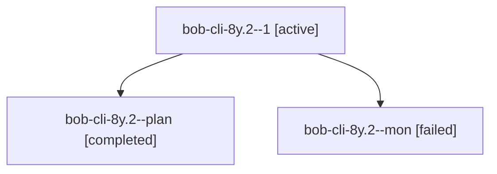

# Session: bob-cli-8y.2

[Agent Hoods](../README.md) / [bbugyi200](../users/bbugyi200/README.md) / [athena](../users/bbugyi200/machines/athena/README.md) / [bob-cli-8y](../users/bbugyi200/machines/athena/hoods/bob-cli-8y/README.md) / bob-cli-8y.2

Owner: `bbugyi200.athena` · Hood: `bob-cli-8y` · Members: 3 · Bead: [bob-cli-8y.2](https://github.com/bobs-org/bob-cli--beads/blob/main/pages/bob-cli-8y/bob-cli-8y.2.md)

## Lineage

The diagram is an optional enhancement; the ordered table below contains the same lineage in accessible text.

| Role | Agent | State | Model / provider | Timing | Commits | Prompt | Chat |
|---|---|---|---|---|---:|---|---|
| 1 | bob-cli-8y.2--1 | active | grok-4.6 / grok | 2026-10-18T00:02:11.311906+00:00 | 0 | [Prompt](../agents/bbugyi200.athena.bob-cli-8y.2--1/prompt.md) | — |
| plan | bob-cli-8y.2--plan | completed | grok-4.6 / grok | 2026-10-17T23:32:40.505820+00:00 → 2026-10-17T23:56:44.536480+00:00 | 0 | [Prompt](../agents/bbugyi200.athena.bob-cli-8y.2--plan/prompt.md) | [Chat](../agents/bbugyi200.athena.bob-cli-8y.2--plan/chat.md) |
| mon | bob-cli-8y.2--mon | failed | grok-4.6 / grok | 2026-10-17T23:56:15.136036+00:00 → 2026-10-18T00:00:27.411302+00:00 | 0 | — | [Chat](../agents/bbugyi200.athena.bob-cli-8y.2--mon/chat.md) |

## Neighbors

| Agent | Relation | State |
|---|---|---|
| [bob-cli-8y.1](bbugyi200.athena.bob-cli-8y.1.md) (session · 9) | bob-cli-8y hood | active 1, completed 4, failed 4 |
| [bob-cli-8y.3](../agents/bbugyi200.athena.bob-cli-8y.3/README.md) | bob-cli-8y hood | waiting |
| [bob-cli-8y.4](../agents/bbugyi200.athena.bob-cli-8y.4/README.md) | bob-cli-8y hood | waiting |
| [bob-cli-8y.land](../agents/bbugyi200.athena.bob-cli-8y.land/README.md) | bob-cli-8y hood | waiting |
