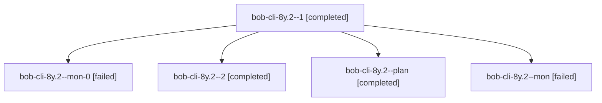

# Session: bob-cli-8y.2

[Agent Hoods](../README.md) / [bbugyi200](../users/bbugyi200/README.md) / [athena](../users/bbugyi200/machines/athena/README.md) / [bob-cli-8y](../users/bbugyi200/machines/athena/hoods/bob-cli-8y/README.md) / bob-cli-8y.2

Owner: `bbugyi200.athena` · Hood: `bob-cli-8y` · Members: 5 · Bead: [bob-cli-8y.2](https://github.com/bobs-org/bob-cli--beads/blob/main/pages/bob-cli-8y/bob-cli-8y.2.md)

## Lineage

The diagram is an optional enhancement; the ordered table below contains the same lineage in accessible text.

| Role | Agent | State | Model / provider | Timing | Commits | Prompt | Chat |
|---|---|---|---|---|---:|---|---|
| 1 | bob-cli-8y.2--1 | completed | grok-4.6 / grok | 2026-10-18T00:02:11.311906+00:00 → 2026-10-18T00:37:54.222805+00:00 | 0 | [Prompt](../agents/bbugyi200.athena.bob-cli-8y.2--1/prompt.md) | [Chat](../agents/bbugyi200.athena.bob-cli-8y.2--1/chat.md) |
| mon-0 | bob-cli-8y.2--mon-0 | failed | grok-4.6 / grok | 2026-10-18T00:37:23.963457+00:00 → 2026-10-18T00:42:12.560627+00:00 | 0 | — | [Chat](../agents/bbugyi200.athena.bob-cli-8y.2--mon-0/chat.md) |
| 2 | bob-cli-8y.2--2 | completed | grok-4.6 / grok | 2026-10-18T00:43:36.017925+00:00 → 2026-10-18T01:03:45.675603+00:00 | [1](../agents/bbugyi200.athena.bob-cli-8y.2--2/README.md#commits) | [Prompt](../agents/bbugyi200.athena.bob-cli-8y.2--2/prompt.md) | [Chat](../agents/bbugyi200.athena.bob-cli-8y.2--2/chat.md) |
| plan | bob-cli-8y.2--plan | completed | grok-4.6 / grok | 2026-10-17T23:32:40.505820+00:00 → 2026-10-17T23:56:44.536480+00:00 | 0 | [Prompt](../agents/bbugyi200.athena.bob-cli-8y.2--plan/prompt.md) | [Chat](../agents/bbugyi200.athena.bob-cli-8y.2--plan/chat.md) |
| mon | bob-cli-8y.2--mon | failed | grok-4.6 / grok | 2026-10-17T23:56:15.136036+00:00 → 2026-10-18T00:00:27.411302+00:00 | 0 | — | [Chat](../agents/bbugyi200.athena.bob-cli-8y.2--mon/chat.md) |

## Commits

| Role | Repo | Commit | Subject | Committed |
|---|---|---|---|---|
| 2 | bob-cli | [`ad036f9`](https://github.com/bobs-org/bob-cli/commit/ad036f9b530b0d735f0d1079e59e718233b437b8) | feat(highlights-ref): add mermaid diagram collect and swap filters | 2026-10-17 21:01:59 EDT |

## Neighbors

| Agent | Relation | State |
|---|---|---|
| [bob-cli-8y.1](bbugyi200.athena.bob-cli-8y.1.md) (session · 9) | bob-cli-8y hood | completed 5, failed 4 |
| [bob-cli-8y.3](bbugyi200.athena.bob-cli-8y.3.md) (session · 5) | bob-cli-8y hood | active 1, completed 2, failed 2 |
| [bob-cli-8y.4](../agents/bbugyi200.athena.bob-cli-8y.4/README.md) | bob-cli-8y hood | waiting |
| [bob-cli-8y.land](../agents/bbugyi200.athena.bob-cli-8y.land/README.md) | bob-cli-8y hood | waiting |
