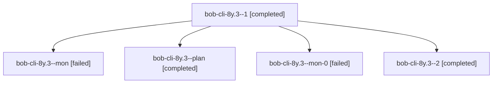

# Session: bob-cli-8y.3

[Agent Hoods](../README.md) / [bbugyi200](../users/bbugyi200/README.md) / [athena](../users/bbugyi200/machines/athena/README.md) / [bob-cli-8y](../users/bbugyi200/machines/athena/hoods/bob-cli-8y/README.md) / bob-cli-8y.3

Owner: `bbugyi200.athena` · Hood: `bob-cli-8y` · Members: 5 · Bead: [bob-cli-8y.3](https://github.com/bobs-org/bob-cli--beads/blob/main/pages/bob-cli-8y/bob-cli-8y.3.md)

## Lineage

The diagram is an optional enhancement; the ordered table below contains the same lineage in accessible text.

| Role | Agent | State | Model / provider | Timing | Commits | Prompt | Chat |
|---|---|---|---|---|---:|---|---|
| 1 | bob-cli-8y.3--1 | completed | grok-4.6 / grok | 2026-10-18T01:37:14.146344+00:00 → 2026-10-18T01:47:31.714791+00:00 | 0 | [Prompt](../agents/bbugyi200.athena.bob-cli-8y.3--1/prompt.md) | [Chat](../agents/bbugyi200.athena.bob-cli-8y.3--1/chat.md) |
| mon | bob-cli-8y.3--mon | failed | grok-4.6 / grok | 2026-10-18T01:32:08.269179+00:00 → 2026-10-18T01:37:29.863765+00:00 | 0 | — | [Chat](../agents/bbugyi200.athena.bob-cli-8y.3--mon/chat.md) |
| plan | bob-cli-8y.3--plan | completed | grok-4.6 / grok | 2026-10-18T01:05:11.751470+00:00 → 2026-10-18T01:33:00.134620+00:00 | 0 | [Prompt](../agents/bbugyi200.athena.bob-cli-8y.3--plan/prompt.md) | [Chat](../agents/bbugyi200.athena.bob-cli-8y.3--plan/chat.md) |
| mon-0 | bob-cli-8y.3--mon-0 | failed | grok-4.6 / grok | 2026-10-18T01:46:39.413250+00:00 → 2026-10-18T01:51:05.787783+00:00 | 0 | — | [Chat](../agents/bbugyi200.athena.bob-cli-8y.3--mon-0/chat.md) |
| 2 | bob-cli-8y.3--2 | completed | grok-4.6 / grok | 2026-10-18T01:52:43.772525+00:00 → 2026-10-18T01:57:32.511500+00:00 | [1](../agents/bbugyi200.athena.bob-cli-8y.3--2/README.md#commits) | [Prompt](../agents/bbugyi200.athena.bob-cli-8y.3--2/prompt.md) | [Chat](../agents/bbugyi200.athena.bob-cli-8y.3--2/chat.md) |

## Commits

| Role | Repo | Commit | Subject | Committed |
|---|---|---|---|---|
| 2 | bob-cli | [`58c9614`](https://github.com/bobs-org/bob-cli/commit/58c9614401350666609e9dbc67d5b95f8aa5b0d9) | feat(highlights-ref): render mermaid diagrams through the clip adapter | 2026-10-17 21:56:04 EDT |

## Neighbors

| Agent | Relation | State |
|---|---|---|
| [bob-cli-8y.1](bbugyi200.athena.bob-cli-8y.1.md) (session · 9) | bob-cli-8y hood | completed 5, failed 4 |
| [bob-cli-8y.2](bbugyi200.athena.bob-cli-8y.2.md) (session · 5) | bob-cli-8y hood | completed 3, failed 2 |
| [bob-cli-8y.4](../agents/bbugyi200.athena.bob-cli-8y.4/README.md) | bob-cli-8y hood | active |
| [bob-cli-8y.land](../agents/bbugyi200.athena.bob-cli-8y.land/README.md) | bob-cli-8y hood | waiting |
