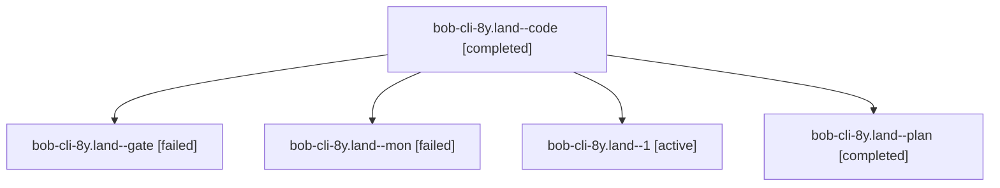

# Session: bob-cli-8y.land

[Agent Hoods](../README.md) / [bbugyi200](../users/bbugyi200/README.md) / [athena](../users/bbugyi200/machines/athena/README.md) / [bob-cli-8y](../users/bbugyi200/machines/athena/hoods/bob-cli-8y/README.md) / bob-cli-8y.land

Owner: `bbugyi200.athena` · Hood: `bob-cli-8y` · Members: 5 · Bead: [bob-cli-8y](https://github.com/bobs-org/bob-cli--beads/blob/main/pages/bob-cli-8y/README.md)

## Lineage

The diagram is an optional enhancement; the ordered table below contains the same lineage in accessible text.

| Role | Agent | State | Model / provider | Timing | Commits | Prompt | Chat |
|---|---|---|---|---|---:|---|---|
| code | bob-cli-8y.land--code | completed | gpt-6-luna / codex | 2026-10-18T02:36:48.321539+00:00 → 2026-10-18T02:48:40.552094+00:00 | 0 | — | [Chat](../agents/bbugyi200.athena.bob-cli-8y.land--code/chat.md) |
| gate | bob-cli-8y.land--gate | failed | gpt-6-astra / codex | 2026-10-18T02:35:12.089202+00:00 → 2026-10-18T02:36:24.403216+00:00 | 0 | — | [Chat](../agents/bbugyi200.athena.bob-cli-8y.land--gate/chat.md) |
| mon | bob-cli-8y.land--mon | failed | gpt-6-luna / codex | 2026-10-18T02:47:48.129012+00:00 → 2026-10-18T02:52:51.747696+00:00 | 0 | — | [Chat](../agents/bbugyi200.athena.bob-cli-8y.land--mon/chat.md) |
| 1 | bob-cli-8y.land--1 | active | gpt-6-luna / codex | 2026-10-18T02:54:35.917186+00:00 | [1](../agents/bbugyi200.athena.bob-cli-8y.land--1/README.md#commits) | [Prompt](../agents/bbugyi200.athena.bob-cli-8y.land--1/prompt.md) | — |
| plan | bob-cli-8y.land--plan | completed | gpt-6-astra / codex | 2026-10-18T02:22:16.251393+00:00 → 2026-10-18T02:48:40.552094+00:00 | 0 | [Prompt](../agents/bbugyi200.athena.bob-cli-8y.land--plan/prompt.md) | [Chat](../agents/bbugyi200.athena.bob-cli-8y.land--plan/chat.md) |

## Commits

| Role | Repo | Commit | Subject | Committed |
|---|---|---|---|---|
| 1 | bob-cli | [`fd3f400`](https://github.com/bobs-org/bob-cli/commit/fd3f400b142ab667ca4ba885ebe5a8d2ea9976c1) | fix(highlights): repair Mermaid landing edge cases | 2026-10-17 23:01:19 EDT |

## Neighbors

| Agent | Relation | State |
|---|---|---|
| [bob-cli-8y.1](bbugyi200.athena.bob-cli-8y.1.md) (session · 9) | bob-cli-8y hood | completed 5, failed 4 |
| [bob-cli-8y.2](bbugyi200.athena.bob-cli-8y.2.md) (session · 5) | bob-cli-8y hood | completed 3, failed 2 |
| [bob-cli-8y.3](bbugyi200.athena.bob-cli-8y.3.md) (session · 5) | bob-cli-8y hood | completed 3, failed 2 |
| [bob-cli-8y.4](../agents/bbugyi200.athena.bob-cli-8y.4/README.md) | bob-cli-8y hood | completed |
