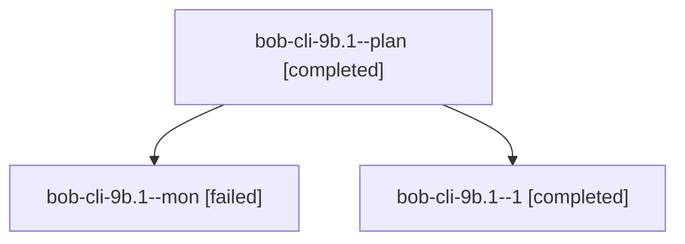

# Session: bob-cli-9b.1

[Agent Hoods](../README.md) / [bbugyi200](../users/bbugyi200/README.md) / [athena](../users/bbugyi200/machines/athena/README.md) / [bob-cli-9b](../users/bbugyi200/machines/athena/hoods/bob-cli-9b/README.md) / bob-cli-9b.1

Owner: `bbugyi200.athena` · Hood: `bob-cli-9b` · Members: 3 · Bead: [bob-cli-9b.1](https://github.com/bobs-org/bob-cli--beads/blob/main/pages/bob-cli-9b/bob-cli-9b.1.md)

## Lineage

The diagram is an optional enhancement; the ordered table below contains the same lineage in accessible text.

| Role | Agent | State | Model / provider | Timing | Commits | Prompt | Chat |
|---|---|---|---|---|---:|---|---|
| plan | bob-cli-9b.1--plan | completed | gpt-6-luna / codex | 2026-10-18T18:39:31.371121+00:00 → 2026-10-18T18:54:53.102775+00:00 | 0 | [Prompt](../agents/bbugyi200.athena.bob-cli-9b.1--plan/prompt.md) | [Chat](../agents/bbugyi200.athena.bob-cli-9b.1--plan/chat.md) |
| mon | bob-cli-9b.1--mon | failed | gpt-6-luna / codex | 2026-10-18T18:54:21.170925+00:00 → 2026-10-18T18:58:56.399829+00:00 | 0 | — | [Chat](../agents/bbugyi200.athena.bob-cli-9b.1--mon/chat.md) |
| 1 | bob-cli-9b.1--1 | completed | gpt-6-luna / codex | 2026-10-18T18:59:35.730351+00:00 → 2026-10-18T19:09:46.444922+00:00 | [1](../agents/bbugyi200.athena.bob-cli-9b.1--1/README.md#commits) | [Prompt](../agents/bbugyi200.athena.bob-cli-9b.1--1/prompt.md) | [Chat](../agents/bbugyi200.athena.bob-cli-9b.1--1/chat.md) |

## Commits

| Role | Repo | Commit | Subject | Committed |
|---|---|---|---|---|
| 1 | bob-cli | [`c166ed2`](https://github.com/bobs-org/bob-cli/commit/c166ed26326dd8b8c76428bbcf04158d920ee95f) | feat(capture): add bare x Pomodoro close | 2026-10-18 15:07:05 EDT |

## Neighbors

| Agent | Relation | State |
|---|---|---|
| [bob-cli-9b.2](../agents/bbugyi200.athena.bob-cli-9b.2/README.md) | bob-cli-9b hood | completed |
| [bob-cli-9b.3](bbugyi200.athena.bob-cli-9b.3.md) (session · 3) | bob-cli-9b hood | completed 2, failed 1 |
| [bob-cli-9b.4](../agents/bbugyi200.athena.bob-cli-9b.4/README.md) | bob-cli-9b hood | completed |
| [bob-cli-9b.land](bbugyi200.athena.bob-cli-9b.land.md) (session · 3) | bob-cli-9b hood | completed 1, failed 2 |
| [bob-cli-9b.land--1--code](../agents/bbugyi200.athena.bob-cli-9b.land--1--code/README.md) | bob-cli-9b hood | active |
| [bob-cli-9b.land--1--mon](../agents/bbugyi200.athena.bob-cli-9b.land--1--mon/README.md) | bob-cli-9b hood | failed |
| [bob-cli-9b.land--1--plan](../agents/bbugyi200.athena.bob-cli-9b.land--1--plan/README.md) | bob-cli-9b hood | active |
