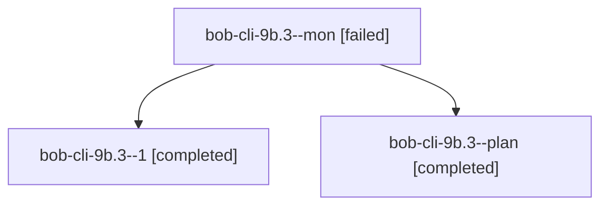

# Session: bob-cli-9b.3

[Agent Hoods](../README.md) / [bbugyi200](../users/bbugyi200/README.md) / [athena](../users/bbugyi200/machines/athena/README.md) / [bob-cli-9b](../users/bbugyi200/machines/athena/hoods/bob-cli-9b/README.md) / bob-cli-9b.3

Owner: `bbugyi200.athena` · Hood: `bob-cli-9b` · Members: 3 · Bead: [bob-cli-9b.3](https://github.com/bobs-org/bob-cli--beads/blob/main/pages/bob-cli-9b/bob-cli-9b.3.md)

## Lineage

The diagram is an optional enhancement; the ordered table below contains the same lineage in accessible text.

| Role | Agent | State | Model / provider | Timing | Commits | Prompt | Chat |
|---|---|---|---|---|---:|---|---|
| mon | bob-cli-9b.3--mon | failed | grok-4.6 / grok | 2026-10-18T20:11:39.762570+00:00 → 2026-10-18T20:17:41.189679+00:00 | 0 | — | [Chat](../agents/bbugyi200.athena.bob-cli-9b.3--mon/chat.md) |
| 1 | bob-cli-9b.3--1 | completed | grok-4.6 / grok | 2026-10-18T20:19:08.629189+00:00 → 2026-10-18T20:28:09.420357+00:00 | [1](../agents/bbugyi200.athena.bob-cli-9b.3--1/README.md#commits) | [Prompt](../agents/bbugyi200.athena.bob-cli-9b.3--1/prompt.md) | [Chat](../agents/bbugyi200.athena.bob-cli-9b.3--1/chat.md) |
| plan | bob-cli-9b.3--plan | completed | grok-4.6 / grok | 2026-10-18T19:54:43.797833+00:00 → 2026-10-18T20:12:25.337600+00:00 | 0 | [Prompt](../agents/bbugyi200.athena.bob-cli-9b.3--plan/prompt.md) | [Chat](../agents/bbugyi200.athena.bob-cli-9b.3--plan/chat.md) |

## Commits

| Role | Repo | Commit | Subject | Committed |
|---|---|---|---|---|
| 1 | bob-cli | [`0f47802`](https://github.com/bobs-org/bob-cli/commit/0f47802b20a6b9c1b2e4469d3ba58cd6a6e997e1) | docs(capture): teach the bare x Pomodoro close | 2026-10-18 16:26:27 EDT |

## Neighbors

| Agent | Relation | State |
|---|---|---|
| [bob-cli-9b.1](bbugyi200.athena.bob-cli-9b.1.md) (session · 3) | bob-cli-9b hood | completed 2, failed 1 |
| [bob-cli-9b.2](../agents/bbugyi200.athena.bob-cli-9b.2/README.md) | bob-cli-9b hood | completed |
| [bob-cli-9b.4](../agents/bbugyi200.athena.bob-cli-9b.4/README.md) | bob-cli-9b hood | active |
| [bob-cli-9b.land](../agents/bbugyi200.athena.bob-cli-9b.land/README.md) | bob-cli-9b hood | waiting |
