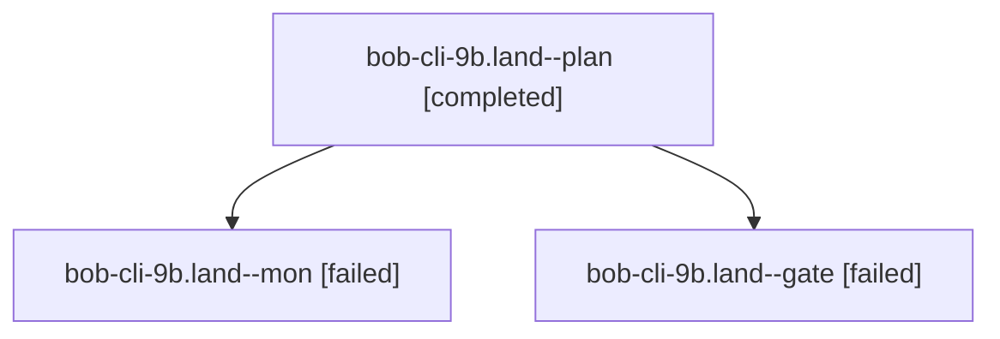

# Session: bob-cli-9b.land

[Agent Hoods](../README.md) / [bbugyi200](../users/bbugyi200/README.md) / [athena](../users/bbugyi200/machines/athena/README.md) / [bob-cli-9b](../users/bbugyi200/machines/athena/hoods/bob-cli-9b/README.md) / bob-cli-9b.land

Owner: `bbugyi200.athena` · Hood: `bob-cli-9b` · Members: 3 · Bead: [bob-cli-9b](https://github.com/bobs-org/bob-cli--beads/blob/main/pages/bob-cli-9b/README.md)

## Lineage

The diagram is an optional enhancement; the ordered table below contains the same lineage in accessible text.

| Role | Agent | State | Model / provider | Timing | Commits | Prompt | Chat |
|---|---|---|---|---|---:|---|---|
| plan | bob-cli-9b.land--plan | completed | gpt-6-astra / codex | 2026-10-18T20:42:37.205374+00:00 → 2026-10-18T20:55:18.914806+00:00 | 0 | [Prompt](../agents/bbugyi200.athena.bob-cli-9b.land--plan/prompt.md) | [Chat](../agents/bbugyi200.athena.bob-cli-9b.land--plan/chat.md) |
| mon | bob-cli-9b.land--mon | failed | gpt-6-astra / codex | 2026-10-18T20:52:56.295380+00:00 → 2026-10-18T21:02:36.234594+00:00 | 0 | — | [Chat](../agents/bbugyi200.athena.bob-cli-9b.land--mon/chat.md) |
| gate | bob-cli-9b.land--gate | failed | gpt-6-astra / codex | 2026-10-18T21:10:34.846205+00:00 → 2026-10-18T21:11:37.322018+00:00 | 0 | — | [Chat](../agents/bbugyi200.athena.bob-cli-9b.land--gate/chat.md) |

## Neighbors

| Agent | Relation | State |
|---|---|---|
| [bob-cli-9b.1](bbugyi200.athena.bob-cli-9b.1.md) (session · 3) | bob-cli-9b hood | completed 2, failed 1 |
| [bob-cli-9b.2](../agents/bbugyi200.athena.bob-cli-9b.2/README.md) | bob-cli-9b hood | completed |
| [bob-cli-9b.3](bbugyi200.athena.bob-cli-9b.3.md) (session · 3) | bob-cli-9b hood | completed 2, failed 1 |
| [bob-cli-9b.4](../agents/bbugyi200.athena.bob-cli-9b.4/README.md) | bob-cli-9b hood | completed |
| [bob-cli-9b.land--1--code](../agents/bbugyi200.athena.bob-cli-9b.land--1--code/README.md) | bob-cli-9b hood | active |
| [bob-cli-9b.land--1--mon](../agents/bbugyi200.athena.bob-cli-9b.land--1--mon/README.md) | bob-cli-9b hood | failed |
| [bob-cli-9b.land--1--plan](../agents/bbugyi200.athena.bob-cli-9b.land--1--plan/README.md) | bob-cli-9b hood | active |
