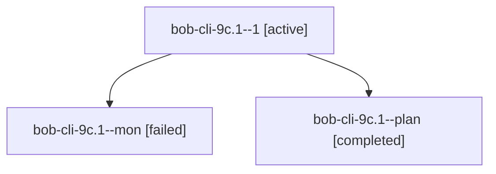

# Session: bob-cli-9c.1

[Agent Hoods](../README.md) / [bbugyi200](../users/bbugyi200/README.md) / [athena](../users/bbugyi200/machines/athena/README.md) / [bob-cli-9c](../users/bbugyi200/machines/athena/hoods/bob-cli-9c/README.md) / bob-cli-9c.1

Owner: `bbugyi200.athena` · Hood: `bob-cli-9c` · Members: 3 · Bead: [bob-cli-9c.1](https://github.com/bobs-org/bob-cli--beads/blob/main/pages/bob-cli-9c/bob-cli-9c.1.md)

## Lineage

The diagram is an optional enhancement; the ordered table below contains the same lineage in accessible text.

| Role | Agent | State | Model / provider | Timing | Commits | Prompt | Chat |
|---|---|---|---|---|---:|---|---|
| 1 | bob-cli-9c.1--1 | active | grok-4.6 / grok | 2026-10-18T18:56:25.932822+00:00 | [1](../agents/bbugyi200.athena.bob-cli-9c.1--1/README.md#commits) | [Prompt](../agents/bbugyi200.athena.bob-cli-9c.1--1/prompt.md) | — |
| mon | bob-cli-9c.1--mon | failed | grok-4.6 / grok | 2026-10-18T18:51:01.656889+00:00 → 2026-10-18T18:55:41.885003+00:00 | 0 | — | [Chat](../agents/bbugyi200.athena.bob-cli-9c.1--mon/chat.md) |
| plan | bob-cli-9c.1--plan | completed | grok-4.6 / grok | 2026-10-18T18:42:50.723083+00:00 → 2026-10-18T18:51:52.471419+00:00 | 0 | [Prompt](../agents/bbugyi200.athena.bob-cli-9c.1--plan/prompt.md) | [Chat](../agents/bbugyi200.athena.bob-cli-9c.1--plan/chat.md) |

## Commits

| Role | Repo | Commit | Subject | Committed |
|---|---|---|---|---|
| 1 | bob-cli | [`85eac25`](https://github.com/bobs-org/bob-cli/commit/85eac25aa112e0888ec09955ef0bc587e3c514ea) | feat(ref): hold vault-maintenance lock during writing scans | 2026-10-18 14:58:58 EDT |

## Neighbors

| Agent | Relation | State |
|---|---|---|
| [bob-cli-9c.2](../agents/bbugyi200.athena.bob-cli-9c.2/README.md) | bob-cli-9c hood | active |
| [bob-cli-9c.3](../agents/bbugyi200.athena.bob-cli-9c.3/README.md) | bob-cli-9c hood | waiting |
| [bob-cli-9c.4](../agents/bbugyi200.athena.bob-cli-9c.4/README.md) | bob-cli-9c hood | waiting |
| [bob-cli-9c.5](../agents/bbugyi200.athena.bob-cli-9c.5/README.md) | bob-cli-9c hood | waiting |
| [bob-cli-9c.6](../agents/bbugyi200.athena.bob-cli-9c.6/README.md) | bob-cli-9c hood | waiting |
| [bob-cli-9c.land](../agents/bbugyi200.athena.bob-cli-9c.land/README.md) | bob-cli-9c hood | waiting |
