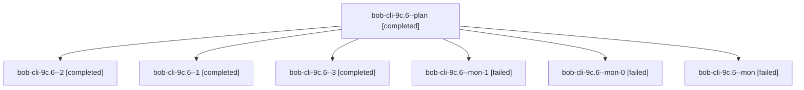

# Session: bob-cli-9c.6

[Agent Hoods](../README.md) / [bbugyi200](../users/bbugyi200/README.md) / [athena](../users/bbugyi200/machines/athena/README.md) / [bob-cli-9c](../users/bbugyi200/machines/athena/hoods/bob-cli-9c/README.md) / bob-cli-9c.6

Owner: `bbugyi200.athena` · Hood: `bob-cli-9c` · Members: 7 · Bead: [bob-cli-9c.6](https://github.com/bobs-org/bob-cli--beads/blob/main/pages/bob-cli-9c/bob-cli-9c.6.md)

## Lineage

The diagram is an optional enhancement; the ordered table below contains the same lineage in accessible text.

| Role | Agent | State | Model / provider | Timing | Commits | Prompt | Chat |
|---|---|---|---|---|---:|---|---|
| plan | bob-cli-9c.6--plan | completed | gpt-6-luna / codex | 2026-10-18T19:57:37.217686+00:00 → 2026-10-18T20:19:01.940101+00:00 | 0 | [Prompt](../agents/bbugyi200.athena.bob-cli-9c.6--plan/prompt.md) | [Chat](../agents/bbugyi200.athena.bob-cli-9c.6--plan/chat.md) |
| 2 | bob-cli-9c.6--2 | completed | gpt-6-luna / codex | 2026-10-18T20:36:16.542199+00:00 → 2026-10-18T20:44:38.401831+00:00 | 0 | [Prompt](../agents/bbugyi200.athena.bob-cli-9c.6--2/prompt.md) | [Chat](../agents/bbugyi200.athena.bob-cli-9c.6--2/chat.md) |
| 1 | bob-cli-9c.6--1 | completed | gpt-6-luna / codex | 2026-10-18T20:24:36.754739+00:00 → 2026-10-18T20:33:57.805551+00:00 | 0 | [Prompt](../agents/bbugyi200.athena.bob-cli-9c.6--1/prompt.md) | [Chat](../agents/bbugyi200.athena.bob-cli-9c.6--1/chat.md) |
| 3 | bob-cli-9c.6--3 | completed | gpt-6-luna / codex | 2026-10-18T20:48:21.234917+00:00 → 2026-10-18T21:00:16.748842+00:00 | [1](../agents/bbugyi200.athena.bob-cli-9c.6--3/README.md#commits) | [Prompt](../agents/bbugyi200.athena.bob-cli-9c.6--3/prompt.md) | [Chat](../agents/bbugyi200.athena.bob-cli-9c.6--3/chat.md) |
| mon-1 | bob-cli-9c.6--mon-1 | failed | gpt-6-luna / codex | 2026-10-18T20:43:37.636413+00:00 → 2026-10-18T20:47:28.388794+00:00 | 0 | — | [Chat](../agents/bbugyi200.athena.bob-cli-9c.6--mon-1/chat.md) |
| mon-0 | bob-cli-9c.6--mon-0 | failed | gpt-6-luna / codex | 2026-10-18T20:33:12.608275+00:00 → 2026-10-18T20:35:29.983761+00:00 | 0 | — | [Chat](../agents/bbugyi200.athena.bob-cli-9c.6--mon-0/chat.md) |
| mon | bob-cli-9c.6--mon | failed | gpt-6-luna / codex | 2026-10-18T20:17:52.884498+00:00 → 2026-10-18T20:23:50.718200+00:00 | 0 | — | [Chat](../agents/bbugyi200.athena.bob-cli-9c.6--mon/chat.md) |

## Commits

| Role | Repo | Commit | Subject | Committed |
|---|---|---|---|---|
| 3 | bob-cli | [`2a11d05`](https://github.com/bobs-org/bob-cli/commit/2a11d0514103a08ef5c29b4100196c5543e2028e) | feat(ref): roll out per-host intake drains | 2026-10-18 16:58:03 EDT |

## Neighbors

| Agent | Relation | State |
|---|---|---|
| [bob-cli-9c.1](bbugyi200.athena.bob-cli-9c.1.md) (session · 3) | bob-cli-9c hood | completed 2, failed 1 |
| [bob-cli-9c.2](../agents/bbugyi200.athena.bob-cli-9c.2/README.md) | bob-cli-9c hood | completed |
| [bob-cli-9c.3](../agents/bbugyi200.athena.bob-cli-9c.3/README.md) | bob-cli-9c hood | completed |
| [bob-cli-9c.4](../agents/bbugyi200.athena.bob-cli-9c.4/README.md) | bob-cli-9c hood | completed |
| [bob-cli-9c.5](../agents/bbugyi200.athena.bob-cli-9c.5/README.md) | bob-cli-9c hood | completed |
| [bob-cli-9c.land](bbugyi200.athena.bob-cli-9c.land.md) (session · 3) | bob-cli-9c hood | active 2, failed 1 |
