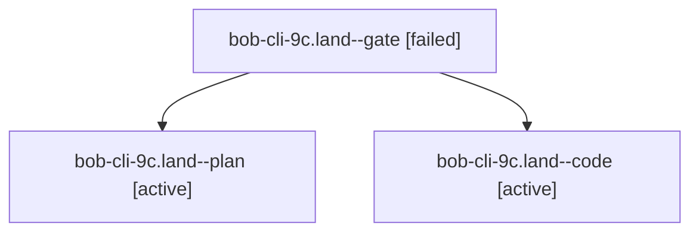

# Session: bob-cli-9c.land

[Agent Hoods](../README.md) / [bbugyi200](../users/bbugyi200/README.md) / [athena](../users/bbugyi200/machines/athena/README.md) / [bob-cli-9c](../users/bbugyi200/machines/athena/hoods/bob-cli-9c/README.md) / bob-cli-9c.land

Owner: `bbugyi200.athena` · Hood: `bob-cli-9c` · Members: 3 · Bead: [bob-cli-9c](https://github.com/bobs-org/bob-cli--beads/blob/main/pages/bob-cli-9c/README.md)

## Lineage

The diagram is an optional enhancement; the ordered table below contains the same lineage in accessible text.

| Role | Agent | State | Model / provider | Timing | Commits | Prompt | Chat |
|---|---|---|---|---|---:|---|---|
| gate | bob-cli-9c.land--gate | failed | opus / claude | 2026-10-18T21:28:39.927632+00:00 → 2026-10-18T21:29:40.930151+00:00 | 0 | — | [Chat](../agents/bbugyi200.athena.bob-cli-9c.land--gate/chat.md) |
| plan | bob-cli-9c.land--plan | active | opus / claude | 2026-10-18T21:09:59.167764+00:00 | 0 | [Prompt](../agents/bbugyi200.athena.bob-cli-9c.land--plan/prompt.md) | [Chat](../agents/bbugyi200.athena.bob-cli-9c.land--plan/chat.md) |
| code | bob-cli-9c.land--code | active | grok-4.6 / grok | 2026-10-18T21:30:16.515130+00:00 | 0 | — | — |

## Neighbors

| Agent | Relation | State |
|---|---|---|
| [bob-cli-9c.1](bbugyi200.athena.bob-cli-9c.1.md) (session · 3) | bob-cli-9c hood | completed 2, failed 1 |
| [bob-cli-9c.2](../agents/bbugyi200.athena.bob-cli-9c.2/README.md) | bob-cli-9c hood | completed |
| [bob-cli-9c.3](../agents/bbugyi200.athena.bob-cli-9c.3/README.md) | bob-cli-9c hood | completed |
| [bob-cli-9c.4](../agents/bbugyi200.athena.bob-cli-9c.4/README.md) | bob-cli-9c hood | completed |
| [bob-cli-9c.5](../agents/bbugyi200.athena.bob-cli-9c.5/README.md) | bob-cli-9c hood | completed |
| [bob-cli-9c.6](bbugyi200.athena.bob-cli-9c.6.md) (session · 7) | bob-cli-9c hood | completed 4, failed 3 |
