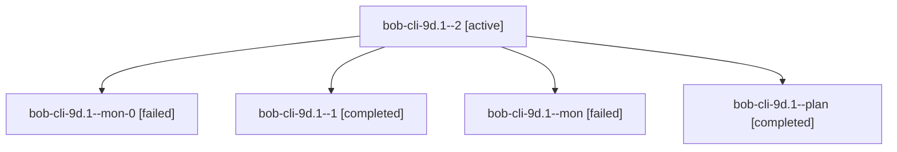

# Session: bob-cli-9d.1

[Agent Hoods](../README.md) / [bbugyi200](../users/bbugyi200/README.md) / [athena](../users/bbugyi200/machines/athena/README.md) / [bob-cli-9d](../users/bbugyi200/machines/athena/hoods/bob-cli-9d/README.md) / bob-cli-9d.1

Owner: `bbugyi200.athena` · Hood: `bob-cli-9d` · Members: 5 · Bead: [bob-cli-9d.1](https://github.com/bobs-org/bob-cli--beads/blob/main/pages/bob-cli-9d/bob-cli-9d.1.md)

## Lineage

The diagram is an optional enhancement; the ordered table below contains the same lineage in accessible text.

| Role | Agent | State | Model / provider | Timing | Commits | Prompt | Chat |
|---|---|---|---|---|---:|---|---|
| 2 | bob-cli-9d.1--2 | active | gpt-6-luna / codex | 2026-10-18T20:06:50.524785+00:00 | 0 | [Prompt](../agents/bbugyi200.athena.bob-cli-9d.1--2/prompt.md) | — |
| mon-0 | bob-cli-9d.1--mon-0 | failed | gpt-6-luna / codex | 2026-10-18T20:00:13.202525+00:00 → 2026-10-18T20:06:10.652851+00:00 | 0 | — | [Chat](../agents/bbugyi200.athena.bob-cli-9d.1--mon-0/chat.md) |
| 1 | bob-cli-9d.1--1 | completed | gpt-6-luna / codex | 2026-10-18T19:56:02.401284+00:00 → 2026-10-18T20:00:48.282865+00:00 | 0 | [Prompt](../agents/bbugyi200.athena.bob-cli-9d.1--1/prompt.md) | [Chat](../agents/bbugyi200.athena.bob-cli-9d.1--1/chat.md) |
| mon | bob-cli-9d.1--mon | failed | gpt-6-luna / codex | 2026-10-18T19:52:24.555615+00:00 → 2026-10-18T19:55:18.724607+00:00 | 0 | — | [Chat](../agents/bbugyi200.athena.bob-cli-9d.1--mon/chat.md) |
| plan | bob-cli-9d.1--plan | completed | gpt-6-luna / codex | 2026-10-18T19:43:19.717810+00:00 → 2026-10-18T19:53:31.421974+00:00 | 0 | [Prompt](../agents/bbugyi200.athena.bob-cli-9d.1--plan/prompt.md) | [Chat](../agents/bbugyi200.athena.bob-cli-9d.1--plan/chat.md) |

## Neighbors

| Agent | Relation | State |
|---|---|---|
| [bob-cli-9d.2](../agents/bbugyi200.athena.bob-cli-9d.2/README.md) | bob-cli-9d hood | completed |
| [bob-cli-9d.3](../agents/bbugyi200.athena.bob-cli-9d.3/README.md) | bob-cli-9d hood | active |
| [bob-cli-9d.land](../agents/bbugyi200.athena.bob-cli-9d.land/README.md) | bob-cli-9d hood | waiting |
