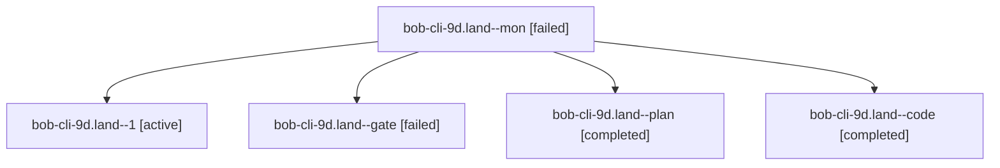

# Session: bob-cli-9d.land

[Agent Hoods](../README.md) / [bbugyi200](../users/bbugyi200/README.md) / [athena](../users/bbugyi200/machines/athena/README.md) / [bob-cli-9d](../users/bbugyi200/machines/athena/hoods/bob-cli-9d/README.md) / bob-cli-9d.land

Owner: `bbugyi200.athena` · Hood: `bob-cli-9d` · Members: 5 · Bead: [bob-cli-9d](https://github.com/bobs-org/bob-cli--beads/blob/main/pages/bob-cli-9d/README.md)

## Lineage

The diagram is an optional enhancement; the ordered table below contains the same lineage in accessible text.

| Role | Agent | State | Model / provider | Timing | Commits | Prompt | Chat |
|---|---|---|---|---|---:|---|---|
| mon | bob-cli-9d.land--mon | failed | gpt-6-luna / codex | 2026-10-18T21:00:30.606320+00:00 → 2026-10-18T21:09:53.150426+00:00 | 0 | — | [Chat](../agents/bbugyi200.athena.bob-cli-9d.land--mon/chat.md) |
| 1 | bob-cli-9d.land--1 | active | gpt-6-luna / codex | 2026-10-18T21:10:46.550764+00:00 | 0 | [Prompt](../agents/bbugyi200.athena.bob-cli-9d.land--1/prompt.md) | — |
| gate | bob-cli-9d.land--gate | failed | gpt-6-astra / codex | 2026-10-18T20:51:45.915275+00:00 → 2026-10-18T20:53:36.026885+00:00 | 0 | — | [Chat](../agents/bbugyi200.athena.bob-cli-9d.land--gate/chat.md) |
| plan | bob-cli-9d.land--plan | completed | gpt-6-astra / codex | 2026-10-18T20:41:30.984891+00:00 → 2026-10-18T21:01:05.965450+00:00 | 0 | [Prompt](../agents/bbugyi200.athena.bob-cli-9d.land--plan/prompt.md) | [Chat](../agents/bbugyi200.athena.bob-cli-9d.land--plan/chat.md) |
| code | bob-cli-9d.land--code | completed | gpt-6-luna / codex | 2026-10-18T20:53:50.057082+00:00 → 2026-10-18T21:01:05.965450+00:00 | 0 | — | [Chat](../agents/bbugyi200.athena.bob-cli-9d.land--code/chat.md) |

## Neighbors

| Agent | Relation | State |
|---|---|---|
| [bob-cli-9d.1](bbugyi200.athena.bob-cli-9d.1.md) (session · 7) | bob-cli-9d hood | completed 4, failed 3 |
| [bob-cli-9d.2](../agents/bbugyi200.athena.bob-cli-9d.2/README.md) | bob-cli-9d hood | completed |
| [bob-cli-9d.3](../agents/bbugyi200.athena.bob-cli-9d.3/README.md) | bob-cli-9d hood | completed |
