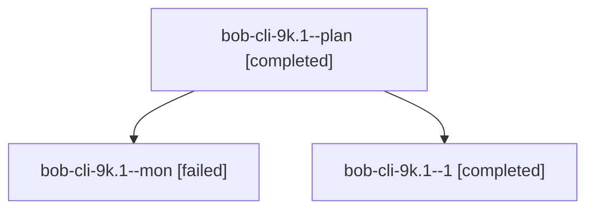

# Session: bob-cli-9k.1

[Agent Hoods](../README.md) / [bbugyi200](../users/bbugyi200/README.md) / [athena](../users/bbugyi200/machines/athena/README.md) / [bob-cli-9k](../users/bbugyi200/machines/athena/hoods/bob-cli-9k/README.md) / bob-cli-9k.1

Owner: `bbugyi200.athena` · Hood: `bob-cli-9k` · Members: 3 · Bead: [bob-cli-9k.1](https://github.com/bobs-org/bob-cli--beads/blob/main/pages/bob-cli-9k/bob-cli-9k.1.md)

## Lineage

The diagram is an optional enhancement; the ordered table below contains the same lineage in accessible text.

| Role | Agent | State | Model / provider | Timing | Commits | Prompt | Chat |
|---|---|---|---|---|---:|---|---|
| plan | bob-cli-9k.1--plan | completed | gpt-6-luna / codex | 2026-10-18T20:38:45.164037+00:00 → 2026-10-18T21:09:15.979213+00:00 | 0 | [Prompt](../agents/bbugyi200.athena.bob-cli-9k.1--plan/prompt.md) | [Chat](../agents/bbugyi200.athena.bob-cli-9k.1--plan/chat.md) |
| mon | bob-cli-9k.1--mon | failed | gpt-6-luna / codex | 2026-10-18T21:08:25.452518+00:00 → 2026-10-18T21:11:31.030865+00:00 | 0 | — | [Chat](../agents/bbugyi200.athena.bob-cli-9k.1--mon/chat.md) |
| 1 | bob-cli-9k.1--1 | completed | grok-4.6 / grok | 2026-10-18T21:12:18.808298+00:00 → 2026-10-18T21:26:31.648290+00:00 | [1](../agents/bbugyi200.athena.bob-cli-9k.1--1/README.md#commits) | [Prompt](../agents/bbugyi200.athena.bob-cli-9k.1--1/prompt.md) | [Chat](../agents/bbugyi200.athena.bob-cli-9k.1--1/chat.md) |

## Commits

| Role | Repo | Commit | Subject | Committed |
|---|---|---|---|---|
| 1 | bob-cli | [`9ec332c`](https://github.com/bobs-org/bob-cli/commit/9ec332c81def3014a559e088124ef93e3bb15ae7) | feat(homes): add shared Pomodoro home resolver and rollup contract | 2026-10-18 17:23:52 EDT |

## Neighbors

| Agent | Relation | State |
|---|---|---|
| [bob-cli-9k.2](../agents/bbugyi200.athena.bob-cli-9k.2/README.md) | bob-cli-9k hood | completed |
| [bob-cli-9k.3](bbugyi200.athena.bob-cli-9k.3.md) (session · 3) | bob-cli-9k hood | completed 2, failed 1 |
| [bob-cli-9k.4](../agents/bbugyi200.athena.bob-cli-9k.4/README.md) | bob-cli-9k hood | completed |
| [bob-cli-9k.5](../agents/bbugyi200.athena.bob-cli-9k.5/README.md) | bob-cli-9k hood | completed |
| [bob-cli-9k.6](../agents/bbugyi200.athena.bob-cli-9k.6/README.md) | bob-cli-9k hood | completed |
| [bob-cli-9k.7](../agents/bbugyi200.athena.bob-cli-9k.7/README.md) | bob-cli-9k hood | completed |
| [bob-cli-9k.8.1](bbugyi200.athena.bob-cli-9k.8.1.md) (session · 3) | bob-cli-9k hood | completed 2, failed 1 |
| [bob-cli-9k.8.2](../agents/bbugyi200.athena.bob-cli-9k.8.2/README.md) | bob-cli-9k hood | completed |
| [bob-cli-9k.8.3](../agents/bbugyi200.athena.bob-cli-9k.8.3/README.md) | bob-cli-9k hood | completed |
| [bob-cli-9k.8.4](../agents/bbugyi200.athena.bob-cli-9k.8.4/README.md) | bob-cli-9k hood | completed |
| [bob-cli-9k.8.land](bbugyi200.athena.bob-cli-9k.8.land.md) (session · 5) | bob-cli-9k hood | active 1, completed 2, failed 2 |
| [bob-cli-9k.land](bbugyi200.athena.bob-cli-9k.land.md) (session · 3) | bob-cli-9k hood | failed 3 |
