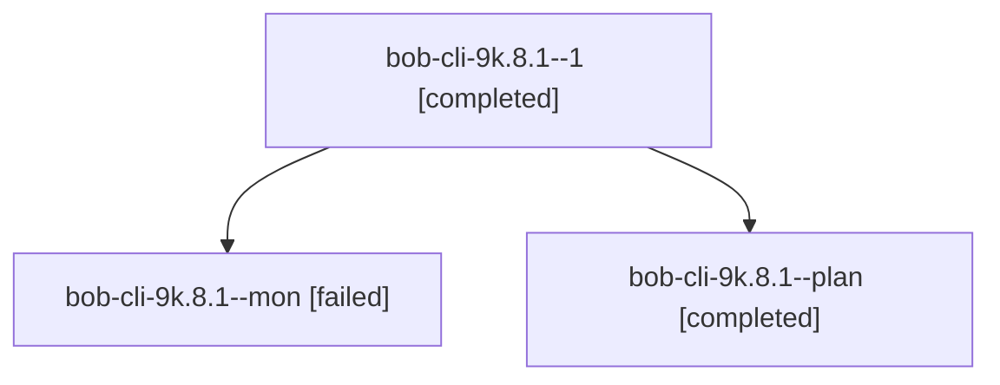

# Session: bob-cli-9k.8.1

[Agent Hoods](../README.md) / [bbugyi200](../users/bbugyi200/README.md) / [athena](../users/bbugyi200/machines/athena/README.md) / [bob-cli-9k](../users/bbugyi200/machines/athena/hoods/bob-cli-9k/README.md) / bob-cli-9k.8.1

Owner: `bbugyi200.athena` · Hood: `bob-cli-9k` · Members: 3 · Bead: [bob-cli-9k.8.1](https://github.com/bobs-org/bob-cli--beads/blob/main/pages/bob-cli-9k/bob-cli-9k.8.1.md)

## Lineage

The diagram is an optional enhancement; the ordered table below contains the same lineage in accessible text.

| Role | Agent | State | Model / provider | Timing | Commits | Prompt | Chat |
|---|---|---|---|---|---:|---|---|
| 1 | bob-cli-9k.8.1--1 | completed | gpt-6-luna / codex | 2026-10-19T00:47:42.061313+00:00 → 2026-10-19T00:56:09.498888+00:00 | [1](../agents/bbugyi200.athena.bob-cli-9k.8.1--1/README.md#commits) | [Prompt](../agents/bbugyi200.athena.bob-cli-9k.8.1--1/prompt.md) | [Chat](../agents/bbugyi200.athena.bob-cli-9k.8.1--1/chat.md) |
| mon | bob-cli-9k.8.1--mon | failed | gpt-6-luna / codex | 2026-10-19T00:41:09.303067+00:00 → 2026-10-19T00:47:07.244802+00:00 | 0 | — | [Chat](../agents/bbugyi200.athena.bob-cli-9k.8.1--mon/chat.md) |
| plan | bob-cli-9k.8.1--plan | completed | gpt-6-luna / codex | 2026-10-19T00:22:21.744029+00:00 → 2026-10-19T00:45:56.590301+00:00 | 0 | [Prompt](../agents/bbugyi200.athena.bob-cli-9k.8.1--plan/prompt.md) | [Chat](../agents/bbugyi200.athena.bob-cli-9k.8.1--plan/chat.md) |

## Commits

| Role | Repo | Commit | Subject | Committed |
|---|---|---|---|---|
| 1 | bob-cli | [`77c7741`](https://github.com/bobs-org/bob-cli/commit/77c77410e32b52010ad8f0d539f466202deb30d5) | feat(stats): complete pomodoro homes parity and stats fixes | 2026-10-18 20:54:36 EDT |

## Neighbors

| Agent | Relation | State |
|---|---|---|
| [bob-cli-9k.8.2](../agents/bbugyi200.athena.bob-cli-9k.8.2/README.md) | bob-cli-9k.8 hood | active |
| [bob-cli-9k.8.3](../agents/bbugyi200.athena.bob-cli-9k.8.3/README.md) | bob-cli-9k.8 hood | active |
| [bob-cli-9k.8.4](../agents/bbugyi200.athena.bob-cli-9k.8.4/README.md) | bob-cli-9k.8 hood | waiting |
| [bob-cli-9k.8.land](../agents/bbugyi200.athena.bob-cli-9k.8.land/README.md) | bob-cli-9k.8 hood | waiting |
| [bob-cli-9k.1](bbugyi200.athena.bob-cli-9k.1.md) (session · 3) | bob-cli-9k hood | completed 2, failed 1 |
| [bob-cli-9k.2](../agents/bbugyi200.athena.bob-cli-9k.2/README.md) | bob-cli-9k hood | completed |
| [bob-cli-9k.3](bbugyi200.athena.bob-cli-9k.3.md) (session · 3) | bob-cli-9k hood | completed 2, failed 1 |
| [bob-cli-9k.4](../agents/bbugyi200.athena.bob-cli-9k.4/README.md) | bob-cli-9k hood | completed |
| [bob-cli-9k.5](../agents/bbugyi200.athena.bob-cli-9k.5/README.md) | bob-cli-9k hood | completed |
| [bob-cli-9k.6](../agents/bbugyi200.athena.bob-cli-9k.6/README.md) | bob-cli-9k hood | completed |
| [bob-cli-9k.7](../agents/bbugyi200.athena.bob-cli-9k.7/README.md) | bob-cli-9k hood | completed |
| [bob-cli-9k.land](bbugyi200.athena.bob-cli-9k.land.md) (session · 3) | bob-cli-9k hood | failed 3 |
