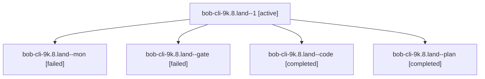

# Session: bob-cli-9k.8.land

[Agent Hoods](../README.md) / [bbugyi200](../users/bbugyi200/README.md) / [athena](../users/bbugyi200/machines/athena/README.md) / [bob-cli-9k](../users/bbugyi200/machines/athena/hoods/bob-cli-9k/README.md) / bob-cli-9k.8.land

Owner: `bbugyi200.athena` · Hood: `bob-cli-9k` · Members: 5 · Bead: [bob-cli-9k.8](https://github.com/bobs-org/bob-cli--beads/blob/main/pages/bob-cli-9k/bob-cli-9k.8.md)

## Lineage



The diagram is an optional enhancement; the ordered table below contains the same lineage in accessible text.

| Role | Agent | State | Model / provider | Timing | Commits | Prompt | Chat |
|---|---|---|---|---|---:|---|---|
| <a id="member-1"></a>1 | bob-cli-9k.8.land--1 | active | gpt-6-luna / codex | 2026-10-19T02:38:02.963575+00:00 | [1](../agents/bbugyi200.athena.bob-cli-9k.8.land--1/README.md#commits) | [Prompt](../agents/bbugyi200.athena.bob-cli-9k.8.land--1/prompt.md) | — |
| <a id="member-mon"></a>mon | bob-cli-9k.8.land--mon | failed | gpt-6-luna / codex | 2026-10-19T02:33:06.330609+00:00 → 2026-10-19T02:37:29.282382+00:00 | 0 | — | [Chat](../agents/bbugyi200.athena.bob-cli-9k.8.land--mon/chat.md) |
| <a id="member-gate"></a>gate | bob-cli-9k.8.land--gate | failed | gpt-6-astra / codex | 2026-10-19T01:59:40.663060+00:00 → 2026-10-19T02:00:06.632479+00:00 | 0 | — | [Chat](../agents/bbugyi200.athena.bob-cli-9k.8.land--gate/chat.md) |
| <a id="member-code"></a>code | bob-cli-9k.8.land--code | completed | gpt-6-luna / codex | 2026-10-19T02:00:28.128001+00:00 → 2026-10-19T02:33:44.138014+00:00 | 0 | — | [Chat](../agents/bbugyi200.athena.bob-cli-9k.8.land--code/chat.md) |
| <a id="member-plan"></a>plan | bob-cli-9k.8.land--plan | completed | gpt-6-astra / codex | 2026-10-19T01:45:19.435018+00:00 → 2026-10-19T02:33:44.138014+00:00 | 0 | [Prompt](../agents/bbugyi200.athena.bob-cli-9k.8.land--plan/prompt.md) | [Chat](../agents/bbugyi200.athena.bob-cli-9k.8.land--plan/chat.md) |

## Commits

| Role | Repo | Commit | Subject | Committed |
|---|---|---|---|---|
| 1 | bob-cli | [`9217a47`](https://github.com/bobs-org/bob-cli/commit/9217a475779fe0a7368f8ac99428fbca0bfbc100) | fix(pomodoro-homes): add scalar-parent vectors | 2026-10-18 22:53:08 EDT |

## Variables

| Role | Variable | Value |
|---|---|---|
| code | `artifacts` | \[{bead: bob-cli-9k.8, kind: image, label: Obsidian scratch app remains on loading screen, path: /home/bryan/.sase/artifacts/agents/gh\_bobs-org\_\_bob-cli/20261018220028/opened-no-plugin-final-55c750f8c… |

#### artifacts

**Role:** `code`

```yaml
- bead: bob-cli-9k.8
  kind: image
  label: Obsidian scratch app remains on loading screen
  path: /home/bryan/.sase/artifacts/agents/gh_bobs-org__bob-cli/20261018220028/opened-no-plugin-final-55c750f8c3c7.png
  ref: file:explicit:d590262a37f7c98de4bfc541
  source_path: /tmp/bob-homes-obsidian-scratch/opened-no-plugin-final.png
- bead: bob-cli-9k.8
  kind: markdown
  label: Obsidian runtime verification blocker details
  path: /home/bryan/.sase/artifacts/agents/gh_bobs-org__bob-cli/20261018220028/obsidian-runtime-blocker-839ddd31cad8.md
  ref: file:explicit:0f1409dbf3236065be038cb1
  source_path: /home/bryan/.cache/bob-homes-obsidian-scratch/obsidian-runtime-blocker.md
```

Values are truncated for display; see each member's agent meta.json for the full values.

## Neighbors

| Agent | Relation | State |
|---|---|---|
| [bob-cli-9k.8.1](bbugyi200.athena.bob-cli-9k.8.1.md) (session · 3) | bob-cli-9k.8 hood | completed 2, failed 1 |
| [bob-cli-9k.8.2](../agents/bbugyi200.athena.bob-cli-9k.8.2/README.md) | bob-cli-9k.8 hood | completed |
| [bob-cli-9k.8.3](../agents/bbugyi200.athena.bob-cli-9k.8.3/README.md) | bob-cli-9k.8 hood | completed |
| [bob-cli-9k.8.4](../agents/bbugyi200.athena.bob-cli-9k.8.4/README.md) | bob-cli-9k.8 hood | completed |
| [bob-cli-9k.1](bbugyi200.athena.bob-cli-9k.1.md) (session · 3) | bob-cli-9k hood | completed 2, failed 1 |
| [bob-cli-9k.2](../agents/bbugyi200.athena.bob-cli-9k.2/README.md) | bob-cli-9k hood | completed |
| [bob-cli-9k.3](bbugyi200.athena.bob-cli-9k.3.md) (session · 3) | bob-cli-9k hood | completed 2, failed 1 |
| [bob-cli-9k.4](../agents/bbugyi200.athena.bob-cli-9k.4/README.md) | bob-cli-9k hood | completed |
| [bob-cli-9k.5](../agents/bbugyi200.athena.bob-cli-9k.5/README.md) | bob-cli-9k hood | completed |
| [bob-cli-9k.6](../agents/bbugyi200.athena.bob-cli-9k.6/README.md) | bob-cli-9k hood | completed |
| [bob-cli-9k.7](../agents/bbugyi200.athena.bob-cli-9k.7/README.md) | bob-cli-9k hood | completed |
| [bob-cli-9k.land](bbugyi200.athena.bob-cli-9k.land.md) (session · 3) | bob-cli-9k hood | failed 3 |
